# MentorIA Acadêmica — Documento Consolidado para Revisão Acadêmica

> Documento técnico dos três integrantes. O sistema não está implementado; os scripts SQL e testes devem ser executados e validados em um PostgreSQL real. Veja orientações no `README.md`.

# MentorIA Acadêmica — Bloco 1: Concepção e Escopo

**Responsável:** Hadson — Pessoa 1, Analista de Requisitos / Product Owner · **Versão:** 1.2 · **Data:** 06/11/2026

Documentos relacionados: [Bloco 2 — Requisitos](docs/02-requisitos.md) · [Bloco 9 — Qualidade e Processo](docs/09-qualidade.md)

## 0. Como ler este documento

Cada decisão relevante aparece no formato **Decisão → Justificativa → Alternativa descartada**, como numa equipe técnica real. Onde faltou informação no enunciado, adotei uma **premissa** explícita (tabela abaixo) para que os números sejam mensuráveis e a equipe possa contestá-los. As premissas valem para os três blocos.

| ID | Premissa assumida | Por quê |
|---|---|---|
| P1 | Piloto em um campus: ~1.500 estudantes, ~120 mentores, ~10 coordenadores, 2 administradores. Meta futura de dimensionamento: 10.000 usuários cadastrados. | Dá base numérica para desempenho, escalabilidade e custo. Ajustável. |
| P2 | Pico inicial planejado: 150 sessões de usuários simultâneas (início de semestre e semana de provas), distinto de 10.000 cadastros totais. | ~10% da base ativa ao mesmo tempo é uma estimativa conservadora para sistemas acadêmicos. |
| P3 | Mentores são estudantes veteranos, pós-graduandos ou professores, em geral voluntários ou com carga horária reconhecida. | Define a motivação do mentor (ver persona Rafael) e o risco de adesão. |
| P4 | Sessões são presenciais ou em ferramenta externa (Meet, Teams etc.); o mentor informa local ou link no agendamento. | O enunciado exclui videochamada própria. |
| P5 | Equipe hipotética futura de desenvolvimento com 4 profissionais, usando sprints de 2 semanas. O grupo acadêmico que documenta o projeto tem 3 integrantes. | Base para Scrum e para o tamanho das histórias. |
| P6 | Câmbio de referência para custos: R$ 5,7429 por US$ 1 (referência histórica de 05/11/2026 usada no Bloco 7; não é cotação atual). | AWS cobra em dólar; precisamos de uma conversão fixa para o estudo. |

---

## 1.1 Documento de Visão

### Nome e slogan

- **Nome:** MentorIA Acadêmica
- **Slogan:** *Quem já chegou lá ajuda você a chegar.*

> **Alerta de decisão — o nome contém “IA”, mas o sistema não usa inteligência artificial.** O enunciado exclui IA explicitamente. Decisão: manter o nome como marca (já definido pela equipe), mas **registrar na Visão e na tela inicial** que “IA” aqui remete à marca, não a um recurso. Justificativa: evitar expectativa falsa em usuários e avaliadores. Alternativa descartada: renomear o produto, por já estar definido no enunciado.

### Problema que o MentorIA resolve

Hoje, a mentoria acadêmica acontece por grupos de mensagens, planilhas e indicação de colegas. Isso gera quatro dores concretas:

1. **O estudante não sabe quem pode ajudar** em determinada disciplina nem quando essa pessoa está livre.
2. **Conflitos de horário:** o mesmo horário é prometido a duas pessoas, gerando faltas e frustração.
3. **O mentor perde tempo** negociando horários por mensagem e não tem registro do que já fez.
4. **A coordenação não enxerga** quantas mentorias acontecem, em quais disciplinas e com que qualidade; os dados vivem em planilhas manuais.

### Público-alvo

| Segmento | Quem é | Necessidade principal |
|---|---|---|
| Primário | Estudantes de graduação com dificuldade em disciplinas | Achar mentor e horário com poucos cliques |
| Primário | Mentores (veteranos, pós-graduandos, docentes) | Organizar disponibilidade e decidir pedidos |
| Secundário | Coordenadores de curso ou de programa de monitoria | Acompanhar e provar resultados |
| Operacional | Administradores de TI da instituição | Gerenciar usuários e permissões |

### Objetivos (mensuráveis)

| ID | Objetivo | Meta | Como medir |
|---|---|---|---|
| O1 | Facilitar a solicitação | Solicitar mentoria em até 3 minutos após o login | Teste de usabilidade com 5 usuários |
| O2 | Eliminar conflitos | 0 agendamentos ativos duplicados para o mesmo horário | Teste de integração + restrição no banco |
| O3 | Dar agilidade ao mentor | 80% das solicitações respondidas em até 24 h | Relatório de tempo de resposta |
| O4 | Dar visibilidade à coordenação | Relatório mensal gerado em menos de 1 minuto | Cronometragem em teste |
| O5 | Medir qualidade | 70% das sessões concluídas recebem avaliação | Taxa avaliações ÷ sessões concluídas |

### Proposta de valor

- **Para o estudante:** encontrar o mentor certo, ver horários reais e agendar sem negociar por mensagem.
- **Para o mentor:** controlar a própria agenda e ter histórico das sessões, útil para certificados e relatórios de extensão.
- **Para a coordenação:** dados confiáveis sobre mentorias, no lugar de planilhas manuais.
- **Para a instituição:** processo auditável, com controle de acesso por perfil e conformidade com a LGPD.

### Escopo

| Dentro do escopo (versão 1.0) | Fora do escopo (explícito) |
|---|---|
| Cadastro e autenticação de usuários | Pagamentos de qualquer tipo |
| Quatro perfis com permissões (RBAC) | Inteligência artificial (recomendação, chatbot etc.) |
| Cadastro de disciplinas e horários pelo mentor | Videochamada própria da plataforma |
| Busca de mentores e consulta de disponibilidade | Aplicativos móveis nativos (a interface web será responsiva) |
| Solicitação, confirmação, recusa e cancelamento | Integração com sistema acadêmico oficial da instituição |
| Registro de conclusão e avaliação da sessão | Chat entre estudante e mentor |
| Consulta de mentorias e relatórios para coordenação | Mentorias em grupo |
| Gestão de usuários e permissões | Integração com Google Calendar |

**Justificativa das exclusões:** cada item retirado reduz risco e prazo. Pagamento exigiria conformidade financeira; IA exigiria dados e validação que o prazo não comporta; videochamada e app móvel já têm alternativas maduras (Meet/Teams e navegador responsivo).

---

## 1.2 Personas

### Persona 1 — Camila Souza (estudante)

| Campo | Descrição |
|---|---|
| Idade | 20 anos |
| Contexto | 4º semestre de Engenharia de Computação; trabalha meio período e estuda à noite. Reprovou uma vez em Cálculo II. |
| Necessidades | Achar mentor da disciplina específica; ver horários compatíveis com o seu turno; saber logo se o pedido foi aceito. |
| Motivações | Passar em Cálculo II sem atrasar a formatura; ter ajuda sem se sentir exposta diante da turma. |
| Frustrações | Mandar mensagem a vários colegas e não ter resposta; combinar horário e a pessoa esquecer. |
| Impacto nos requisitos | RF010, RF011, RF012, RF015, RF018 |

### Persona 2 — Rafael Lima (mentor)

| Campo | Descrição |
|---|---|
| Idade | 27 anos |
| Contexto | Mestrando em Matemática Aplicada, bolsista; dá mentoria a 6–8 alunos por semestre e precisa comprovar horas de extensão. |
| Necessidades | Publicar horários uma vez só; aceitar ou recusar pedidos rapidamente; registrar o que foi feito em cada sessão. |
| Motivações | Contribuir com a comunidade; acumular horas comprováveis para o currículo e para a bolsa. |
| Frustrações | Alunos que faltam; agenda dispersa em várias conversas; falta de prova do trabalho realizado. |
| Impacto nos requisitos | RF007, RF008, RF009, RF014, RF016 |

### Persona 3 — Helena Albuquerque (coordenadora)

| Campo | Descrição |
|---|---|
| Idade | 45 anos |
| Contexto | Coordenadora do curso; responde à direção pelo programa de apoio ao estudante, hoje controlado em planilhas. |
| Necessidades | Saber quantas mentorias ocorrem, por disciplina e período; identificar disciplinas sem mentor; ver a qualidade pelas avaliações. |
| Motivações | Reduzir evasão e reprovação; apresentar números à direção com segurança. |
| Frustrações | Dados desencontrados; demora para consolidar relatórios; falta de evidências. |
| Impacto nos requisitos | RF019, RF020 |

---

## 1.3 Mapa de stakeholders

Escala: **Alta / Média / Baixa**. A estratégia segue a matriz interesse × influência de Mendelow.

| Stakeholder | Interesse | Influência | Estratégia |
|---|---|---|---|
| Estudantes | Alto: são os usuários finais | Média | Manter informados; coletar feedback a cada sprint |
| Mentores | Alto: dependem da ferramenta para a agenda | Alta: sem mentores não há produto | Gerenciar de perto; oferecer cadastro simples |
| Coordenadores | Alto: usam relatórios para prestar contas | Alta: decidem a adoção | Gerenciar de perto; validar relatórios com eles |
| Direção da instituição | Médio: quer resultados e baixo custo | Alta: aprova o programa | Manter satisfeita; apresentar indicadores |
| Administrador / TI | Alto: opera usuários e acessos | Média | Envolver na definição de perfis |
| Professor avaliador (trabalho acadêmico) | Alto: avalia processo e documentação | Alta | Entregar artefatos completos e rastreáveis |
| Equipe de desenvolvimento (4 pessoas) | Alto | Alta | Reuniões de sprint; documentação clara |
| Encarregado de dados / jurídico (LGPD) | Médio | Média | Consultar na definição de dados pessoais e retenção |
| AWS (fornecedor de infraestrutura) | Baixo | Média: preço e disponibilidade fogem ao nosso controle | Monitorar preços e termos |

---

## 1.4 Estudo de viabilidade

### Viabilidade técnica — **Viável**

| Aspecto | Avaliação | Evidência / justificativa |
|---|---|---|
| Maturidade da pilha | Alta | Node.js 24 LTS, Express 5, PostgreSQL e Bootstrap 5.3 são tecnologias estáveis e muito documentadas. |
| Carga esperada | Baixa | A meta inicial é de 150 usuários simultâneos e base futura de 10.000 cadastros. O desempenho da VM de 2 GB **não está comprovado**: deverá ser verificado por teste de carga com dados representativos antes de implantação. |
| Complexidade de domínio | Média | Regra mais delicada: impedir agendamento ativo duplicado sob concorrência. Será resolvida no banco (índice único parcial) além da validação na aplicação. |
| Sem ORM | Risco controlável | Exige disciplina com SQL; mitigada por consultas parametrizadas e revisão de código. |
| `bcryptjs` | Aceitável | Implementação em JavaScript é mais lenta que a nativa, mas o volume de logins é baixo; custo de hash 12. |
| Habilidades da equipe | A confirmar | Premissa: a equipe domina JavaScript; PostgreSQL e Nginx exigirão aprendizado, tratado em spike na Sprint 0. |

### Viabilidade operacional — **Viável**

- **Processo atual substituído:** planilhas e mensagens, que a plataforma simplifica; baixa resistência esperada.
- **Treinamento:** interface com três telas principais por perfil; um guia de 1 página por perfil basta.
- **Suporte:** a equipe responde por e-mail na fase acadêmica; para uso real, definir responsável de TI.
- **Adoção:** depende da participação dos mentores (ver risco R1).

### Viabilidade econômica — **Viável (custo baixo)**

**Decisão:** desenvolvimento local e duas instâncias separadas no AWS Lightsail: **staging Linux 1 GB** e **produção Linux 2 GB**; em cada instância, Nginx, Node.js/Express e PostgreSQL local. **Justificativa:** separar teste de produção, mantendo implantação simples e custo publicado. **Alternativa descartada:** EC2 + RDS separados por ambiente, mais flexível para alta disponibilidade, porém mais complexo e caro para o piloto. Ambas as instâncias são pontos únicos de falha e **não oferecem garantia de SLA**.

**Fonte de preços verificada em 06/11/2026:** [AWS Lightsail — preços oficiais](https://aws.amazon.com/pt/lightsail/pricing/). Planos Linux com IPv4 público: 1 GB por US$ 7/mês e 2 GB por US$ 12/mês. [Snapshots Lightsail](https://docs.aws.amazon.com/lightsail/latest/userguide/amazon-lightsail-frequently-asked-questions-faq-billing-and-account-management.html): US$ 0,05/GB-mês do espaço armazenado (variável conforme uso e retenção). Valores base, sem impor uma contratação real, dependem da região, impostos e configuração.

| Item | Mensal (US$) | Mensal (R$; premissa P6) | Premissa e observação |
|---|---:|---:|---|
| Staging — Lightsail Linux 1 GB | 7,00 | 40,20 | Homologação e testes. |
| Produção — Lightsail Linux 2 GB | 12,00 | 68,91 | Nginx, API Express e PostgreSQL na mesma VM. |
| Snapshots dos dois ambientes (estimativa de 25 GB-mês) | 1,25 | 7,18 | Armazenamento a US$ 0,05 por GB-mês; projeção não medida. |
| Bucket Lightsail Object Storage 5 GB | 1,00 | 5,74 | Cópias externas de `pg_dump`, dentro da franquia do plano. |
| **Subtotal AWS estimado** | **21,25** | **122,04** | Antes de tributos, excedentes e câmbio real. |
| Tributos brasileiros, projeção de +12,15% | — | ≈ 14,82 | Aproximação para faturamento AWS Serviços Brasil; conferir caso concreto. |
| **Total AWS estimado com tributos** | **21,25 antes de impostos** | **≈ 136,86** | Staging + produção + snapshots + bucket. |
| Domínio `.com.br`, se utilizado | — | ≈ 3,33 | Aproximação de R$ 40/ano / 12; não incluso na AWS. |
| HTTPS Let's Encrypt | 0,00 | 0,00 | Gratuito, configuração sob responsabilidade da equipe. |

**Referência anual:** US$ 255 de infraestrutura antes de tributos (≈ R$ 1.642/ano com os impostos modelados), mais cerca de R$ 40 de domínio; comparar com [Bloco 7 — Custos](docs/07-planejamento.md). **Subtotal verificável das instâncias: US$ 19/mês**. O valor de US$ 21,25 é um cenário de consumo assumido, não cobrança observada. Na região São Paulo, a franquia de transferência é reduzida à metade; a performance de 150 simultâneos e 10 mil cadastros é meta sujeita a teste de carga.

**Operação e recuperação propostas:** snapshots automáticos diários (Lightsail preserva até 7 snapshots automáticos), RPO alvo de 24 h, RTO alvo de 4 h e restauração de teste semestral. O RTO/RPO são metas ainda não comprovadas. A disponibilidade de 99,5% é meta de monitoramento, **não SLA garantido** por uma máquina única.

---

## 1.5 Cinco riscos iniciais

Escala 1 (muito baixa) a 5 (muito alta). **Severidade = probabilidade × impacto.**

| ID | Risco | Prob. | Impacto | Sev. | Mitigação |
|---|---|---|---|---|---|
| R1 | **Baixa adesão de mentores**: sem mentores com horários, a plataforma fica vazia | 3 | 5 | 15 | Convite direto pela coordenação; cadastro de mentor em menos de 5 minutos; comprovante baseado no histórico de sessões, sujeito à aprovação da instituição; piloto com 10 mentores. |
| R2 | **Indisponibilidade da VM única** (ponto único de falha) | 2 | 4 | 8 | Snapshots diários com restauração testada; monitoramento por verificação periódica de saúde; meta de disponibilidade realista (99,5%) documentada em vez de prometer alta disponibilidade. |
| R3 | **Vazamento de dados pessoais ou falha de segurança** (SQL injection sem ORM, senhas, tokens) | 2 | 5 | 10 | Consultas parametrizadas obrigatórias; `bcryptjs` com custo 12; HTTPS; revisão de código focada em segurança; coleta mínima de dados (LGPD); testes de autorização por perfil. |
| R4 | **Estouro de escopo e prazo** com equipe pequena | 4 | 4 | 16 | Priorização MoSCoW; MVP com os Must; congelar o escopo a cada sprint; backlog de “Won’t” visível. |
| R5 | **Agendamentos duplicados por concorrência** (duas solicitações simultâneas ao mesmo horário) | 3 | 4 | 12 | Índice único parcial no PostgreSQL para status ativos; transação com tratamento de erro de violação; teste de integração com requisições paralelas. |

**Leitura do quadro:** os riscos mais severos são R4 (escopo) e R1 (adesão), ambos de gestão e não de tecnologia. Por isso o plano de mitigação prioriza processo (Scrum, MoSCoW) e engajamento, não só código.


---

# MentorIA Acadêmica — Bloco 2: Requisitos

**Responsável:** Hadson — Pessoa 1, Analista de Requisitos / Product Owner · **Versão:** 1.2 · **Data:** 06/11/2026

Documentos relacionados: [Bloco 1 — Concepção e Escopo](docs/01-concepcao.md) (inclui as premissas P1 a P6) · [Bloco 9 — Qualidade e Processo](docs/09-qualidade.md) · Diagramas: [`diagrama-casos-de-uso.drawio`](diagramas/editaveis/diagrama-casos-de-uso.drawio), [`diagrama-atividades-agendamento.drawio`](diagramas/editaveis/diagrama-atividades-agendamento.drawio), [`diagrama-atividades-administrativo.drawio`](diagramas/editaveis/diagrama-atividades-administrativo.drawio)

## 

## Requisitos Funcionais (RF001 a RF021)

**Legenda MoSCoW:** **M** = Must (indispensável ao MVP), **S** = Should (importante, mas o produto funciona sem), **C** = Could (desejável se sobrar tempo), **W** = Won’t nesta versão.

|ID|Requisito (descrição)|MoSCoW|Justificativa|
|-|-|-|-|
|RF001|O sistema deve permitir que um estudante se cadastre informando nome, e-mail institucional e senha. Mentores e coordenadores são criados pelo administrador (RF004).|M|Porta de entrada do produto. Limitar o autocadastro ao estudante evita que alguém se atribua perfil privilegiado.|
|RF002|O sistema deve autenticar o usuário por e-mail e senha, emitir um JWT e permitir logout.|M|Autenticação é base de toda a segurança e do RBAC.|
|RF003|O sistema deve permitir recuperar a senha por link enviado ao e-mail, válido por 30 minutos e de uso único.|S|Reduz chamados de suporte, mas depende de envio de e-mail; o produto opera sem isso se o administrador redefinir senhas.|
|RF004|O administrador deve criar, editar, desativar e reativar usuários **após aceite comprovado pelo próprio titular nos cadastros administrativos** (RN12). A desativação é lógica (preserva o histórico), não pode atingir o próprio administrador nem o último administrador ativo, e cancela os agendamentos ativos futuros do usuário desativado, liberando os horários (RN07, RN08).|M|Único meio de criar mentores e coordenadores; exclusão lógica mantém a integridade de relatórios; o cancelamento em cascata evita agendamentos “órfãos” com alguém que não acessa mais o sistema.|
|RF005|O administrador deve atribuir e alterar o perfil (Estudante, Mentor, Coordenador, Administrador) de cada usuário, **desde que os compromissos futuros do perfil anterior estejam encerrados e as disponibilidades futuras inativadas (RN11)**, sem poder remover o perfil do último administrador ativo; cada rota da API verifica o perfil, e a mudança vale já na próxima requisição (RN10).|M|O RBAC é requisito explícito do projeto e protege os dados; sem a validade imediata, um perfil revogado continuaria funcionando até o token expirar.|
|RF006|O mentor deve manter um perfil com foto opcional, biografia, formação e formas de contato para a sessão (local ou link).|S|Ajuda o estudante a escolher; o fluxo central funciona só com nome e disciplinas.|
|RF007|O mentor deve cadastrar e remover as disciplinas que está apto a mentorar, a partir de um catálogo de disciplinas.|M|Sem disciplinas não existe busca útil. Catálogo evita grafias diferentes da mesma disciplina.|
|RF008|O mentor deve criar horários de disponibilidade informando data, hora de início e duração (30, 45 ou 60 min), sem sobrepor outro horário seu.|M|Matéria-prima do agendamento; durações fixas simplificam a regra de conflito.|
|RF009|O mentor deve editar ou inativar um horário apenas enquanto não houver agendamento ativo nele. **Se já existir histórico, a data/hora/duração não podem mudar: o mentor inativa o horário e cria outro (RN13).**|S|Dá flexibilidade; a proteção evita quebrar compromissos já assumidos.|
|RF010|O estudante deve buscar mentores por disciplina e nome, com paginação.|M|Resolve a dor principal: descobrir quem pode ajudar.|
|RF011|O estudante deve consultar a lista de horários livres de um mentor, excluindo horários passados e já reservados.|M|Elimina a negociação por mensagem.|
|RF012|O estudante deve solicitar agendamento de um horário livre, informando disciplina e uma observação opcional. O status inicial é PENDENTE.|M|Início do fluxo principal.|
|RF013|O sistema deve impedir mais de um agendamento ativo (PENDENTE ou CONFIRMADO) para o mesmo horário e impedir que o mesmo estudante tenha dois agendamentos ativos sobrepostos.|M|Regra de negócio central citada no enunciado.|
|RF014|O mentor deve confirmar ou recusar solicitações pendentes; a recusa exige uma justificativa. Solicitações sem resposta em 48 h passam a EXPIRADO e liberam o horário.|M|Fecha o fluxo; a expiração evita horários presos para sempre.|
|RF015|O estudante deve cancelar um agendamento PENDENTE ou CONFIRMADO até 2 horas antes do início; o mentor também pode cancelar com justificativa.|S|Reduz faltas silenciosas e libera horários; a regra de 2 h é uma decisão de produto.|
|RF016|Após o horário da sessão, o mentor deve registrar a conclusão (compareceu ou não, duração real e observações). Só então o status passa a CONCLUIDO.|M|Gatilho para avaliação e base dos relatórios.|
|RF017|O estudante deve avaliar uma sessão CONCLUIDA com nota de 1 a 5 e comentário opcional, uma única vez por sessão.|M|Fecha o fluxo principal e mede a qualidade (objetivo O5).|
|RF018|O sistema deve notificar o usuário dentro da plataforma a cada mudança de status do agendamento; envio por e-mail é opcional.|C|Melhora a experiência, mas o usuário consegue consultar o status manualmente.|
|RF019|O coordenador deve consultar mentorias com filtros por período, disciplina, mentor e status.|M|Atende ao ator Coordenador e ao objetivo O4.|
|RF020|O coordenador deve visualizar relatórios agregados (sessões por período e disciplina, média das avaliações, taxas de recusa e cancelamento, tempo médio de resposta) e exportar em CSV.|S|Valor alto para a gestão, mas depende dos dados do MVP já existirem.|
|RF021|O administrador deve manter o catálogo de disciplinas: criar, editar, inativar e reativar. Disciplina inativa não aparece para novas associações nem nas buscas, mas preserva o histórico; não pode ser excluída fisicamente se houver mentor ou agendamento ligado a ela (RN09).|M|**Lacuna encontrada na modelagem dos casos de uso:** o RF007 exige um catálogo, mas nenhum requisito dizia quem o mantém. Sem isso, o mentor não consegue cadastrar disciplinas e a busca (RF010) fica vazia.|

**Resumo da priorização:** 15 Must (71%), 5 Should (24%), 1 Could (5%). Os 15 Must formam o MVP e cobrem o fluxo principal de ponta a ponta. A proporção é alta porque o sistema é pequeno e o fluxo é sequencial: tirar qualquer etapa o inutiliza.

> **Nota:** o professor exige **no mínimo 20 RF**. A entrega tem 21 RF, incluindo a manutenção do catálogo pela administração (RF021), sem necessidade de fundir requisitos.

**Won’t (nesta versão):** pagamentos, inteligência artificial, videochamada própria, aplicativo móvel, chat interno, mentoria em grupo.

### Regras de negócio de suporte

|ID|Regra|
|-|-|
|RN01|Status do agendamento: PENDENTE → CONFIRMADO ou RECUSADO ou CANCELADO ou EXPIRADO; CONFIRMADO → CONCLUIDO ou CANCELADO. Status finais: RECUSADO, CANCELADO, EXPIRADO, CONCLUIDO.|
|RN02|“Ativo” significa PENDENTE ou CONFIRMADO. Um horário só pode ter um agendamento ativo.|
|RN03|Uma solicitação PENDENTE já bloqueia o horário. Justificativa: sem isso, duas pessoas poderiam solicitar o mesmo horário e o mentor teria de recusar uma delas, gerando frustração.|
|RN04|Só se pode avaliar sessão CONCLUIDA com comparecimento registrado.|
|RN05|Um mentor não pode agendar sessão consigo mesmo.|
|RN06|Nenhuma ação altera dados de outro usuário fora das permissões do seu perfil (RBAC).|
|RN07|Ao desativar um usuário, todos os agendamentos ativos futuros dele (PENDENTE ou CONFIRMADO) passam a CANCELADO por decisão do sistema, os horários são liberados e as contrapartes são notificadas (se RF018 estiver habilitado). Agendamentos já concluídos permanecem intactos.|
|RN08|O administrador não pode desativar a si mesmo nem remover o perfil, ou desativar, o último administrador ativo. Justificativa: evita travar a gestão do sistema.|
|RN09|Disciplina com mentor ou agendamento vinculado só pode ser inativada, nunca excluída. Disciplina inativa não aceita novas associações, mas as existentes e o histórico continuam válidos.|
|RN10|A cada requisição autenticada, o sistema confirma no banco que o usuário está ativo e qual é o seu perfil atual. Desativações e mudanças de perfil valem imediatamente, mesmo com token ainda dentro dos 15 minutos de validade.|
|RN11|Antes de trocar o perfil de um mentor, devem ser encerradas suas reservas ativas futuras e inativadas as disponibilidades ativas futuras; para estudante, devem ser encerradas as reservas ativas futuras. Caso contrário, a troca é recusada (409). A desativação segue o fluxo de cancelamento automático da RN07.|
|RN12|No cadastro administrativo, o próprio titular deve ter aceitado a política previamente por canal institucional verificável. Exigem-se data/hora do aceite e referência da evidência, sem que o administrador marque aceite em nome de outra pessoa. Sem prova, a criação é recusada (422); a equipe poderá planejar convite/ativação posteriormente, fora do fluxo atual.|
|RN13|Disponibilidade com qualquer histórico não pode ter mentor, início ou duração alterados; o mentor inativa e cria outro horário. Uma disponibilidade com reserva PENDENTE ou CONFIRMADA não pode ser inativada enquanto a reserva permanecer ativa.|

\---

## 2.2 Requisitos Não Funcionais

Todos os requisitos têm um **critério numérico** e uma **forma de verificação**, para que possam virar teste. Os números partem das premissas P1 e P2 (Bloco 1).

### Desempenho

|ID|Requisito|Critério mensurável|Verificação|
|-|-|-|-|
|RNF001|Tempo de resposta da API|95% das requisições principais da API respondem em até 300 ms com 150 usuários simultâneos e carga de teste documentada, após aquecimento|Teste de carga com k6 ou autocannon|
|RNF002|Busca de mentores e horários|Resposta em até 300 ms (percentil 95), com 10.000 usuários cadastrados, 120 mentores ativos, 10.000 horários e 150 usuários simultâneos no teste|Teste de carga com massa de dados|
|RNF003|Carregamento das páginas|Primeira página útil em até 3 s em conexão 4G; pontuação Lighthouse de desempenho ≥ 80|Lighthouse manual a cada sprint|

### Disponibilidade

|ID|Requisito|Critério mensurável|Verificação|
|-|-|-|-|
|RNF004|Disponibilidade mensal|≥ 99,5% (no máximo ≈ 3 h 40 min de indisponibilidade por mês). **Decisão:** não prometer 99,9%, pois há uma única VM (risco R2).|Monitor externo de saúde a cada 5 min|
|RNF005|Backup e recuperação|Backup diário; perda máxima de dados (RPO) de 24 h; tempo máximo de recuperação (RTO) de 4 h; restauração testada ao menos 1 vez por semestre|Relatório do teste de restauração|

### Segurança

|ID|Requisito|Critério mensurável|Verificação|
|-|-|-|-|
|RNF006|Armazenamento de senhas|Hash com `bcryptjs`, custo ≥ 12; senha mínima de 8 caracteres com letra e número; 0 senhas em texto puro no banco ou nos logs|Teste unitário e inspeção do banco|
|RNF007|Tokens JWT|Expiração de **15 minutos** do token de acesso; segredo aleatório de no mínimo **256 bits** armazenado em variável de ambiente; payload sem dados sensíveis (apenas id e perfil). A cada requisição o sistema consulta o banco para confirmar usuário ativo e perfil atual (RN10): desativação e troca de perfil valem na próxima requisição, e não só no vencimento do token.|Testes de integração: token expirado retorna 401; usuário desativado com token válido retorna 401; perfil alterado muda o acesso na requisição seguinte|
|RNF008|Transporte seguro|100% do tráfego em HTTPS (TLS 1.2 ou superior); HTTP redireciona para HTTPS; cabeçalhos de segurança básicos ativos|Teste SSL Labs com nota ≥ A|
|RNF009|Proteção contra injeção|100% das consultas SQL parametrizadas; `npm audit` com 0 vulnerabilidades altas ou críticas na entrega|Revisão de código e `npm audit`|
|RNF010|Proteção de login|Limite de 5 tentativas falhas por e-mail e IP em 15 min; depois, bloqueio de 15 min|Teste de integração|
|RNF011|Controle de acesso (RBAC)|100% das rotas protegidas verificam o perfil; cada rota tem teste que comprova resposta 403 para perfil não autorizado|Suíte de testes de integração|
|RNF024|Auditoria administrativa|100% das ações administrativas (criar, editar, desativar e reativar usuário; alterar perfil; manter o catálogo) gravam autor, ação, alvo e data/hora, sem senha ou token; retenção de 12 meses; registro só de inserção|Teste de integração e inspeção do log|

### Escalabilidade

|ID|Requisito|Critério mensurável|Verificação|
|-|-|-|-|
|RNF012|Crescimento vertical|Evoluir para o cenário de 750 usuários simultâneos sem mudar as regras de negócio, condicionado a redimensionamento da VM, índices e testes de carga; 10.000 usuários cadastrados como meta de volume de dados|Teste de carga ampliado com 750 usuários concorrentes e 10.000 cadastros; documentar dimensionamento necessário e gargalos|
|RNF013|Listagens limitadas|100% das listagens paginadas, no máximo 50 itens por página; colunas de busca e de chave estrangeira indexadas|Revisão do esquema e teste de integração|
|RNF014|Evolução da arquitetura|Cada módulo do monólito acessa os outros apenas por sua interface pública (serviço), nunca pelo banco de outro módulo; 0 dependências circulares|Verificação com ferramenta de dependências (ex.: `madge`)|

### LGPD (Lei 13.709/2018)

|ID|Requisito|Critério mensurável|Verificação|
|-|-|-|-|
|RNF015|Minimização de dados|Coletar apenas nome, e-mail institucional, perfil e dados da mentoria; 0 campos pessoais sem finalidade documentada|Inventário de dados revisado a cada sprint|
|RNF016|Consentimento e transparência|Política de privacidade exibida no autocadastro; aceite do próprio titular registrado com data e hora para 100% dos usuários. Em cadastros administrativos, origem e referência de evidência institucional, sem aceite por procuração do administrador (RN12).|Teste de integração e inspeção do registro de evidência|
|RNF017|Direitos do titular|Exportação dos dados pessoais e eliminação ou anonimização atendidas em até 15 dias, com procedimento do administrador documentado|Simulação de solicitação|
|RNF018|Privacidade das avaliações|O coordenador vê notas e comentários **sem o nome do estudante**; o mentor vê o comentário sem identificação. **Decisão:** estimula avaliação honesta e reduz exposição.|Teste de integração das respostas da API|
|RNF019|Logs e retenção|Logs técnicos sem senha, token ou texto de avaliação; retenção máxima de 90 dias. A trilha de auditoria administrativa tem retenção própria de 12 meses (RNF024), por finalidade de responsabilização, a validar com o encarregado de dados.|Inspeção de logs|

### Usabilidade

|ID|Requisito|Critério mensurável|Verificação|
|-|-|-|-|
|RNF020|Rapidez da tarefa principal|Um estudante novo solicita uma mentoria em até 3 min e em no máximo 5 cliques após o login|Teste com 5 usuários|
|RNF021|Responsividade|Layout funcional de 360 px a 1920 px de largura, sem rolagem horizontal|Playwright com três tamanhos de tela|
|RNF022|Acessibilidade|Conformidade com WCAG 2.1 nível AA nas telas principais; Lighthouse de acessibilidade ≥ 90; contraste mínimo 4,5:1|Lighthouse e navegação por teclado|
|RNF023|Satisfação|Pontuação SUS (System Usability Scale) ≥ 75 e mensagens de erro em português, sem códigos técnicos|Questionário SUS aplicado ao fim do piloto|

**Decisões integradas:** a referência de 10 mil usuários significa **cadastrados**, e não simultâneos. As metas de p95 ≤ 300 ms com 150 acessos simultâneos dependem de ensaio e não foram medidas. O frontend deve armazenar o JWT somente em memória nesta proposta; ao expirar após 15 minutos, solicita novo login (sem refresh token no MVP).

**Observação:** estes números são metas de projeto. Metas de desempenho e disponibilidade serão revalidadas com os resultados reais do teste de carga na Sprint de estabilização.

\---

## 2.3 Histórias de Usuário (US001 a US016)

**Escala de pontos:** Fibonacci (1, 2, 3, 5, 8, 13), medindo complexidade e incerteza, não horas. Referência: US001 (cadastro simples) = 3 pontos. Critérios de aceite no formato **Dado (Given) / Quando (When) / Então (Then)**.

### US001 — Cadastro de estudante · 3 pontos · RF001

**Como** Camila (estudante), **quero** criar minha conta com e-mail institucional e senha, **para** poder solicitar mentorias.

* **Dado** que informo nome, e-mail institucional válido e senha de 8 caracteres ou mais, **quando** aceito a política de privacidade e envio o formulário, **então** minha conta é criada com perfil Estudante e sou levada ao login.
* **Dado** que o e-mail já está cadastrado, **quando** envio o formulário, **então** vejo a mensagem “E-mail já cadastrado” e nenhuma conta é criada.
* **Dado** que não aceitei a política de privacidade, **quando** tento enviar, **então** o cadastro é bloqueado.

### US002 — Login e logout · 3 pontos · RF002

**Como** Camila (estudante), **quero** entrar e sair do sistema com segurança, **para** proteger meus dados.

* **Dado** credenciais corretas, **quando** faço login, **então** recebo acesso e vejo a tela inicial do meu perfil.
* **Dado** senha incorreta, **quando** tento entrar, **então** vejo “E-mail ou senha inválidos”, sem revelar qual dos dois está errado.
* **Dado** 5 tentativas falhas em 15 minutos, **quando** tento a sexta, **então** o acesso é bloqueado por 15 minutos.

### US003 — Gestão de usuários e perfis · 8 pontos · RF004, RF005

**Como** administrador, **quero** criar usuários, definir seus perfis e desativá-los, **para** controlar quem acessa o sistema.

* **Dado** que sou administrador e o titular já aceitou a política por canal institucional comprovado, **quando** crio um usuário com perfil Mentor informando data do aceite e referência da evidência, **então** ele passa a existir, a ação é registrada na auditoria e ele pode fazer login.
* **Dado** que não existe evidência de aceite do titular, **quando** tento criar a conta administrativamente, **então** a API recusa com 422, sem criar usuário.
* **Dado** um mentor com disponibilidades futuras ativas, **quando** tento trocar seu perfil sem inativá-las e encerrar reservas futuras, **então** a API recusa com 409 (RN11).
* **Dado** um usuário com agendamentos no histórico, **quando** eu o desativo, **então** ele não consegue entrar, mas o histórico permanece nos relatórios.
* **Dado** um mentor com agendamentos ativos futuros, **quando** eu o desativo, **então** esses agendamentos passam a CANCELADO, os horários são liberados e os estudantes afetados são avisados (se habilitado).
* **Dado** que sou o único administrador ativo, **quando** tento desativar a mim mesmo ou remover meu perfil, **então** o sistema recusa.
* **Dado** um usuário desativado cujo token ainda não expirou, **quando** ele faz uma requisição, **então** recebe 401 imediatamente.
* **Dado** que alterei o perfil de um usuário logado, **quando** ele faz a próxima requisição, **então** as permissões novas já valem.
* **Dado** que sou estudante, **quando** tento acessar a gestão de usuários, **então** recebo acesso negado.

*Pontuação 8 (antes 5):* a desativação com cancelamento em cascata, a proteção do último administrador e a revalidação por requisição aumentaram a complexidade.

### US004 — Cadastro de disciplinas do mentor · 3 pontos · RF007

**Como** Rafael (mentor), **quero** indicar as disciplinas que posso mentorar, **para** aparecer nas buscas dos estudantes certos. *(Depende da US016: o catálogo precisa existir.)*

* **Dado** o catálogo de disciplinas, **quando** seleciono “Cálculo II” e salvo, **então** a disciplina aparece no meu perfil.
* **Dado** que já tenho a disciplina, **quando** tento adicioná-la novamente, **então** não há duplicidade.
* **Dado** que removo uma disciplina, **quando** salvo, **então** ela deixa de aparecer em novas buscas, mas agendamentos existentes não são afetados.

### US005 — Cadastro de horários de disponibilidade · 5 pontos · RF008

**Como** Rafael (mentor), **quero** publicar meus horários livres, **para** que estudantes possam reservar sem negociação.

* **Dado** que informo data futura, hora e duração de 60 min, **quando** salvo, **então** o horário fica visível aos estudantes.
* **Dado** que já tenho um horário das 14h às 15h, **quando** tento criar outro das 14h30 às 15h30, **então** recebo erro de sobreposição.
* **Dado** uma data no passado, **quando** tento salvar, **então** o sistema recusa.

### US006 — Busca de mentores · 5 pontos · RF010

**Como** Camila (estudante), **quero** buscar mentores por disciplina e nome, **para** encontrar quem pode me ajudar em Cálculo II.

* **Dado** mentores cadastrados, **quando** busco por “Cálculo II”, **então** vejo apenas mentores ativos dessa disciplina, paginados.
* **Dado** uma busca sem resultados, **quando** a executo, **então** vejo “Nenhum mentor encontrado” com sugestão de limpar filtros.
* **Dado** até 120 mentores, **quando** busco, **então** a resposta chega em até 300 ms p95 (RNF002), nas condições de carga especificadas.

### US007 — Consulta de horários livres · 3 pontos · RF011

**Como** Camila (estudante), **quero** ver os horários livres de um mentor, **para** escolher um que caiba no meu turno.

* **Dado** um mentor com horários, **quando** abro o perfil dele, **então** vejo apenas horários futuros e sem agendamento ativo.
* **Dado** que outro estudante acabou de reservar um horário, **quando** atualizo a lista, **então** esse horário não aparece mais.

### US008 — Solicitar agendamento · 8 pontos · RF012, RF013

**Como** Camila (estudante), **quero** solicitar um horário com um mentor, **para** receber ajuda na disciplina.

* **Dado** um horário livre, **quando** envio a solicitação com disciplina e observação, **então** o agendamento é criado como PENDENTE e o horário deixa de estar livre.
* **Dado** que já tenho agendamento ativo em horário sobreposto com outro mentor, **quando** tento solicitar, **então** recebo erro de conflito.
* **Dado** que dois estudantes enviam a solicitação ao mesmo tempo, **quando** ambas chegam ao servidor, **então** apenas uma é criada e a outra recebe “Horário indisponível”.

*Pontuação 8:* envolve concorrência, transação e índice único no banco; é a história mais arriscada do MVP.

### US009 — Garantia de horário sem duplicidade · 5 pontos · RF013

**Como** Rafael (mentor), **quero** que cada horário meu tenha no máximo um agendamento ativo, **para** não receber dois alunos ao mesmo tempo.

* **Dado** um agendamento PENDENTE ou CONFIRMADO no horário, **quando** outro estudante tenta reservá-lo, **então** a API retorna conflito (409).
* **Dado** que o agendamento foi RECUSADO, CANCELADO ou EXPIRADO, **quando** outro estudante tenta reservá-lo, **então** a reserva é aceita.
* **Dado** tentativa de duplicidade direto no banco, **quando** o INSERT é executado, **então** a restrição do banco o rejeita.

### US010 — Confirmar ou recusar solicitação · 5 pontos · RF014

**Como** Rafael (mentor), **quero** confirmar ou recusar pedidos, **para** controlar minha agenda.

* **Dado** uma solicitação PENDENTE, **quando** confirmo, **então** o status vira CONFIRMADO e o estudante é avisado.
* **Dado** uma solicitação PENDENTE, **quando** recuso sem justificativa, **então** o sistema exige a justificativa antes de salvar.
* **Dado** uma solicitação sem resposta há 48 h, **quando** o prazo vence, **então** o status vira EXPIRADO e o horário volta a ficar livre.

### US011 — Cancelar agendamento · 3 pontos · RF015

**Como** Camila (estudante), **quero** cancelar um agendamento, **para** liberar o horário quando não puder comparecer.

* **Dado** um agendamento ativo que começa em mais de 2 h, **quando** cancelo, **então** o status vira CANCELADO e o horário é liberado.
* **Dado** um agendamento que começa em menos de 2 h, **quando** tento cancelar, **então** o sistema recusa e orienta a contatar o mentor.

### US012 — Registrar conclusão da sessão · 5 pontos · RF016

**Como** Rafael (mentor), **quero** registrar que a sessão aconteceu, **para** manter histórico e comprovar minhas horas.

* **Dado** um agendamento CONFIRMADO cujo horário já passou, **quando** registro comparecimento, duração e observações, **então** o status vira CONCLUIDO.
* **Dado** um agendamento cujo horário ainda não começou, **quando** tento concluir, **então** o sistema recusa.
* **Dado** que o estudante faltou, **quando** registro a ausência, **então** a sessão fica concluída sem direito à avaliação.

### US013 — Avaliar mentoria · 3 pontos · RF017

**Como** Camila (estudante), **quero** avaliar a sessão concluída, **para** dar retorno sobre a qualidade da ajuda.

* **Dado** uma sessão CONCLUIDA com comparecimento, **quando** envio nota de 1 a 5 e comentário opcional, **então** a avaliação é salva.
* **Dado** que já avaliei a sessão, **quando** tento avaliar de novo, **então** o sistema recusa.
* **Dado** uma sessão não concluída, **quando** tento avaliar, **então** a opção não está disponível.

### US014 — Acompanhar mentorias · 5 pontos · RF019

**Como** Helena (coordenadora), **quero** consultar as mentorias com filtros, **para** acompanhar o programa.

* **Dado** mentorias cadastradas, **quando** filtro por período e disciplina, **então** vejo apenas as correspondentes, paginadas.
* **Dado** que sou estudante, **quando** tento acessar essa consulta, **então** recebo acesso negado.
* **Dado** a listagem, **quando** vejo as avaliações, **então** o nome do estudante não aparece (RNF018).

### US015 — Relatórios e exportação · 8 pontos · RF020

**Como** Helena (coordenadora), **quero** ver indicadores agregados e exportar em CSV, **para** prestar contas à direção.

* **Dado** um período escolhido, **quando** gero o relatório, **então** vejo total de sessões, média das notas, taxa de recusa e cancelamento e tempo médio de resposta, em até 1 minuto.
* **Dado** o relatório na tela, **quando** clico em exportar, **então** recebo um CSV com os mesmos números.
* **Dado** um período sem dados, **quando** gero o relatório, **então** vejo “Sem dados no período”, e não valores zerados enganosos.

### US016 — Gestão do catálogo de disciplinas · 3 pontos · RF021

**Como** administrador, **quero** manter o catálogo de disciplinas, **para** que os mentores escolham nomes padronizados.

* **Dado** que informo nome e código novos, **quando** salvo, **então** a disciplina entra no catálogo e fica disponível para os mentores.
* **Dado** uma disciplina com mentor ou agendamento vinculado, **quando** tento excluí-la, **então** o sistema só permite inativá-la.
* **Dado** uma disciplina inativa, **quando** um mentor abre a lista para cadastrar disciplinas, **então** ela não aparece, mas continua visível nos agendamentos antigos.

### Resumo do backlog

|História|Pontos|RF atendidos|Prioridade|
|-|-|-|-|
|US001|3|RF001|Must|
|US002|3|RF002|Must|
|US003|8|RF004, RF005|Must|
|US004|3|RF007|Must|
|US005|5|RF008|Must|
|US006|5|RF010|Must|
|US007|3|RF011|Must|
|US008|8|RF012, RF013|Must|
|US009|5|RF013|Must|
|US010|5|RF014|Must|
|US011|3|RF015|Should|
|US012|5|RF016|Must|
|US013|3|RF017|Must|
|US014|5|RF019|Must|
|US015|8|RF020|Should|
|US016|3|RF021|Must|
|**Total**|**75**|||

**Leitura:** com velocidade estimada de 20 a 25 pontos por sprint (equipe de 4, sprint de 2 semanas, P5), os 75 pontos caberiam em 4 sprints, mas o plano da seção 9.7 usa 5, deixando a última leve para estabilização. RF003, RF006, RF009 e RF018 (Should e Could) ainda não têm história; serão refinadas após o MVP, e essa lacuna é intencional, para não inflar o backlog inicial.


---

# MentorIA Acadêmica — Documento de Arquitetura de Software (DAS)

**Identificador:** DAS-APS-003  
**Versão:** 1.2  
**Status:** Proposta revisada por Kennedy — aceite do trio pendente  
**Projeto:** MentorIA Acadêmica | **Domínio:** EdTech  
**Autor técnico:** Kennedy (Arquiteto de Software)  
**Revisores previstos:** Hadson (PO) e Guilherme (Engenharia/DBA)  
**Equipe:** Hadson, Kennedy e Guilherme  
**Data de referência:** 06/11/2026

## Histórico de revisões

| Versão | Data | Alteração | Autor |
|---|---|---|---|
| 1.0 | 05/11/2026 | Primeira consolidação técnica para integração dos blocos 1–5, 7–9 | Kennedy |
| 1.1 | 05/11/2026 | Revisão de consistência UML, reservas concorrentes e referências dos diagramas | Kennedy |
| 1.2 | 06/11/2026 | Integração RF021/US016, JWT, metas de desempenho/capacidade e ambientes AWS | Kennedy + Hadson (proposta) |

> **Classificação do documento:** projeto acadêmico que simula um handoff profissional. Descreve uma **solução futura**: não representa software implantado, infraestrutura contratada, desempenho medido ou conformidade LGPD certificada.

## 1. Resumo executivo e objetivo

O MentorIA Acadêmica é uma plataforma web destinada a intermediar mentorias entre estudantes e mentores. Permite localizar mentores por disciplina, consultar disponibilidades, solicitar agendamentos, confirmar ou recusar pedidos, concluir sessões e registrar avaliações. Coordenadores consultam informações gerenciais; administradores gerenciam usuários e permissões.

Esta arquitetura foi especificada para permitir que uma futura equipe comece a implementação conhecendo as **responsabilidades de cada componente, dependências, decisões técnicas, restrições, fluxos críticos e contratos de integração**. A solução proposta utiliza **monólito modular com backend em Node.js/Express, interface web simples e banco PostgreSQL**. Esta opção reduz o número de unidades de implantação e de integrações operacionais frente a uma arquitetura distribuída.

### 1.1 Escopo arquitetural

**Incluído:** quatro papéis de acesso; autenticação; cadastro e perfis; catálogo de mentores e disciplinas; disponibilidades; solicitações e confirmação de mentorias; registro de sessões; avaliações; notificações internas; consultas e administração.

**Fora do escopo deste recorte:** inteligência artificial aplicada, pagamentos/Pix, chat em tempo real, emissão de certificados, videochamadas nativas, aplicativo móvel próprio, integrações externas de e-mail/SMS e execução efetiva de produção. Se Hadson definir algum item como `Must`, a arquitetura, os diagramas e os custos devem ser revisados antes da entrega.

### 1.2 Atores

| Perfil | Responsabilidades de negócio | Limitação relevante |
|---|---|---|
| Estudante | Procurar mentores, solicitar e cancelar agendamentos, avaliar sessões concluídas | Não gerencia horários ou sessões de terceiros |
| Mentor | Disponibilizar horários, aceitar/recusar solicitações, registrar conclusão | Atua somente sobre suas disponibilidades e sessões |
| Coordenador | Consultar indicadores e acompanhar mentorias | Não altera senhas nem concede perfis administrativos |
| Administrador | Gerenciar usuários, perfis e permissões | Operações sensíveis devem ser auditadas |

## 2. Direcionadores, premissas e restrições

### 2.1 Capacidade funcional base

A tabela abaixo rastreia capacidades arquiteturais aos **21 requisitos RF001–RF021** e **16 histórias US001–US016** entregues por Hadson. As associações estão sujeitas à validação final do trio.

| Capacidade | Fluxo essencial | Módulo responsável | Requisito RF/US final |
|---|---|---|---|
| CAP-01 | Autenticação e controle de sessão | Autenticação e Usuários | RF002, RF003; US002 |
| CAP-02 | Cadastro e manutenção de usuário | Autenticação e Usuários | RF001, RF004, RF005; US001, US003 |
| CAP-03 | Cadastro/busca de mentor por disciplina | Mentores e Disciplinas | RF006, RF007, RF010, RF021; US004, US006, US016 |
| CAP-04 | Gestão de disponibilidade | Disponibilidades e Agendamentos | RF008, RF009, RF011; US005, US007 |
| CAP-05 | Solicitação e decisão sobre agendamento | Disponibilidades e Agendamentos | RF012–RF015; US008–US011 |
| CAP-06 | Encerramento da sessão e avaliação | Sessões e Avaliações | RF016, RF017; US012, US013 |
| CAP-07 | Comunicação interna do andamento | Notificações / domínio de sessões | RF018 (Could); sem história Must |
| CAP-08 | Administração e relatórios | Administração e Relatórios | RF019, RF020; US014, US015 |

### 2.2 Atributos de qualidade propostos

Os números abaixo são **critérios arquiteturais de referência a validar com Hadson**, e não resultados de testes nem promessa comercial.

| Atributo | Meta de projeto proposta | Como verificar | Consequência arquitetural |
|---|---|---|---|
| Desempenho | p95 ≤ 300 ms para operações principais e busca da API no cenário de 150 acessos simultâneos | Testes com 150 usuários simultâneos, 10.000 cadastros e 10.000 horários, instrumentando latência | Índices apropriados e consultas parametrizadas; otimizar após medição |
| Capacidade | Meta de 10.000 usuários cadastrados; pico inicial planejado de 150 simultâneos, com cenário futuro de 750 a dimensionar | Carga de dados sintética e cenários de pico | PostgreSQL e serviços sem estado de sessão no processo |
| Segurança | 100% dos endpoints privados com validação de JWT e autorização | Testes automáticos de acesso sem token/perfil errado | Middleware de autenticação + RBAC + checagem de titularidade |
| Privacidade | 100% dos campos pessoais identificados no dicionário de dados | Revisão conjunta com DBA/PO | Minimização de dados e retenção definida no Bloco 5 |
| Resiliência | Backup diário, RPO alvo ≤ 24 h e RTO alvo ≤ 4 h (a comprovar por teste) | Ensaio documentado de restauração | Backup e procedimento operacional com dono definido |
| Disponibilidade | **Meta observável de 99,5% sem SLA garantido; não prometer 99,9%** na topologia de instância única | Medição após implantação e revisão da infra | Para SLA formal, prever redundância e failover, com novo custo |

### 2.3 Restrições

- Atividade acadêmica: a implementação e a operação real não fazem parte da entrega.
- O sistema é de domínio único e equipe pequena; a opção arquitetural deve minimizar complexidade inicial.
- O frontend usa HTML, CSS, JavaScript e Bootstrap; não há SPA com build obrigatório.
- Um único backend Express mantém módulos lógicos independentes; não são microserviços.
- PostgreSQL é o único banco de aplicação; acessos passam pelo backend.
- Banco e API não devem expor credenciais ou informações pessoais ao navegador.

## 3. Visão arquitetural da solução

### 3.1 Estilo escolhido

Adota-se um **monólito modular em camadas**. O frontend web apresenta as telas e consome uma API REST. O backend executa validações, autenticação, autorização, regras de negócio e persistência. As regras do domínio são concentradas nos serviços, enquanto os repositórios isolam operações SQL.

**Justificativa:** os recursos principais compartilham transações e dados relacionais; o time de desenvolvimento hipotético é reduzido; o custo operacional é restrito. A alternativa microserviços aumentaria custos de comunicação, observabilidade, implantação e consistência sem uma necessidade comprovada de escalabilidade independente.

### 3.2 Contêineres lógicos e execução

| Contêiner | Tecnologia | Função | Comunicação |
|---|---|---|---|
| Aplicação Web (Frontend) | HTML5, CSS3, JS, Bootstrap 5.3 | Exibição das páginas, entrada de dados e consumo da API | HTTPS para API REST/JSON |
| API Backend | Node.js 24 LTS, Express 5, `pg` | Negócio, autenticação, autorização, DTOs e consultas | REST/JSON com frontend; SQL com PostgreSQL |
| Banco de Dados | PostgreSQL | Integridade, persistência, transações e índices | Conexões privadas do backend, porta 5432 |

**Esclarecimento C4:** “contêiner” significa *unidade lógica de execução ou armazenamento*, não necessariamente um servidor diferente. A aplicação web estática pode ser servida via Nginx no **mesmo servidor** do backend. Esse servidor também pode hospedar o banco na configuração de referência de baixo custo, com risco de ponto único de falha explicitado.

### 3.3 Ambiente de referência para o futuro desenvolvimento

- Navegador → **HTTPS/443** → Nginx, que entrega HTML/CSS/JS e encaminha `/api/*` ao Express.
- Nginx → Express em **127.0.0.1:3000**; porta não exposta publicamente.
- Express → PostgreSQL em **rede privada/localhost, TCP 5432**; sem acesso direto pelo navegador.
- Ambiente **local** para desenvolvimento; instâncias **staging Linux 1 GB** e **produção Linux 2 GB** isoladas em Lightsail, de acordo com o Bloco 1. Preço-base conjunto de US$ 19/mês; backups e custos acessórios separados.
- O Bloco 6 (DevOps) é opcional. Essa descrição de topologia é uma **referência arquitetural**, não implica Docker, pipeline CI/CD ou contratação de cloud.

### 3.4 Estrutura conceitual de código (não implementada)

```text
src/
├── app.js                    # configuração do Express
├── routes/                   # mapeamento de endpoints
├── controllers/              # HTTP, validação inicial, status e DTOs
├── services/                 # regras de negócio
│   ├── autenticacao/
│   ├── mentores/
│   ├── agendamentos/
│   ├── sessoes/
│   └── administracao/
├── domain/                   # enums, validações, políticas de status
├── repositories/             # SQL parametrizado, transações e consultas
├── middleware/               # autenticação, autorização, erros
├── config/                   # conexão, variáveis, ambiente
└── tests/                    # testes unitários e de integração futuros
public/                       # HTML, CSS, JS e Bootstrap
```

**Regra de dependência:** `routes → controllers → services → repositories → PostgreSQL`. Um serviço pode usar políticas de domínio, mas não deve depender diretamente de objetos HTTP. Controllers não devem conter SQL.

## 4. Modelo C4 — quatro níveis obrigatórios

O modelo C4 oferece diferentes níveis de detalhamento: contexto, contêineres, componentes e código. No projeto APS, os quatro níveis foram elaborados conforme a exigência da disciplina.

### 4.1 Nível 1 — Contexto

**Propósito:** delimitar o sistema e os quatro tipos de usuário. O sistema aparece como uma caixa central, com relações rotuladas para Estudante, Mentor, Coordenador e Administrador. Não se detalham frameworks neste nível.

**Decisão demonstrada:** plataforma única de mentorias, sem pagamentos ou integrações de terceiros previstas no escopo inicial.

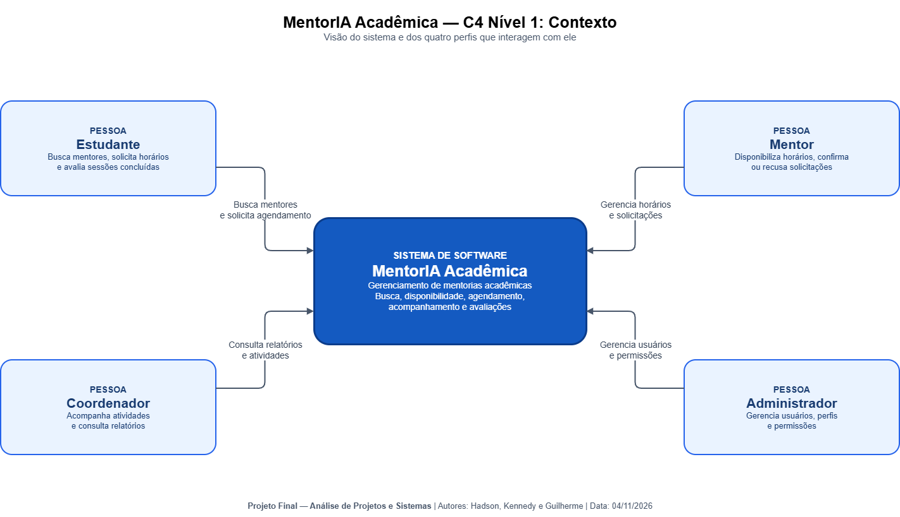

### 4.2 Nível 2 — Contêineres

**Propósito:** evidenciar frontend, API Express e PostgreSQL, tecnologias e protocolos: browser/HTTPS; frontend/API REST+JSON; backend/banco SQL. Os quatro perfis acessam apenas a interface web.

**Decisão demonstrada:** apresentação separada da lógica de negócio; acesso ao banco restrito ao backend. A borda de sistema envolve os três contêineres lógicos.

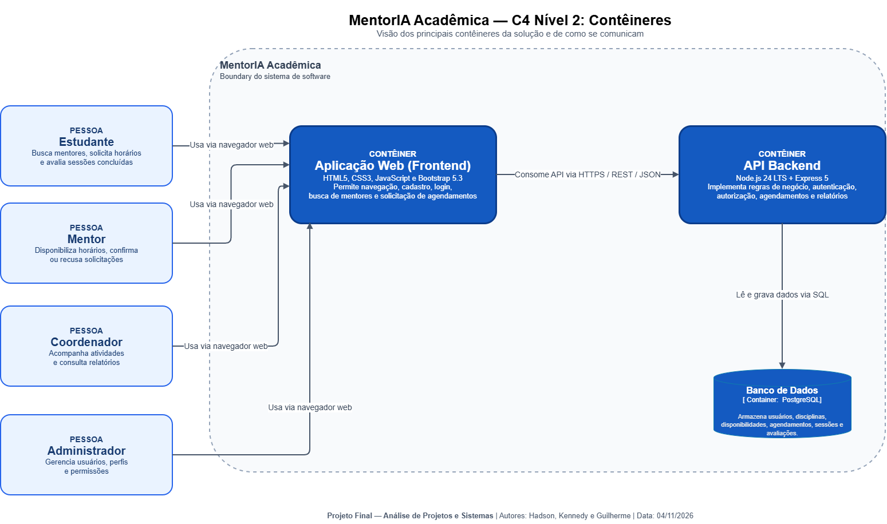

### 4.3 Nível 3 — Componentes

**Escopo:** interior da API Backend. Um `Express Router/Controllers` direciona solicitações para serviços de Autenticação e Usuários, Mentores e Disciplinas, Disponibilidades e Agendamentos, Sessões e Avaliações, Administração e Relatórios. Repositórios isolam SQL e PostgreSQL.

**Decisão demonstrada:** módulos separados por responsabilidade de negócio, sem comunicação remota entre eles. A biblioteca `pg` centraliza o acesso relacional.

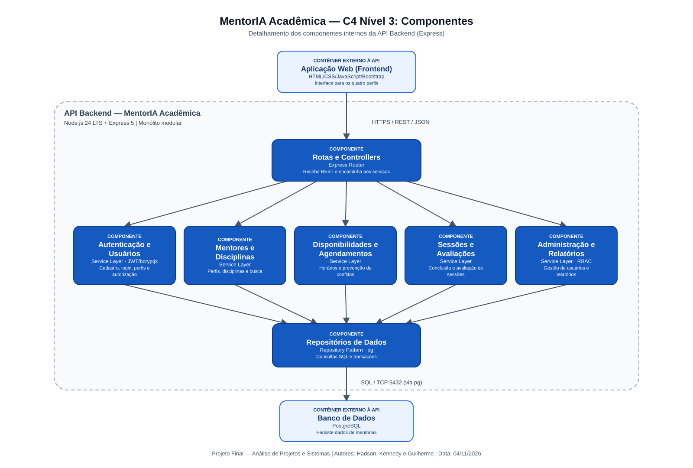

### 4.4 Nível 4 — Código (componente crítico)

**Escopo:** detalhamento do componente de agendamentos. O `AgendamentoService` coordena `ValidadorAgendamento`, `PoliticaDeStatus` e repositórios; operações de reserva são transacionais.

**Critério representado na versão revisada:** a exclusividade de **solicitações ativas** considera somente `PENDENTE` e `CONFIRMADO`; `CONCLUIDO` não bloqueia uma nova reserva. O diagrama foi conferido no pacote de revisão, e a publicação final deve usar as imagens derivadas do arquivo editável.

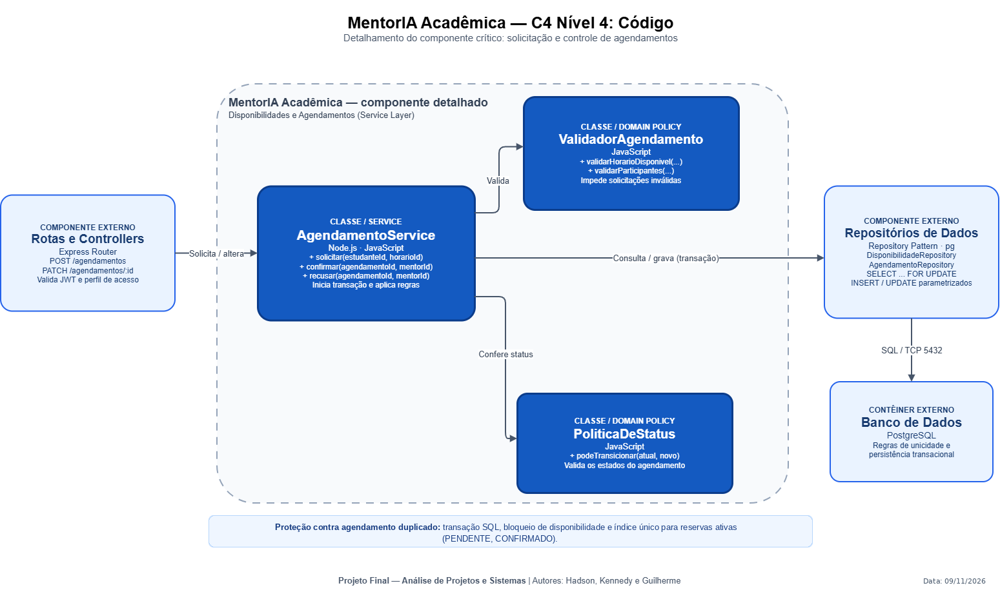

## 5. Catálogo de componentes e contratos

| Componente | Responsabilidade | Entrada principal | Saída / regra |
|---|---|---|---|
| AutenticacaoController | Receber credenciais e devolver resposta HTTP | `POST /api/auth/login` | `200` com token ou `401` genérico |
| AutenticacaoService | Verificar identidade e emitir JWT | `email`, `senha` | Token de acesso curto (15 min) |
| UsuarioRepository | Carregar usuário por e-mail/ID | Identificador/email | Hash de senha, perfil e estado ativo |
| MentorService | Consultar mentores e vínculos a disciplinas | Filtro de disciplina | Lista paginada de mentores |
| AgendamentoController | Validar payload e encaminhar requisições | `POST /api/agendamentos` | `201`, `400`, `401`, `403` ou `409` conforme caso |
| AgendamentoService | Aplicar regras do fluxo de reserva | estudante autenticado e disponibilidade | Criação `PENDENTE` ou conflito |
| DisponibilidadeRepository | Consultar e bloquear horários | ID da disponibilidade | Registro com trava `FOR UPDATE` |
| AgendamentoRepository | Consultar ativos e persistir pedidos | IDs e status | Inserção e atualização transacional |
| SessaoService | Registrar sessão concluída | Agendamento confirmado | Sessão + estado `CONCLUIDO` |
| AvaliacaoService | Validar autoria e conclusão | Nota/comentário | Uma avaliação do estudante por sessão |
| AdministracaoService | Consultas gerenciais e usuários | Identidade e permissão | Relatórios administrativos controlados |

**Regras de interface:** o OpenAPI 3.0 de Guilherme é o contrato definitivo; estes endpoints são a **referência prevista**. Endpoint, DTO e código de erro deverão ser idênticos ao modelo final da API.

## 6. Dados e integridade

### 6.1 Entidades principais

As entidades conceituais canônicas são `Usuario`, `PerfilMentor`, `Disciplina`, `MentorDisciplina`, `Disponibilidade`, `Agendamento`, `SessaoMentoria`, `Avaliacao`, `Notificacao` (opcional) e `LogAuditoria`. O status do agendamento inclui `EXPIRADO` além dos cinco estados originais. Serviços de aplicação (`AutenticacaoService`, `AgendamentoService`) são classes de comportamento e **não** tabelas independentes.

### 6.2 Estados do agendamento

`PENDENTE → CONFIRMADO → CONCLUIDO` (caminho de sucesso). Pedidos `PENDENTE` podem ir para `RECUSADO` ou `CANCELADO`; pedidos `CONFIRMADO` podem ser cancelados antes da conclusão, conforme regra acordada com Hadson.

- Um horário só pode receber solicitação para data futura.
- Uma disponibilidade não pode ter duas solicitações em estados `PENDENTE`/`CONFIRMADO` simultaneamente.
- Agendamentos `RECUSADO`/`CANCELADO` podem coexistir no histórico sem bloquear uma nova solicitação.
- `CONCLUIDO` registra resultado histórico; não é estado ativo de uma reserva futura.
- A conclusão e a avaliação são operações distintas, com validação de autoria.

### 6.3 Concorrência de reservas (regra crítica)

A verificação de horário e a criação do agendamento devem ocorrer **na mesma transação e na mesma conexão PostgreSQL** (o `pg` client transacional deve ser compartilhado entre os repositórios envolvidos). Fluxo lógico recomendado:

1. `BEGIN`.
2. Bloquear a linha da disponibilidade com `SELECT ... FOR UPDATE`, no mesmo cliente transacional reutilizado na operação de inserção.
3. Checar propriedade do mentor, validade temporal e existência de reserva ativa.
4. Criar `Agendamento` `PENDENTE`.
5. `COMMIT`; caso exista conflito, `ROLLBACK` e HTTP `409 Conflict`.

Como defesa adicional, Guilherme deve incluir no modelo físico um **índice único parcial** para cada `disponibilidade_id` com status `PENDENTE`/`CONFIRMADO`, ou restrição equivalente. A política de erro deve traduzir violação da unicidade para `409`, sem revelar dados de outros estudantes. Isso evita confiar apenas em uma verificação feita na aplicação.

Exemplo **de referência** para discussão com o DBA (nomes de colunas devem seguir o SQL final):

```sql
CREATE UNIQUE INDEX ux_agendamento_disponibilidade_ativa
ON agendamentos (disponibilidade_id)
WHERE status IN ('PENDENTE', 'CONFIRMADO');
```

**Observação:** as sequências revisadas retratam a primeira solicitação como `201/PENDENTE` e a segunda como `409`, demonstrando a proteção de concorrência. A consistência do SQL executável pertence ao Bloco 5.

## 7. Segurança, privacidade e limites

| Controle | Proposta | Razão / risco mitigado |
|---|---|---|
| Autenticação | JWT assinado; validade inicial de 15 minutos | Limita exposição de token comprometido; revogação precisa de política adicional |
| Credenciais | Hash de senhas com `bcryptjs`, jamais senha em texto puro | Protege senhas em caso de acesso indevido ao banco |
| Autorização | RBAC por perfil **e** verificação do titular do recurso | Evita acesso a agendamentos de terceiros (BOLA/IDOR) |
| Transporte | HTTPS/TLS; sem API e banco em portas públicas não necessárias | Reduz exposição de credenciais e tráfego |
| Persistência | SQL parametrizado via `pg`; validação do payload | Mitiga SQL injection e dados inválidos |
| Segredos | Variáveis de ambiente, sem credenciais no GitHub | Evita vazamento de chaves e conexão |
| Privacidade | Minimização, retenção, controle de acesso e dicionário PII | Apoia atendimento aos requisitos LGPD definidos pelo PO/DBA |
| Erros/logs | Respostas genéricas para falha de login e logs sem senha/token | Evita vazamento de informação sensível |

O JWT deve ser tratado como segredo; o frontend não deverá gravar tokens em logs. Para o projeto simples, sugere-se guardar token apenas em memória da aba; renovação de sessão exigirá autenticação novamente ou uma proposta futura formal. O plano não constitui auditoria de segurança ou avaliação legal de conformidade.

## 8. Stack tecnológica — comparação obrigatória

| Camada | Escolha | Alternativa avaliada e descartada | Justificativa ligada ao projeto | ADR |
|---|---|---|---|---|
| Arquitetura | Monólito modular | Microserviços | Reduz unidades de deploy, complexidade de transações e operação para equipe pequena | ADR-001 |
| Interface | HTML5, CSS3, JS, Bootstrap 5.3 | React | Telas majoritariamente formulários e consultas; sem build/estado complexo obrigatório | ADR-002 |
| Runtime/API | Node.js 24 LTS + Express 5 | NestJS | Menor abstração inicial para API REST de escopo limitado; versão LTS | ADR-003 |
| Persistência | PostgreSQL + `pg` | MongoDB | Relacionamentos fortes, FKs, transações e restrições de unicidade | ADR-004 |
| Integração | REST/JSON por HTTPS | GraphQL | Operações CRUD e fluxos previsíveis; OpenAPI documentável e HTTP padrão | ADR-005 |
| Hospedagem planejada | AWS Lightsail + Nginx | EC2 + RDS | Reduz componentes e facilita estimativa inicial; custo/HA precisam ser validados | ADR-006 |
| Identidade | JWT de acesso curto + RBAC | Sessão de servidor tradicional | API sem estado de sessão; cuidado com revogação e titularidade | ADR-007 |
| Separação interna | Controller + Service Layer + Repository | Controller acessando SQL diretamente | Mantém regras testáveis e dependências sob controle | ADR-008 |
| Reserva concorrente | Transação PostgreSQL + lock + unicidade | `SELECT` simples sem transação | Protege a integridade quando duas solicitações chegam juntas | ADR-009 |

## 9. Padrões de projeto adotados

### 9.1 Service Layer

A regra “horário livre → pedido pendente → decisão do mentor” pertence ao `AgendamentoService`. Controllers recebem e respondem HTTP, sem conter transações ou regras complexas. Essa separação permite testar fluxos de negócio independentemente do navegador. **Alternativa descartada:** regras espalhadas entre rotas Express, dificultando testes e consistência.

### 9.2 Repository

`UsuarioRepository`, `DisponibilidadeRepository` e `AgendamentoRepository` concentram acesso SQL, mapeamento de registros e execução de consultas parametrizadas. **Alternativa descartada:** consultas repetidas dentro de serviços e controllers, gerando acoplamento e risco de divergência.

### 9.3 Políticas de domínio

`ValidadorAgendamento` e `PoliticaDeStatus` encapsulam verificações do agendamento e transições permitidas. São objetos simples, não novos microserviços. **Alternativa descartada:** condições duplicadas em cada endpoint, com chances de aceitar estados inválidos.

Não se propõem **Saga, CQRS ou event bus**: não há serviço distribuído, consistência eventual obrigatória ou leitura com carga diferenciada que justifique esses padrões no escopo definido.

## 10. Riscos arquiteturais e compromissos

| ID | Risco | Prob. | Impacto | Tratamento proposto | Dono |
|---|---|---|---|---|---|
| AR-01 | Duplo agendamento por concorrência | Média | Alto | `FOR UPDATE`, transação, índice parcial e teste de disputa | Kennedy + Guilherme |
| AR-02 | Acesso indevido a reservas alheias | Média | Alto | RBAC + checagem de titularidade + testes 403/404 | Kennedy + Hadson |
| AR-03 | Instância única indisponível | Média | Alto | Backups testados; não prometer SLA 99,9%; plano de recuperação | Guilherme |
| AR-04 | Exposição de dados pessoais | Média | Alto | Classificação PII, minimização e logs seguros | Hadson + Guilherme |
| AR-05 | Divergência RF ↔ C4 ↔ UML ↔ SQL | Alta | Alto | Matriz de rastreio e revisão cruzada antes do PDF | Trio |
| AR-06 | Escala acima da capacidade prevista | Média | Médio | Carga e métricas; crescimento vertical ou separação do banco após validação | Kennedy + Guilherme |

Os riscos de negócio, equipe e regulação devem completar a matriz **mínima de oito riscos** do Bloco 7, mantida por Guilherme.

## 11. Plano de validação e critérios para handoff

**Validação do Bloco 3**

- [ ] ADRs 001–009 revisados, alternativos e consequências coerentes.
- [ ] C4 N1–N4 com título, autores e data, e a mesma nomenclatura dos requisitos.
- [ ] Stack documentada por camada; nenhuma tecnologia adicional sem ADR quando relevante.
- [ ] Padrões Repository e Service Layer correspondem aos desenhos e ao código previsto.
- [ ] Restrições de agendamento aparecem no C4 N4, UML, dicionário e SQL.
- [ ] RNFs com métricas revisadas por Hadson; ambiente e custos reais revisados por Guilherme.
- [ ] Links do GitHub e nomes de arquivos conferidos.

**Critério de saída:** a equipe de desenvolvimento futura consegue identificar o caminho de uma requisição, seus pontos de validação, onde persistir dados e como testar os principais erros, sem inventar decisões que não estejam registradas. O README executável do futuro projeto, a API OpenAPI e o SQL físico dependem do Bloco 8 e do Bloco 5.

## 12. Registro de decisões (ADRs)

| ADR | Tema | Arquivo |
|---|---|---|
| 001 | Estilo arquitetural | [ADR-001](docs/adrs/ADR-001.md) |
| 002 | Interface | [ADR-002](docs/adrs/ADR-002.md) |
| 003 | Backend | [ADR-003](docs/adrs/ADR-003.md) |
| 004 | Banco | [ADR-004](docs/adrs/ADR-004.md) |
| 005 | API | [ADR-005](docs/adrs/ADR-005.md) |
| 006 | Infraestrutura planejada | [ADR-006](docs/adrs/ADR-006.md) |
| 007 | Segurança de acesso | [ADR-007](docs/adrs/ADR-007.md) |
| 008 | Organização do código | [ADR-008](docs/adrs/ADR-008.md) |
| 009 | Concorrência de agendamentos | [ADR-009](docs/adrs/ADR-009.md) |

## 13. Referências técnicas

- Enunciado do professor: *Análise de Projeto e Sistemas — Projeto Final*, especialmente Bloco 3 (p. 8), Bloco 4 (p. 9), regra de justificativas (p. 14) e critérios bloqueadores (p. 15).
- C4 Model, Simon Brown: https://c4model.com/diagrams
- Express (documentação): https://expressjs.com/
- Node.js — política de versões LTS: https://nodejs.org/en/about/previous-releases
- PostgreSQL — cláusula `FOR UPDATE`: https://www.postgresql.org/docs/current/sql-select.html
- PostgreSQL — índices parciais: https://www.postgresql.org/docs/current/indexes-partial.html
- OWASP API Security Top 10: https://owasp.org/projects/api-security-project
- AWS Lightsail — preços oficiais (a serem calculados por região/cenário): https://aws.amazon.com/pt/lightsail/pricing/


## Anexo — Compatibilização com os Blocos 1, 2 e 9 (06/11/2026)

As premissas e os requisitos de Hadson foram incorporados como **propostas comuns sujeitas ao aceite do trio**. Regras adicionais: expiração do agendamento PENDENTE em 48 h (`EXPIRADO`), impedimento de desativar o último administrador ativo, cancelamento de reservas futuras ao desativar usuário, revalidação de status e perfil a cada requisição e trilha `LogAuditoria` para ações administrativas. **`SessaoMentoria`** substitui `RegistroSessao` no vocabulário oficial. Ver [modelo do banco](docs/05-banco.md), [dicionário de dados](docs/dicionario-dados.md) e [requisitos](docs/02-requisitos.md).


---

# Bloco 4 — Diagramas UML | MentorIA Acadêmica

**ID:** UML-APS-004-K  
**Versão:** 1.2  
**Responsável pela integração:** Kennedy — Arquitetura de Software  
**Revisão cruzada:** Hadson (requisitos); Guilherme (dados)  
**Status:** correções locais aplicadas; validação cruzada com requisitos e banco pendente  
**Data:** 06/11/2026

## 1. Objetivo e escopo

Este caderno descreve **quatro diagramas UML** elaborados pelo arquiteto: um de classes e três de sequência. Os outros **cinco diagramas** do Bloco 4 são divididos entre os demais integrantes: Casos de Uso e duas Atividades (Hadson), Componentes UML e Deployment (Guilherme). O total solicitado pela página 9 do enunciado corresponde a **seis tipos UML e nove diagramas concretos**.

A documentação a seguir complementa, mas não substitui, a **exibição e explicação ao vivo dos diagramas** exigida pelo professor. Cada imagem final deve ter título, autores e data.

## 2. Diagrama UML de classes

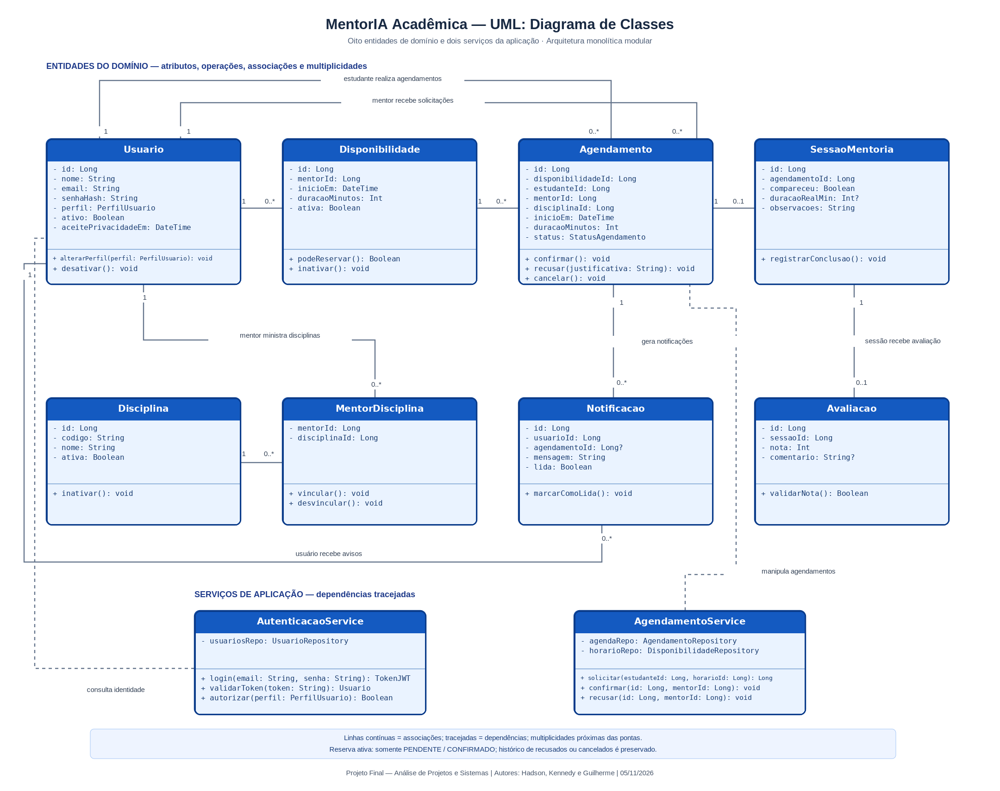

### 2.1 Classes incluídas

| Classe | Tipo | Papel | Coerência esperada com banco |
|---|---|---|---|
| `Usuario` | Entidade | Identidade, perfil, situação ativa | `usuarios` |
| `Disciplina` | Entidade | Área do conhecimento | `disciplinas` |
| `MentorDisciplina` | Entidade associativa | Vínculo N:N mentor–disciplina | `mentor_disciplinas` |
| `Disponibilidade` | Entidade | Janela de atendimento de mentor | `disponibilidades` |
| `Agendamento` | Entidade | Solicitação e estado da reserva | `agendamentos` |
| `SessaoMentoria` | Entidade | Execução/conclusão de atendimento | `sessoes_mentoria` |
| `Avaliacao` | Entidade | Avaliação do estudante | `avaliacoes` |
| `Notificacao` | Entidade | Aviso interno ao usuário | `notificacoes` |
| `AutenticacaoService` | Serviço | Regras de login/token/autorização | Não é tabela |
| `AgendamentoService` | Serviço | Solicitação, confirmação e recusa | Não é tabela |

### 2.2 Convenções exigidas

- Atributos têm nome e tipo: `- email: String`, `- id: Long`, `- ativo: Boolean`.
- Métodos têm assinatura tipada: `+ solicitar(estudanteId: Long, horarioId: Long): Long`.
- Visibilidade: `+` público; `-` privado; `#` protegido quando aplicável.
- Relações de domínio usam associação contínua e multiplicidades junto de **cada ponta**; dependências de serviço usam linhas tracejadas.
- Duas associações distintas **já representam os papéis do usuário** em agendamentos: como estudante e como mentor. A multiplicidade adotada é `Usuario 1` para `Agendamento 0..*` em cada papel; Guilherme deve confirmar as duas FKs.
- Associação `Disponibilidade → Agendamento`: `1` disponibilidade para `0..*` pedidos históricos. Apenas um pedido pode estar ativo (`PENDENTE`/`CONFIRMADO`) em um instante, regra de banco por índice único parcial. Multiplicidades não representam sozinhas a restrição por status.
- A classe de serviço depende de repositórios; não deve representar dependência direta entre frontend e banco.

### 2.3 Conferência de integridade

O desenho contém dez classes: oito entidades representativas e dois serviços; `PerfilMentor` e `LogAuditoria` existem no banco, mas ficam fora deste recorte de classes da UML. A nomenclatura oficial da sessão é `SessaoMentoria`, em todos os documentos.

Os campos `Agendamento.estudanteId`, `mentorId`, `disponibilidadeId` devem possuir FKs correspondentes no modelo físico. `Avaliacao` deve se associar a uma `SessaoMentoria` concluída. `Notificacao` guarda seu destinatário e a referência ao agendamento quando pertinente. `PerfilUsuario` e `StatusAgendamento` são tipos/enums do domínio, não precisam ser tabelas independentes.

## 3. Sequência 1 — Autenticação (login)

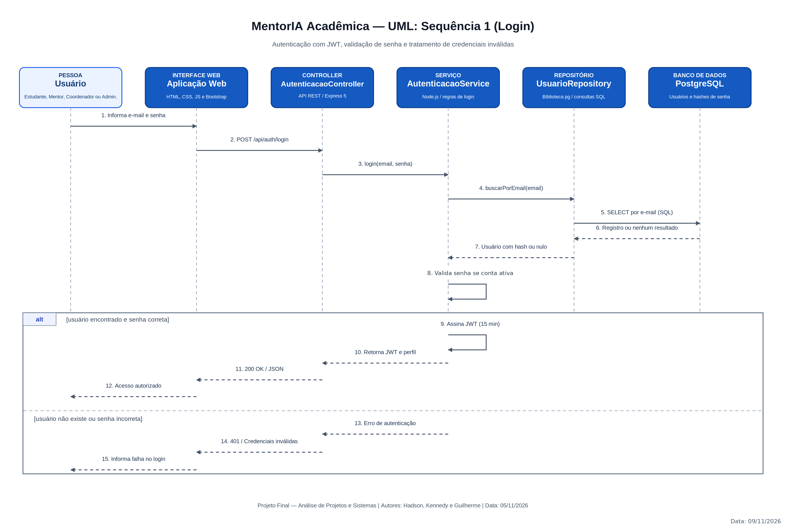

**Pré-condição:** usuário cadastrado e ativo, com senha armazenada apenas como hash. **Disparo:** envio de e-mail e senha pela interface.

1. Interface envia `POST /api/auth/login` ao `AutenticacaoController`.
2. O controller encaminha ao `AutenticacaoService`.
3. O serviço consulta `UsuarioRepository` e recebe hash/perfil/estado.
4. Faz comparação de senha com `bcryptjs`.
5. Em caso válido, retorna JWT de 15 minutos e perfil com HTTP `200`.
6. Em credencial inválida ou usuário inexistente, retorna `401` com mensagem genérica.

**Pós-condição:** cliente autenticado ou tentativa rejeitada sem divulgar se o e-mail existe. O diagrama usa fragmento `alt` para os caminhos de sucesso e de erro.

## 4. Sequência 2 — Solicitação de agendamento (happy path)

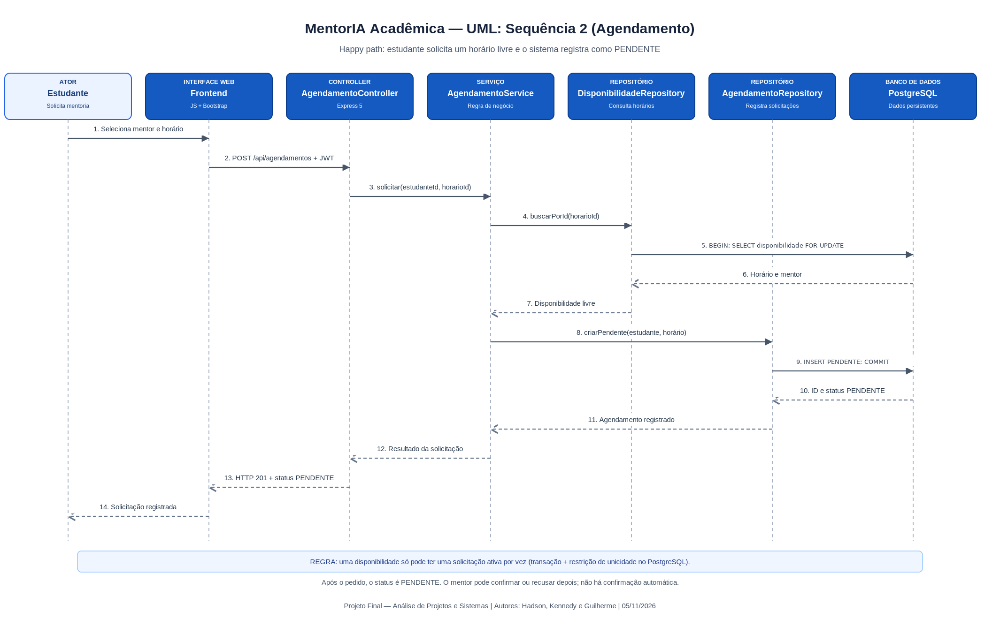

**Pré-condição:** estudante com JWT válido, disponibilidade futura e sem solicitação ativa.

1. O estudante seleciona mentor e horário na aplicação web.
2. Frontend envia `POST /api/agendamentos` com autenticação.
3. `AgendamentoController` chama `AgendamentoService`.
4. Service verifica disponibilidade via `DisponibilidadeRepository`.
5. Na **mesma conexão e transação**, `DisponibilidadeRepository` bloqueia o horário com `FOR UPDATE`, verifica o estado e `AgendamentoRepository` insere o pedido `PENDENTE` antes do `COMMIT`.
6. Backend devolve HTTP `201` com ID e `status: PENDENTE`.

**Pós-condição:** pedido registrado, aguardando confirmação/recusa do mentor. **Observação:** `PENDENTE` não significa que a mentoria já esteja confirmada. A transação é explicitada em regras e no diagrama de erro concorrente.

## 5. Sequência 3 — Erro crítico por concorrência

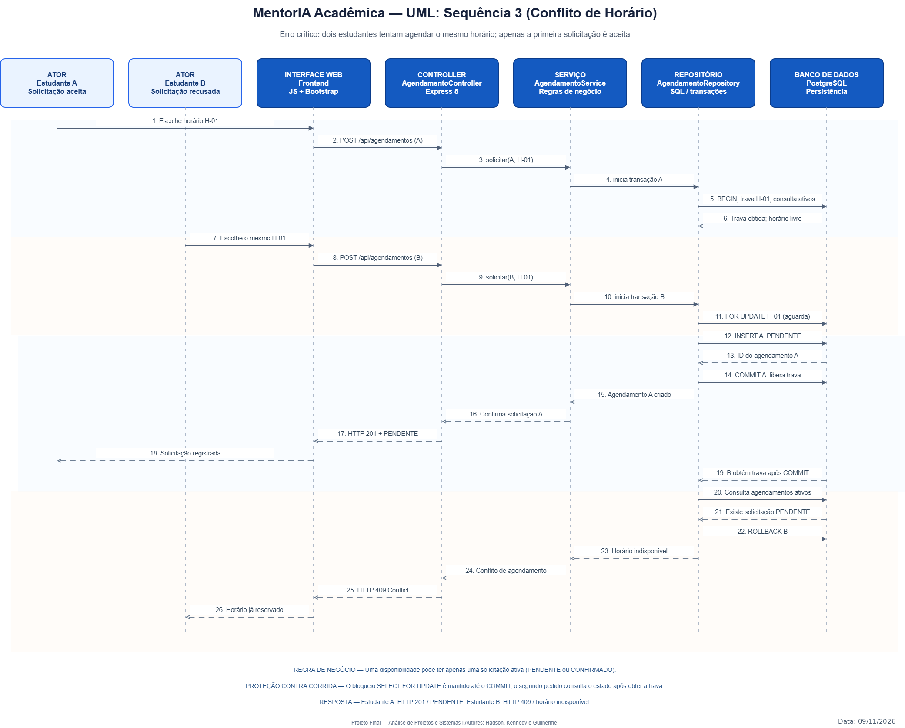

**Cenário:** estudantes A e B enviam pedidos para o mesmo horário; ambos veem a disponibilidade antes da reserva definitiva.

1. A inicia transação, bloqueia a linha de `Disponibilidade` (`SELECT ... FOR UPDATE`), checa ausência de reserva ativa e insere `PENDENTE`.
2. B tenta bloquear a mesma disponibilidade e aguarda a liberação da trava.
3. A confirma (`COMMIT`), liberando a trava.
4. B obtém a trava, consulta agendamentos ativos e encontra o pedido de A.
5. B não insere novo registro; desfaz a tentativa (`ROLLBACK`) e recebe HTTP `409 Conflict`.

**Resultado:** A recebe `201/PENDENTE`; B recebe `409/Horário indisponível`. A proteção também deve existir no banco por índice único parcial para agendamentos ativos.

## 6. Rastreamento e explicação na apresentação

| Diagrama | Demonstra principalmente | Pergunta provável do professor |
|---|---|---|
| Classes | Domínio, tipos, visibilidades, associações | “Por que `MentorDisciplina` é associação N:N? Onde estão FKs?” |
| Sequência login | Repositório, segurança, resposta 200/401 | “O frontend acessa a senha/hash?” Não. |
| Sequência agendamento | Solução de negócio e status `PENDENTE` | “Por que o agendamento ainda não está confirmado?” |
| Sequência erro | Consistência transacional e conflito `409` | “O que impede duas reservas simultâneas?” |

**Regra de apresentação:** é necessário exibir e **explicar** cada diagrama, não apenas mostrar uma imagem. Os slides finais não precisam ganhar uma data separada; cada **diagrama** deve conservar autores e data na própria figura.

## 7. Pendências para aceite

- [x] As duas associações `Usuario` ↔ `Agendamento` e multiplicidades foram corrigidas no `.drawio` e na imagem gerada. [ ] Pendente validação com Guilherme/DER.
- [ ] Validar cardinalidades com Guilherme e confirmar constraints/índice SQL.
- [ ] Fazer a última conferência de abertura no Draw.io instalado por Kennedy (os arquivos passaram na inspeção estrutural do ZIP; a conferência visual no aplicativo segue necessária).
- [ ] Confirmar códigos e nomes dos endpoints com o OpenAPI final de Guilherme.
- [ ] Atualizar PNGs após cada edição e conferir legibilidade no PDF.


---

## 8. Integração dos demais diagramas UML (responsabilidade do trio)

Os nove diagramas estão presentes em `.drawio` e PNG após a integração dos arquivos de Guilherme. O Bloco 4 ainda depende de conferência visual e aprovação formal do trio. Os quatro diagramas documentados anteriormente são a parte preparada por Kennedy. Os diagramas C4 são exigências **adicionais do Bloco 3** e não substituem estes diagramas UML.

| Diagrama obrigatório | Responsável | Imagem esperada | Situação |
|---|---|---|---|
| Casos de uso | Hadson | `diagrama-casos-de-uso.png` | Recebido e corrigido; verificar no Draw.io |
| Atividades: agendamento | Hadson | `diagrama-atividades-agendamento.png` | Recebido e corrigido; verificar no Draw.io |
| Atividades: administração | Hadson | `diagrama-atividades-administrativo.png` | Recebido e corrigido; verificar no Draw.io |
| Componentes UML | Guilherme | `uml-componentes.png` | Integrado; validar no Draw.io |
| Implantação / Deployment | Guilherme | `uml-implantacao.png` | Integrado; validar no Draw.io |

### 8.1 Casos de uso — Hadson

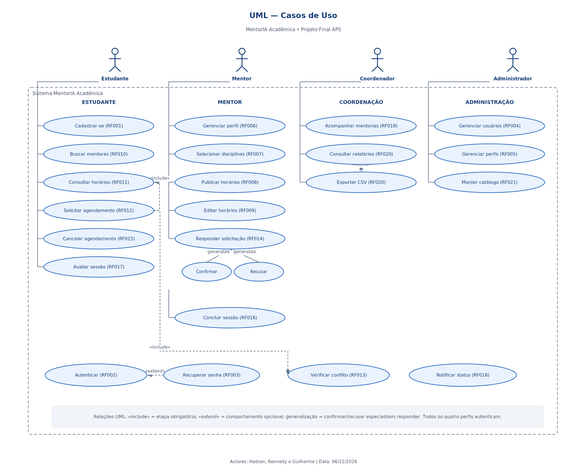

**Editável:** [`diagrama-casos-de-uso.drawio`](diagramas/editaveis/diagrama-casos-de-uso.drawio). Os quatro atores são Estudante, Mentor, Coordenador e Administrador. Os casos de uso abrangem RF001–RF021, incluindo a manutenção do catálogo (RF021) e as relações de inclusão, extensão e generalização.

### 8.2 Atividades do agendamento — Hadson

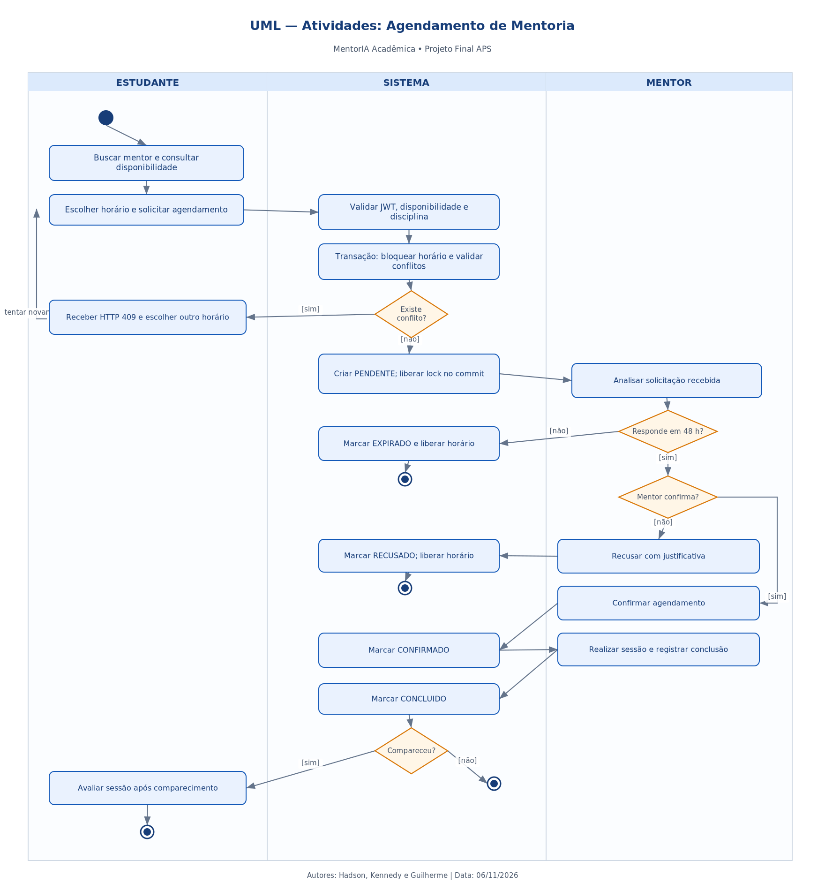

**Editável:** [`diagrama-atividades-agendamento.drawio`](diagramas/editaveis/diagrama-atividades-agendamento.drawio). O fluxo inclui busca, solicitação, validação transacional do horário, erro 409, reserva `PENDENTE`, resposta em 48 h (ou `EXPIRADO`), confirmação/recusa, conclusão e avaliação quando houve comparecimento.

### 8.3 Atividades administrativas — Hadson

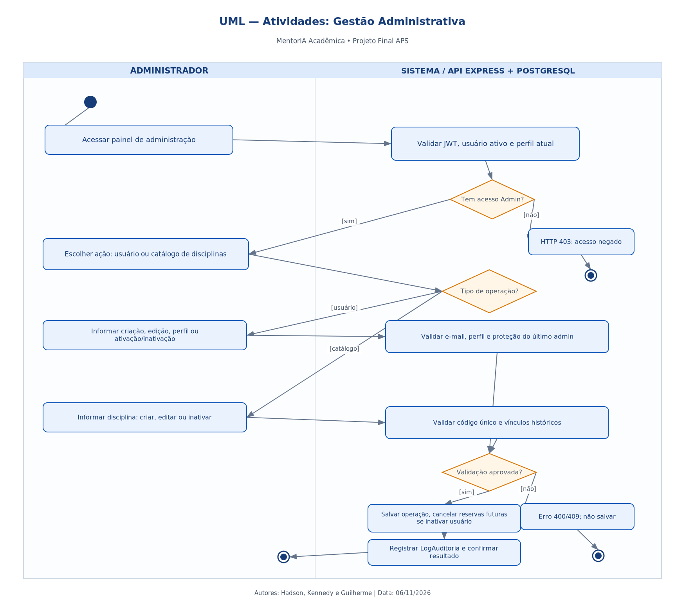

**Editável:** [`diagrama-atividades-administrativo.drawio`](diagramas/editaveis/diagrama-atividades-administrativo.drawio). Representa autorização RBAC, manutenção de usuários/perfis e catálogo de disciplinas (RF004, RF005, RF021), validações, proteção do último administrador, exclusão lógica e auditoria (RNF024).

### 8.4 Diagrama UML de componentes — Guilherme

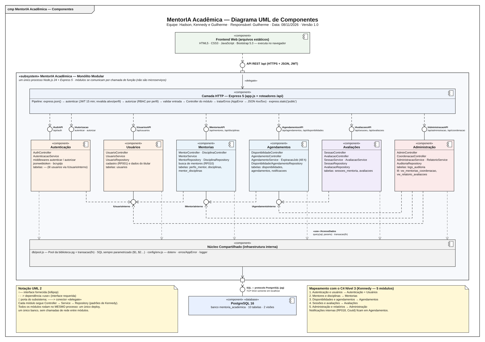

**Editável:** [`uml-componentes.drawio`](diagramas/editaveis/uml-componentes.drawio). O diagrama apresenta seis componentes internos mapeados aos cinco módulos de negócio da arquitetura C4: a separação entre Autenticação e Usuários é uma **subdivisão técnica** dentro do mesmo monólito. Usa portas/interfaces UML e conexão ao banco PostgreSQL. Conferir visualmente antes da apresentação.

### 8.5 Diagrama UML de implantação — Guilherme

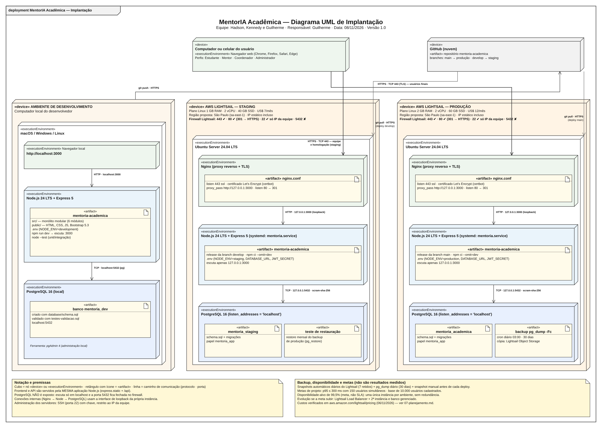

**Editável:** [`uml-implantacao.drawio`](diagramas/editaveis/uml-implantacao.drawio). Descreve desenvolvimento local, staging Lightsail 1 GB e produção Lightsail 2 GB, Nginx/HTTPS 443, Node.js na 3000 local e PostgreSQL na 5432 restrita ao loopback. Estimativas, não infraestrutura contratada.

## 9. Validação final do Bloco 4

- [ ] Os **nove diagramas UML** possuem título, autores e data dentro da figura, são legíveis e poderão ser explicados ao vivo.
- [x] O pacote contém os quatro UML de Kennedy em `.drawio` e `.png`. [ ] Conferir visualmente no Draw.io antes da apresentação.
- [x] Associações e nomes principais harmonizados com o banco. [ ] Conferir detalhes visuais no Draw.io ao montar os slides.
- [x] Diagrama de classes editável e PNG atualizados: tipo `Long` corresponde a `BIGINT` no SQL; `inicioEm`/`duracaoMinutos` representam `inicio_em`/`duracao_minutos`; entidades e atributos revisados com o banco.
- [ ] Nomes das entidades, valores de status e relacionamentos correspondem ao banco, aos RFs e ao contrato OpenAPI.
- [ ] Hadson e Guilherme revisaram e aprovaram suas respectivas seções.


---

# Bloco 5 — Banco de Dados

**Projeto:** MentorIA Acadêmica · **Responsável:** Guilherme · **Equipe:** Hadson, Kennedy e Guilherme
**Versão:** 1.0 · **Data:** 08/11/2026 · **SGBD:** PostgreSQL 16 (compatível com 13+)

| Artefato | Arquivo | Conteúdo |
|---|---|---|
| Modelo físico (DDL) | [`sql/schema.sql`](sql/schema.sql) | 10 tabelas, 13 FKs, 2 *exclusion constraints*, índice único parcial, 6 funções de trigger e 2 visões |
| Testes do modelo | [`sql/testes-validacao.sql`](sql/testes-validacao.sql) | 38 verificações automáticas (positivas e negativas) em `BEGIN … ROLLBACK` |
| Modelo lógico (DBML) | [`sql/modelo-banco.dbml`](sql/modelo-banco.dbml) | Importável no dbdiagram.io |
| Dicionário de dados | [`docs/dicionario-dados.md`](docs/dicionario-dados.md) | Campos, tipos, restrições, classificação LGPD e retenção |
| DER conceitual | [`diagramas/der-conceitual.png`](diagramas/imagens/der-conceitual.png) | Entidades e cardinalidades |
| DER lógico | [`diagramas/der-logico.png`](diagramas/imagens/der-logico.png) | Gerado a partir do banco real |

> **Observação da revisão de 09/11/2026:** RF008 fixa disponibilidades em **30, 45 ou 60 minutos**. RTO alinhado ao RNF005: **4 h**. Os relatos de execução abaixo são de Guilherme; esta revisão não reexecutou o PostgreSQL.

> **Status de validação:** o `schema.sql` foi executado com sucesso em **PostgreSQL 16.15** (Ubuntu 24.04) em 06/11/2026. Os 38 testes originais de `testes-validacao.sql` foram relatados como aprovados; os testes T38–T39 foram adicionados após a revisão e ainda não foram executados, e as três disputas de concorrência da §6.4 foram executadas com duas sessões simultâneas. O mesmo roteiro deve ser repetido no pgAdmin 4 (§11) antes da entrega.

---

## 1. Fontes e decisões herdadas

O modelo segue o **Contrato de Integração v1.0** e o **`00-decisoes-compartilhadas.md`**, ambos de 06/11/2026. Quando esses documentos divergem do plano inicial do grupo, valem os de 06/11:

| Tema | Plano inicial | Adotado neste bloco | Motivo |
|---|---|---|---|
| Tabelas | 8 | **10** (+`perfis_mentor`, +`logs_auditoria`) | RF006 e RNF024 no contrato |
| Estados do agendamento | 5 | **6** (+`EXPIRADO`) | RF014: expiração após 48 h |
| Valores de perfil | "Estudante, Mentor…" | `ESTUDANTE`, `MENTOR`, `COORDENADOR`, `ADMINISTRADOR` | Vocabulário comum |
| Cadastro de disciplinas | "o mentor cadastra" | O catálogo é da Administração; o mentor **se vincula** (`mentor_disciplinas`) | RF021 (Must) |

---

## 2. Modelo conceitual

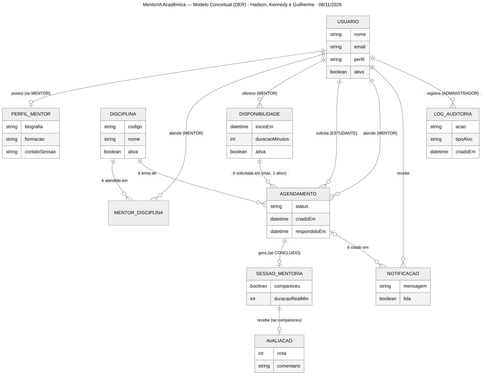

### 2.1 Entidades

| Entidade | O que representa | Atributos principais |
|---|---|---|
| **Usuario** | Pessoa cadastrada; os quatro atores são **perfis** (RBAC), não entidades separadas | nome, email, senhaHash, perfil, ativo, aceitePrivacidadeEm |
| **PerfilMentor** | Apresentação do mentor | biografia, formacao, contatoSessao |
| **Disciplina** | Item do catálogo institucional | codigo, nome, ativa |
| **MentorDisciplina** | Disciplinas que cada mentor atende (associativa) | — |
| **Disponibilidade** | Horário **oferecido** pelo mentor | inicioEm, duracaoMinutos, ativa |
| **Agendamento** | **Pedido** do estudante para ocupar uma disponibilidade | status, observacao, justificativa, criadoEm, respondidoEm |
| **SessaoMentoria** | Atendimento **efetivamente realizado** | compareceu, duracaoRealMin, observacoes |
| **Avaliacao** | Opinião do estudante sobre a sessão | nota (1–5), comentario |
| **Notificacao** | Aviso interno (*Could*) | mensagem, lida |
| **LogAuditoria** | Registro de ação administrativa | acao, tipoAlvo, alvoId |

> **Disponibilidade × Agendamento × Sessão:** a disponibilidade é a *oferta*, o agendamento é o *pedido de reserva* e a sessão é o *fato ocorrido*. Por isso são três tabelas: uma disponibilidade pode acumular vários pedidos ao longo do tempo (recusados, expirados), mas só um ativo; e só o pedido concluído gera sessão.

### 2.2 Relacionamentos e cardinalidades

| Relacionamento | Cardinalidade | Restrição de negócio |
|---|---|---|
| Usuario — PerfilMentor | 1 : 0..1 | Só usuário `MENTOR` |
| Usuario (Mentor) — Disciplina | N : N via MentorDisciplina | Par mentor-disciplina único |
| Usuario (Mentor) — Disponibilidade | 1 : 0..* | Sem sobreposição entre disponibilidades ativas do mesmo mentor |
| Disponibilidade — Agendamento | 1 : 0..* (histórico) | **No máximo 1 ativo** (`PENDENTE`/`CONFIRMADO`) |
| Usuario (Estudante) — Agendamento | 1 : 0..* | Sem reservas ativas sobrepostas do mesmo estudante |
| Usuario (Mentor) — Agendamento | 1 : 0..* | Igual ao mentor da disponibilidade |
| Disciplina — Agendamento | 1 : 0..* | Disciplina atendida pelo mentor |
| Agendamento — SessaoMentoria | 1 : 0..1 | Só se `CONCLUIDO` |
| SessaoMentoria — Avaliacao | 1 : 0..1 | Só se `compareceu = true` |
| Usuario — Notificacao | 1 : 0..* | — |
| Agendamento — Notificacao | 0..1 : 0..* | Referência opcional |
| Usuario (Administrador) — LogAuditoria | 1 : 0..* | Autor obrigatório |

---

## 3. Modelo lógico

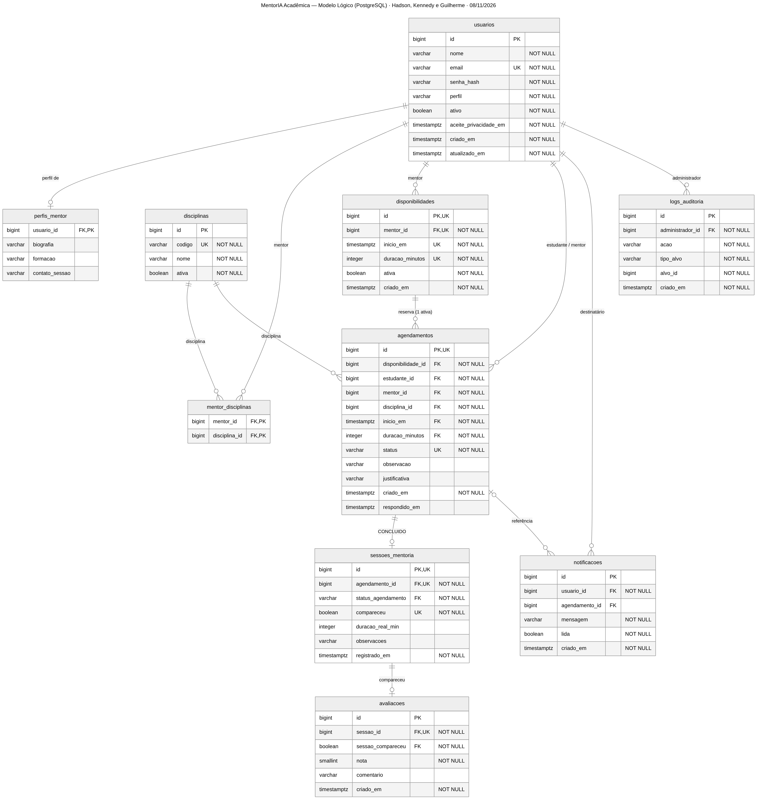

| Tabela | PK | FKs | UNIQUE / regras de tabela |
|---|---|---|---|
| `usuarios` | `id` | — | `email`; CHECK de perfil, e-mail e formato bcrypt |
| `perfis_mentor` | `usuario_id` | `usuario_id → usuarios` | (PK garante 0..1) |
| `disciplinas` | `id` | — | `codigo` |
| `mentor_disciplinas` | `(mentor_id, disciplina_id)` | → `usuarios`, → `disciplinas` | PK composta |
| `disponibilidades` | `id` | `mentor_id → usuarios` | `(id, mentor_id, inicio_em, duracao_minutos)`; **EXCLUDE** sem sobreposição por mentor |
| `agendamentos` | `id` | **composta** `(disponibilidade_id, mentor_id, inicio_em, duracao_minutos) → disponibilidades`; → `usuarios` (estudante, mentor); → `disciplinas` | **índice único parcial** por disponibilidade ativa; **EXCLUDE** sem sobreposição por estudante; `(id, status)` |
| `sessoes_mentoria` | `id` | **composta** `(agendamento_id, status_agendamento) → agendamentos(id, status)` | `agendamento_id`; `(id, compareceu)` |
| `avaliacoes` | `id` | **composta** `(sessao_id, sessao_compareceu) → sessoes_mentoria(id, compareceu)` | `sessao_id`; `nota` 1–5 |
| `notificacoes` | `id` | → `usuarios` (CASCADE), → `agendamentos` (SET NULL) | — |
| `logs_auditoria` | `id` | `administrador_id → usuarios` | Somente inserção (trigger) |

**Índices de desempenho** (13 no total): busca de mentores por disciplina, disponibilidades futuras por mentor, "meus agendamentos" por estudante e mentor, varredura de pendentes para expiração, notificações não lidas e consultas de auditoria. Todos estão no dicionário de dados (§2).

O DBML (`modelo-banco.dbml`) reproduz exatamente as 10 tabelas, 13 FKs e 13 índices do SQL. Isso foi conferido por script contra o banco criado (ver §12). O que o DBML não sabe representar (CHECK, EXCLUDE, cláusula `WHERE` de índice parcial e triggers) aparece em *Notes* dentro do próprio DBML.

---

## 4. Modelo físico — decisões técnicas

| Decisão | Escolha | Alternativa descartada | Por quê |
|---|---|---|---|
| Chave primária | `bigint GENERATED ALWAYS AS IDENTITY` | `serial`; UUID | Padrão SQL moderno; impede inserir `id` manual por engano; 8 bytes contra 16 do UUID. A exposição de IDs sequenciais é tratada pela checagem de titularidade no Service |
| Datas | `timestamptz` | `timestamp` sem fuso | Evita erros de horário de verão e de fuso; o servidor grava em UTC |
| Enumerações (perfil, status) | `varchar` + `CHECK` | `CREATE TYPE … AS ENUM` | O contrato permite CHECK; incluir ou remover valor é um `ALTER` simples e não trava o tipo |
| E-mail único | `CHECK (email = lower(email))` + `UNIQUE` | Extensão `citext` | Sem extensão extra; o Service normaliza e o banco garante |
| Senha | `varchar(60)` + CHECK do formato bcrypt | Coluna livre | Defesa em profundidade: o banco rejeita senha em texto claro |
| Exclusão | **Lógica** (`ativo`, `ativa`) e FKs `RESTRICT` | `ON DELETE CASCADE` | Preserva o histórico de mentorias e de auditoria |
| Regras de perfil | Trigger `fn_exigir_perfil` no momento do registro | FK composta `(id, perfil)` | A FK "congelaria" o perfil do usuário para sempre; com o trigger, a administração pode mudar perfis sem reescrever o histórico |

### 4.1 Técnica 1 — índice único **parcial** (uma reserva ativa por horário)
```sql
CREATE UNIQUE INDEX ux_agendamentos_disponibilidade_ativa
    ON agendamentos (disponibilidade_id)
    WHERE status IN ('PENDENTE', 'CONFIRMADO');
```
Só as linhas ativas entram no índice. Recusas, cancelamentos, expirações e conclusões ficam no histórico **sem** bloquear um novo pedido. Um `UNIQUE (disponibilidade_id)` comum impediria esse histórico.

### 4.2 Técnica 2 — *exclusion constraint* (sem sobreposição de horários)
```sql
EXCLUDE USING gist (estudante_id WITH =, fn_periodo(inicio_em, duracao_minutos) WITH &&)
    WHERE (status IN ('PENDENTE', 'CONFIRMADO'))
```
Lê-se: *"não podem existir duas linhas ativas com o mesmo estudante **e** intervalos que se sobrepõem (`&&`)"*. É a generalização do UNIQUE para intervalos. Exige a extensão `btree_gist`, que é oficial e vem com o PostgreSQL. O intervalo é `[início, fim)`, então uma sessão das 10h às 11h **não** conflita com outra que começa às 11h. A mesma técnica impede que um **mentor** tenha disponibilidades ativas sobrepostas.

`fn_periodo` é marcada como `IMMUTABLE` de propósito: somar **minutos** a um `timestamptz` não depende do fuso horário (somar dias ou meses dependeria). Sem isso, o PostgreSQL não aceitaria a expressão no índice.

### 4.3 Técnica 3 — FK composta "fotografando" a disponibilidade **[proposta DBA]**
A *exclusion constraint* do estudante só enxerga colunas da própria tabela, então o horário precisa estar em `agendamentos`. Para isso não virar uma cópia descontrolada:
```sql
FOREIGN KEY (disponibilidade_id, mentor_id, inicio_em, duracao_minutos)
 REFERENCES disponibilidades (id, mentor_id, inicio_em, duracao_minutos)
```
Uma única FK garante duas regras do contrato: **(a)** o `mentor_id` do agendamento é o mesmo da disponibilidade e **(b)** o horário copiado é idêntico. Como consequência, o horário de uma disponibilidade **que já tem agendamentos** não pode ser alterado (`NO ACTION`): o mentor desativa e cria outra, e o histórico fica íntegro.

### 4.4 Técnica 4 — FK com coluna discriminadora
`sessoes_mentoria(agendamento_id, status_agendamento='CONCLUIDO') → agendamentos(id, status)` e `avaliacoes(sessao_id, sessao_compareceu=true) → sessoes_mentoria(id, compareceu)`. A combinação de uma coluna constante (com CHECK) e uma FK composta faz o próprio banco garantir que:
- só existe sessão de agendamento `CONCLUIDO`, e o agendamento não sai mais desse estado;
- só se avalia sessão com comparecimento, e uma sessão avaliada não pode virar "não compareceu".

### 4.5 Triggers (regras que CHECK e FK não expressam)
| Função | Garante |
|---|---|
| `fn_agendamento_validar_insercao` | Nasce `PENDENTE`; disponibilidade ativa; mentor ativo; horário futuro; disciplina ativa **e** atendida pelo mentor; `criado_em` = relógio do servidor |
| `fn_agendamento_validar_atualizacao` | Máquina de estados; `EXPIRADO` só após 48 h; campos de identificação imutáveis; `respondido_em` automático |
| `fn_exigir_perfil` | MENTOR em disponibilidades, vínculos e perfil de mentor; ESTUDANTE em agendamentos; ADMINISTRADOR em auditoria |
| `fn_proteger_ultimo_administrador` | Não desativa, rebaixa nem exclui o último administrador ativo (com *advisory lock*) |
| `fn_logs_auditoria_somente_insercao` | Bloqueia UPDATE/TRUNCATE; DELETE só fora da retenção |
| `fn_proteger_compromissos_ao_mudar_perfil` | Bloqueia mudança de perfil de mentor/estudante com compromissos futuros (RN11) |
| `fn_proteger_disponibilidade_atualizacao` | Bloqueia edição do intervalo com histórico e inativação com reserva ativa (RN13) |

**Máquina de estados implementada:**
```
             ┌──────────► CONFIRMADO ──────► CONCLUIDO
             │                 │
PENDENTE ────┼──► RECUSADO     └──────────► CANCELADO
             ├──► CANCELADO
             └──► EXPIRADO  (somente após 48 h)
Ativos: PENDENTE e CONFIRMADO · Finais: RECUSADO, CANCELADO, EXPIRADO, CONCLUIDO
```

---

## 5. Regras de negócio: banco × camada Service

| # | Regra | Garantia no banco | O que fica com o Service | Teste |
|---|---|---|---|---|
| 1 | Dois agendamentos ativos na mesma disponibilidade | Índice único parcial | `SELECT … FOR UPDATE` + mensagem 409 | T08, C1 |
| 2 | Reservas ativas sobrepostas do mesmo estudante | EXCLUDE em `agendamentos` | Pré-checagem para mensagem amigável; 409 | T11, C3 |
| 3 | Horários sobrepostos do mesmo mentor | EXCLUDE em `disponibilidades` | Validar entrada e devolver 409 | T05 |
| 4 | Avaliação duplicada | `UNIQUE (sessao_id)` | 409 | T25 |
| 5 | Nota fora de 1–5 | `CHECK` | Validação de entrada (422) | T23 |
| 6 | Desativar ou rebaixar o último administrador | Trigger + *advisory lock* | 409 com mensagem | T29, T30, C2 |
| 7 | Solicitação nasce `PENDENTE` | Trigger | — | T13 |
| 8 | Transições de status válidas | Trigger | **Quem** pode cada transição (RBAC): só o mentor do agendamento confirma ou recusa | T15, T22 |
| 9 | Expiração após 48 h | Trigger impede expirar antes | **Rotina periódica** e expiração "preguiçosa" (§6.2) | T16, T18 |
| 10 | Mentor do agendamento = mentor da disponibilidade | FK composta | — | T09, T10 |
| 11 | Horário futuro; disponibilidade e mentor ativos | Trigger | — | T36, T37 |
| 12 | Disciplina atendida pelo mentor | Trigger | — | T12 |
| 13 | Perfis corretos em cada papel | Trigger `fn_exigir_perfil` | Middleware RBAC em todas as rotas | T04, T06, T14, T34 |
| 14 | Sessão só de agendamento concluído | FK discriminadora | Mentor registra a conclusão | T19–T22 |
| 15 | Avaliação só com comparecimento | FK discriminadora | **Só o estudante do agendamento** avalia (titularidade) | T26, T27 |
| 16 | Desativar usuário cancela agendamentos ativos futuros e audita | Auditoria imutável | Transação da §6.3 | T31–T33 |
| 17 | Senha só como hash; JWT nunca persistido | CHECK bcrypt; não há coluna de token | `bcryptjs` (custo ≥ 12); JWT de 15 min revalidando `ativo` e `perfil` a cada requisição | T02 |
| 18 | Coordenação sem identificação do estudante | Visões `vw_*` sem colunas do estudante | Endpoints de coordenação leem apenas as visões | T35 |

---

## 6. Fluxos transacionais (referência para a implementação)

### 6.1 Solicitar agendamento — `POST /api/agendamentos` (RF012–RF013)
```js
// AgendamentoService.solicitar() — consultas sempre parametrizadas ($1, $2…)
const client = await pool.connect();
try {
  await client.query('BEGIN');                      // READ COMMITTED (padrão)

  // 1) Bloqueia a linha da disponibilidade: pedidos simultâneos para o
  //    MESMO horário passam a ser atendidos em fila.
  const { rows: [disp] } = await client.query(
    `SELECT id, mentor_id, inicio_em, duracao_minutos, ativa
       FROM disponibilidades WHERE id = $1 FOR UPDATE`, [disponibilidadeId]);
  if (!disp) throw new NaoEncontrado('Disponibilidade inexistente');           // 404

  // 2) Expiração preguiçosa: libera um PENDENTE vencido deste horário.
  await client.query(
    `UPDATE agendamentos SET status = 'EXPIRADO'
      WHERE disponibilidade_id = $1 AND status = 'PENDENTE'
        AND criado_em < now() - interval '48 hours'`, [disp.id]);

  // 3) Grava. O índice parcial e a EXCLUDE são a garantia final.
  const { rows: [novo] } = await client.query(
    `INSERT INTO agendamentos (disponibilidade_id, estudante_id, mentor_id, disciplina_id,
                               inicio_em, duracao_minutos, observacao)
     VALUES ($1, $2, $3, $4, $5, $6, $7) RETURNING *`,
    [disp.id, estudanteId, disp.mentor_id, disciplinaId, disp.inicio_em, disp.duracao_minutos, observacao]);

  await client.query('COMMIT');
  return novo;                                                                 // 201 PENDENTE
} catch (e) {
  await client.query('ROLLBACK');
  if (e.code === '23505' || e.code === '23P01') throw new Conflito(e.constraint); // 409
  if (e.code === '23514') throw new RegraViolada(e.constraint);                   // 409/422
  throw e;
} finally {
  client.release();
}
```
**Por que *lock* **e** índice?** O contrato exige os dois. O índice impede a duplicidade **mesmo que o código erre** (ou que alguém insira direto pelo pgAdmin). O `FOR UPDATE` organiza a fila: a segunda requisição espera a primeira terminar e recebe uma resposta 409 previsível. Também evita a corrida entre a expiração preguiçosa e uma nova reserva.

### 6.2 Expiração de 48 horas (RF014)
Rotina agendada no backend (por exemplo, a cada 5 minutos), **planejada e ainda não implementada**:
```sql
UPDATE agendamentos SET status = 'EXPIRADO'
 WHERE status = 'PENDENTE' AND criado_em < now() - interval '48 hours'
RETURNING id, estudante_id;          -- usado para gerar notificações (RF018, Could)
```
Usa o índice parcial `ix_agendamentos_pendentes_criado`. Se a rotina atrasar, a expiração preguiçosa da §6.1 garante que um horário vencido nunca fique bloqueado.

### 6.2.1 Cadastro administrativo com aceite prévio (RN12)

`POST /api/administracao/usuarios` deve exigir `aceiteTitularEm` (timestamp real do aceite) e `referenciaAceite` (identificador do comprovante institucional protegido). O serviço **não** permite que o administrador marque aceite em nome do titular: sem evidência, retorna 422 e não grava nada. Havendo comprovante, grava `aceite_privacidade_em`, `aceite_privacidade_fonte = 'INSTITUCIONAL'` e `aceite_privacidade_referencia`, além de gerar log de auditoria da criação. Para autocadastro, a origem padrão é `AUTOCADASTRO`, sem referência externa. O banco verifica a consistência entre fonte e referência; conferência documental real fica no processo administrativo e no Service.

### 6.3 Desativar usuário — `PATCH /api/administracao/usuarios/{id}` (RF004/RN07)
Em **uma** transação:
1. `UPDATE usuarios SET ativo = false WHERE id = $1`. O trigger protege o último administrador.
2. `UPDATE agendamentos SET status = 'CANCELADO', justificativa = 'Usuário desativado' WHERE (estudante_id = $1 OR mentor_id = $1) AND status IN ('PENDENTE','CONFIRMADO') AND inicio_em > now()`.
3. Se for mentor: `UPDATE disponibilidades SET ativa = false WHERE mentor_id = $1 AND inicio_em > now()`.
4. `INSERT INTO logs_auditoria (administrador_id, acao, tipo_alvo, alvo_id) VALUES ($adm, 'DESATIVAR_USUARIO', 'USUARIO', $1)`.

### 6.4 Concorrência — testes executados
| Teste | Cenário (duas sessões simultâneas) | Resultado observado |
|---|---|---|
| C1 | Ana e Bruno pedem a **mesma** disponibilidade | Ana grava; Bruno recebe `23505 ux_agendamentos_disponibilidade_ativa` |
| C2 | Dois administradores (os únicos) são desativados ao mesmo tempo | O primeiro é desativado; o segundo recebe `rn_ultimo_administrador` |
| C3 | Bruno pede dois horários **sobrepostos** de mentores diferentes ao mesmo tempo | O primeiro grava; o segundo recebe `23P01 ex_agendamentos_estudante_sem_sobreposicao` |

> O trigger do último administrador pressupõe o nível de isolamento padrão **READ COMMITTED** (o padrão do PostgreSQL e da biblioteca `pg`). Se algum dia a aplicação usar `SERIALIZABLE`, a proteção continua valendo, porque o próprio PostgreSQL aborta a transação conflitante.

---

## 7. Segurança

| Camada | Medida |
|---|---|
| Rede | PostgreSQL escuta só em `localhost` (`listen_addresses = 'localhost'`); a porta 5432 **fechada** no firewall do Lightsail; abertas apenas 443/80 (Nginx) e 22 (SSH com chave, restrito ao IP da equipe) |
| Autenticação no banco | `pg_hba.conf` com `scram-sha-256`; nenhum acesso com o usuário `postgres` pela aplicação |
| Privilégio mínimo | Três papéis: **`mentoria_owner`** (dono do schema, roda migrações), **`mentoria_app`** (`SELECT/INSERT/UPDATE`, sem `UPDATE` em `logs_auditoria`, sem DDL) e **`mentoria_backup`** (somente leitura, para o `pg_dump`). O script de papéis está comentado no final do `schema.sql` |
| SQL injection | **Somente consultas parametrizadas** (`$1, $2…`) com a biblioteca `pg`; nunca concatenar texto do usuário em SQL |
| Segredos | `DATABASE_URL` e `JWT_SECRET` no `.env` (fora do Git); `.env.example` sem valores reais |
| Senhas e tokens | Só hash bcrypt; JWT não é gravado no banco; nenhum segredo vai para `logs_auditoria` |
| Limites | `statement_timeout = '5s'` e `idle_in_transaction_session_timeout = '30s'` para o papel `mentoria_app` |
| Erros | A API devolve código e mensagem de negócio; nunca o texto bruto do PostgreSQL |

---

## 8. LGPD e retenção

- **Minimização:** só se coleta o necessário para a mentoria (nome, e-mail, perfil). Não há CPF, telefone, endereço, data de nascimento nem dado sensível (art. 5º, II).
- **Transparência:** `aceite_privacidade_em` registra o aceite da política.
- **Classificação:** cada coluna está marcada no dicionário (PI-D, PI-C, PI-L, PI-I, CRED, NP).
- **Visões gerenciais anônimas:** a coordenação acessa `vw_mentorias_coordenacao` e `vw_relatorio_avaliacoes`, que não identificam o estudante.
- **Direitos do titular (art. 18):** acesso, correção e eliminação ou anonimização. A eliminação é feita **por anonimização** (nome → "Usuário removido", e-mail → `anonimo-<id>@removido.invalid`, hash aleatório), preservando a integridade do histórico e os relatórios agregados.
- **Retenção:** auditoria por 12 meses (decisão do grupo, a validar). Os demais prazos são propostas, detalhados em [dicionário §4](docs/dicionario-dados.md#4-retenção-e-ciclo-de-vida-dos-dados).
- **Backups também contêm dados pessoais:** retenção limitada (7 dias de snapshots e 30 dias de dumps), acesso restrito e criptografia antes de sair da instância.

---

## 9. Backup e restauração

| Mecanismo | Frequência | Retenção | Onde | Cobre |
|---|---|---|---|---|
| **Snapshot automático do Lightsail** (instância inteira) | Diário | 7 últimos (padrão do Lightsail) | AWS Lightsail | Perda da VM, erro de atualização do SO |
| **`pg_dump -Fc`** (lógico) via `cron` | Diário, às 03:00 | 30 dias | Disco local + cópia em bucket do Lightsail Object Storage | Erro humano em dados, restauração de uma tabela, migração de servidor |
| Snapshot manual | Antes de cada deploy ou migração | Até o deploy seguinte | AWS Lightsail | Reverter um deploy problemático |

**Metas propostas:** RPO ≤ 24 h e RTO ≤ 4 h. O RTO de até 4 h é um limite por incidente; isoladamente pode superar o orçamento mensal de cerca de 3,6 h da meta de **99,5%**, portanto ambas as metas exigem acompanhamento e não são garantias. Com uma única instância, sem réplica, **não se promete** 99,9%. A evolução natural, se a meta subir, é *WAL archiving* com PITR ou um banco gerenciado.

```bash
# Backup diário (crontab do usuário de backup)
pg_dump -Fc -d mentoria_academica -f /var/backups/mentoria/mentoria_$(date +%F).dump
find /var/backups/mentoria -name '*.dump' -mtime +30 -delete

# Restauração em um banco novo (validar antes de trocar o de produção)
createdb mentoria_restore
pg_restore -d mentoria_restore --no-owner /var/backups/mentoria/mentoria_2026-11-08.dump
```
**Teste de restauração mensal** no ambiente de *staging*: um backup que nunca foi restaurado não conta como backup.

---

## 10. Migrações sem indisponibilidade planejada

**Ferramenta:** arquivos SQL versionados (`sql/migrations/V001__schema_inicial.sql`, `V002__…`) mais uma tabela `schema_migrations`, aplicados por um script Node com `pg`. Assim nenhum ORM ou dependência nova entra na stack. Uma alternativa avaliada foi o `node-pg-migrate`, que pode ser adotado se o grupo preferir.

**Padrão expandir → migrar → contrair:**
1. **Expandir:** só mudanças compatíveis com a versão atual do código (nova coluna anulável, nova tabela, novo índice).
2. **Migrar:** deploy do código que escreve nos dois formatos; *backfill* em lotes pequenos.
3. **Contrair:** depois que nenhuma versão antiga estiver rodando, remover o que ficou obsoleto.

**Regras práticas:**
| Operação | Como fazer sem travar |
|---|---|
| Novo índice | `CREATE INDEX CONCURRENTLY` (fora de transação) |
| Nova coluna | `ADD COLUMN` anulável ou com `DEFAULT` constante (instantâneo no PostgreSQL 11+) |
| Nova FK ou CHECK | `ADD CONSTRAINT … NOT VALID` e depois `VALIDATE CONSTRAINT` em outro passo |
| Renomear coluna | Criar a nova, copiar e trocar o código; remover a antiga depois (nunca `RENAME` direto com a aplicação rodando) |
| Qualquer migração | `SET lock_timeout = '3s'` para falhar rápido em vez de enfileirar a aplicação; snapshot manual antes |

Fluxo de deploy: snapshot → migração (expandir) no *staging* → testes → migração em produção → `systemctl reload` da aplicação. Como o Node.js reinicia em segundos atrás do Nginx, o impacto percebido é mínimo, sem janela de manutenção planejada.

---

## 11. PostgreSQL × MongoDB

| Critério | PostgreSQL (escolhido) | MongoDB (descartado) |
|---|---|---|
| Natureza dos dados | Fortemente relacionais: usuário ↔ disciplina ↔ disponibilidade ↔ agendamento ↔ sessão ↔ avaliação | Documentos; relações exigem `$lookup` ou duplicação |
| Regra "1 reserva ativa por horário" | **Índice único parcial** nativo | Possível com índice único parcial, mas sem FKs para o restante |
| Horários sobrepostos | **EXCLUDE + `tstzrange`**, garantia declarativa no banco | Sem equivalente; dependeria só da aplicação |
| Integridade referencial | FKs, inclusive compostas | Inexistente; responsabilidade do código |
| Transações | ACID nativo e maduro | Multi-documento desde a 4.0, menos idiomático |
| Relatórios da coordenação | SQL, `GROUP BY`, visões | *Aggregation pipeline* |
| Esquema | Rígido e versionado (bom para o domínio estável do projeto) | Flexível (vantagem que o projeto não precisa) |
| Stack definida | `pg` sem ORM, SQL parametrizado | Exigiria outro driver e outra modelagem |
| Custo | Software livre na própria instância Lightsail | Livre na instância, ou Atlas (custo extra) |

**Conclusão:** as regras mais críticas do MentorIA (sem dupla reserva, sem sobreposição, histórico íntegro) são **restrições relacionais e temporais**, que o PostgreSQL garante no próprio banco. No MongoDB, elas ficariam só na aplicação. *(Mantém coerência com o ADR-004 de Kennedy.)*

---

## 12. Como validar no pgAdmin 4 (passo a passo)

**Pré-requisitos (macOS com Apple Silicon):** PostgreSQL 16 pelo [Postgres.app](https://postgresapp.com/) ou pelo instalador da EDB, e o [pgAdmin 4](https://www.pgadmin.org/download/).

1. **Criar o banco:** no pgAdmin, *Servers → PostgreSQL 16 → Databases →* botão direito *Create → Database…*, com o nome `mentoria_academica`.
2. **Executar o DDL:** selecione o banco, *Tools → Query Tool*, abra `schema.sql` (ícone de pasta) e pressione **F5**. O esperado é *"Query returned successfully"*, sem erros.
3. **Conferir os objetos:** *Schemas → public → Tables* deve mostrar 10 tabelas, e *Views* deve mostrar 2. Em cada tabela, *Constraints* mostra PK, FK, UNIQUE, CHECK e EXCLUDE; *Triggers* mostra os gatilhos.
4. **Rodar os testes:** abra um novo Query Tool, carregue `testes-validacao.sql` e pressione **F5**. Na aba **Messages** devem aparecer **44 casos principais `[OK] T00…T43` (mais notificações auxiliares T41b/T43b)**. Se alguma regra falhar, a execução para em `FALHOU: Txx`. O script termina em `ROLLBACK`, então o banco continua vazio.
5. **Testar a concorrência (C1) com duas abas:**
   - Insira dados de exemplo **sem** `BEGIN/ROLLBACK` (copie o bloco "Massa de dados" do arquivo de testes e execute).
   - **Aba A:** `BEGIN;` + o `INSERT` do agendamento da Ana (sem `COMMIT`).
   - **Aba B:** `BEGIN;` + o mesmo `INSERT` com o Bruno. A aba fica **esperando** (a linha está bloqueada).
   - **Aba A:** `COMMIT;`. Na hora, a **Aba B** recebe `duplicate key value violates unique constraint "ux_agendamentos_disponibilidade_ativa"`.
6. **Gerar o DER no pgAdmin (opcional):** botão direito no banco → *ERD For Database*. Isso serve de prova visual de que o modelo físico existe.
7. **Gerar o DER no dbdiagram.io:** em https://dbdiagram.io/d, cole o conteúdo de `modelo-banco.dbml`. *Export → PNG* gera a imagem do modelo lógico.

Para recomeçar do zero: botão direito no banco → *Delete/Drop* → criar novamente e voltar ao passo 2.

---

## 13. Decisões técnicas consolidadas e validação final

| Item | Proposta adotada | Validar com |
|---|---|---|
| Colunas `inicio_em` e `duracao_minutos` em `agendamentos` (FK composta) | Necessárias para a regra do estudante; o diagrama de classes pode mostrá-las como atributos derivados (`/inicioEm`) | Kennedy |
| Colunas técnicas `status_agendamento` e `sessao_compareceu` | Discriminadoras de integridade; não precisam aparecer no UML de classes | Kennedy |
| `perfis_mentor` com PK = `usuario_id` (sem `id` próprio) | Expressa diretamente o 1 : 0..1 | Kennedy |
| Duração da disponibilidade 30, 45 ou 60 min | **Conforme RF008** | Alinhado |
| Pedido feito a menos de 48 h do horário | RF014 mantém expiração após 48 h; mesmo que o horário passe antes, a rotina não altera o prazo sem decisão formal do PO. | Hadson (RF014) |
| Horário com histórico não pode ser editado | **RN13:** inativar (depois de encerrar pedidos ativos) e criar outro horário; protegido por trigger | Proposta técnica registrada; confirmar com Hadson |
| Mudança de perfil | **RN11:** primeiro encerrar reservas e inativar horários futuros; senão 409 | Proposta técnica registrada; confirmar com Hadson |
| Cadastro administrativo e LGPD | **RN12:** aceitar apenas data/origem/referência de aceite prestado pelo próprio titular; sem evidência 422 | Proposta técnica registrada; confirmar com Hadson |
| Prazos de retenção além da auditoria | Propostas no dicionário | Trio |


---

# Bloco 7 — Planejamento

**Projeto:** MentorIA Acadêmica · **Responsável:** Guilherme · **Equipe:** Hadson, Kennedy e Guilherme
**Versão:** 1.0 · **Data:** 08/11/2026 · **Pesquisa de preços e salários feita em:** 06/11/2026

> Este bloco planeja a **implementação futura** do sistema, feita por uma equipe hipotética de quatro profissionais. O projeto acadêmico atual entrega somente análise, projeto e documentação.

---

## 1. Premissas

| # | Premissa |
|---|---|
| P1 | Metodologia **Scrum** (Bloco 9), com sprints de **2 semanas** (10 dias úteis) |
| P2 | Equipe hipotética de **4 profissionais CLT**: 1 Tech Lead/Arquiteto (também facilita o Scrum), 2 Desenvolvedores Full Stack Pleno e 1 Analista de Testes Pleno. O papel de PO fica com o cliente (coordenação acadêmica) e não entra no custo |
| P3 | Stack fixa do grupo: HTML/CSS/JS + Bootstrap 5.3, Node.js 24 + Express 5, PostgreSQL com `pg`, JWT + `bcryptjs`, AWS Lightsail + Nginx |
| P4 | O Bloco 5 (`schema.sql`) e o contrato OpenAPI (Bloco 8) já existem: a implementação parte deles |
| P5 | Metas de arquitetura (p95 ≤ 300 ms, 150 simultâneos, 10.000 cadastrados, 99,5%) serão testadas na **Sprint 5**; ainda não há resultado medido |
| P6 | Câmbio de referência: **US$ 1 = R$ 5,7429** (cotação de 05/11/2026, [Asaas](https://www.asaas.com/cotacao-do-dolar)) |

---

## 2. EAP / WBS (4 níveis)

```text
1  MentorIA Acadêmica
├── 1.1  Gestão do projeto
│   ├── 1.1.1  Planejamento (EAP, estimativas, cronograma, custos)
│   ├── 1.1.2  Cerimônias Scrum (planning, daily, review, retrospectiva)
│   └── 1.1.3  Gestão de riscos e comunicação com stakeholders
├── 1.2  Requisitos (Hadson)
│   ├── 1.2.1  Documento de visão, personas e stakeholders
│   ├── 1.2.2  Requisitos funcionais (21 RF) e não funcionais
│   ├── 1.2.3  Histórias de usuário (16 US) com critérios de aceite
│   └── 1.2.4  Casos de uso e diagramas de atividades
├── 1.3  Arquitetura e projeto (Kennedy + Guilherme)
│   ├── 1.3.1  ADRs e tabela de stack
│   ├── 1.3.2  C4 (contexto, contêineres, componentes, código)
│   ├── 1.3.3  UML: classes, sequência, componentes, implantação
│   └── 1.3.4  Contrato de API (OpenAPI 3.0)
├── 1.4  Banco de dados (Guilherme)
│   ├── 1.4.1  Modelos conceitual, lógico e físico
│   ├── 1.4.2  DDL, índices e restrições de integridade
│   ├── 1.4.3  Dicionário de dados e LGPD
│   └── 1.4.4  Backup, restauração e migrações
├── 1.5  Desenvolvimento (futuro)
│   ├── 1.5.1  Fundação técnica
│   │   ├── 1.5.1.1  Repositório, estrutura de pastas e padrões
│   │   ├── 1.5.1.2  Núcleo compartilhado (pool pg, erros, config)
│   │   └── 1.5.1.3  Execução de migrações
│   ├── 1.5.2  Módulo Autenticação e Usuários
│   │   ├── 1.5.2.1  Cadastro com aceite de privacidade
│   │   ├── 1.5.2.2  Login JWT (15 min)
│   │   └── 1.5.2.3  Middleware RBAC
│   ├── 1.5.3  Módulo Mentorias (perfil do mentor, disciplinas, busca)
│   ├── 1.5.4  Módulo Agendamentos (disponibilidades, solicitação, resposta, expiração 48 h)
│   ├── 1.5.5  Módulo Avaliações (sessão e avaliação)
│   ├── 1.5.6  Módulo Administração (usuários, perfis, catálogo, relatórios, auditoria)
│   └── 1.5.7  Frontend (páginas Bootstrap por perfil)
├── 1.6  Testes
│   ├── 1.6.1  Unitários (node:test)
│   ├── 1.6.2  Integração da API (node:test + Supertest + PostgreSQL de teste)
│   ├── 1.6.3  E2E dos fluxos principais (Playwright)
│   └── 1.6.4  Desempenho (meta p95 ≤ 300 ms / 150 simultâneos)
├── 1.7  Implantação
│   ├── 1.7.1  Instância Lightsail de staging (1 GB) + Nginx + HTTPS
│   ├── 1.7.2  Instância Lightsail de produção (2 GB) + firewall
│   ├── 1.7.3  Backups (snapshots + pg_dump) e teste de restauração
│   └── 1.7.4  Go-live e monitoramento
└── 1.8  Documentação
    ├── 1.8.1  README e guia do desenvolvedor
    ├── 1.8.2  Documentação da API (Swagger)
    └── 1.8.3  Manual do usuário por perfil
```

---

## 3. Estimativas — backlog oficial de Hadson

O planejamento foi harmonizado com o `docs/02-requisitos.md` de Hadson e com o cronograma
`docs/09-qualidade.md` do projeto integrado. **Não há backlog paralelo B01–B20 nem pontos provisórios.**
As 16 histórias somam **75 story points**; os habilitadores técnicos da Sprint 0 são
**atividades sem story points**, para não duplicar esforço de histórias de produto.

### 3.1 Rastreabilidade do backlog

| História | Produto / objetivo | RF principal | MoSCoW | Pontos | Sprint |
|---|---|---|---|---:|---|
| US001 | Cadastro de estudante | RF001 | Must | 3 | S1 |
| US002 | Login e logout | RF002 | Must | 3 | S1 |
| US003 | Administração de usuários, perfis e inativação | RF004–RF005 | Must | 8 | S1 |
| US004 | Vínculo mentor–disciplinas | RF007 | Must | 3 | S2 |
| US005 | Disponibilidade do mentor | RF008 | Must | 5 | S2 |
| US006 | Busca de mentores | RF010 | Must | 5 | S2 |
| US007 | Consulta de horários | RF011 | Must | 3 | S2 |
| US008 | Solicitar agendamento com proteção contra concorrência | RF012–RF013 | Must | 8 | S3 |
| US009 | Impedir duplicidade de reserva ativa | RF013 | Must | 5 | S3 |
| US010 | Confirmar ou recusar (inclui rotina de expiração) | RF014 | Must | 5 | S3 |
| US011 | Cancelar agendamento | RF015 | Should | 3 | S4 |
| US012 | Registrar sessão concluída | RF016 | Must | 5 | S4 |
| US013 | Avaliar sessão | RF017 | Must | 3 | S4 |
| US014 | Consulta gerencial | RF019 | Must | 5 | S4 |
| US015 | Relatórios e CSV | RF020 | Should | 8 | S5 |
| US016 | Manter catálogo de disciplinas | RF021 | Must | 3 | S1 |
| **Total** | **16 histórias** | **21 RF no catálogo geral** | | **75** | |

**Itens não pontuados:** infraestrutura, pipeline, instalação do PostgreSQL, migrações,
OpenAPI, testes E2E e testes de carga. São tarefas vinculadas às histórias ou à Sprint 0,
não novas histórias com pontuação adicional. RF003 (recuperação de senha), RF006
(perfil complementar do mentor), RF009 (editar/inativar horário) e RF018
(notificações) constam como funcionalidades opcionais/refináveis e não entram
como entregas obrigatórias no MVP de 75 pontos.

### 3.2 Velocidade, esforço e duração

- Equipe hipotética: quatro profissionais CLT, conforme P2; não confundir com os três autores do trabalho acadêmico.
- Sprint: duas semanas, com capacidade **planejada** de 20 a 25 pontos por sprint; a velocidade real só poderá ser medida após a implementação.
- Backlog: 75 pontos / aproximadamente 20–25 pontos por sprint; distribuição em **cinco sprints**, com folga planejada para qualidade na Sprint 5.
- **Sprint 0**: preparação de ambiente e documentação, sem story points e com duração ilustrativa de duas semanas.
- **Duração orçada:** Sprint 0 + cinco sprints = **12 semanas (≈ 2,77 meses)** de equipe hipotética.
- Não transformar story points automaticamente em horas: pontos representam complexidade relativa e são recalibrados no Planning.

---

## 4. Cronograma (cinco sprints + Sprint 0)

Datas **ilustrativas**, sem compromisso contratual:

| Etapa | Período previsto | Histórias | Pontos | Entrega principal |
|---|---|---|---:|---|
| **S0** | 18/01 – 29/01/2027 | Sem US | — | Repositório, PostgreSQL, esquema, migrações, pipeline, estudos técnicos de Nginx e segurança |
| **S1** | 01/02 – 12/02/2027 | US001, US002, US003, US016 | **17** | Cadastro apenas de estudantes, login, RBAC, gestão administrativa, catálogo e auditoria |
| **S2** | 15/02 – 26/02/2027 | US004, US005, US006, US007 | **16** | Disciplinas do mentor, disponibilidades de 30/45/60 min, busca e horários livres |
| **S3** | 01/03 – 12/03/2027 | US008, US009, US010 | **18** | Solicitação PENDENTE, conflito 409, resposta do mentor e expiração de 48 h |
| **S4** | 15/03 – 26/03/2027 | US011, US012, US013, US014 | **16** | Cancelamento, sessão, avaliação, consulta da coordenação |
| **S5** | 29/03 – 09/04/2027 | US015 | **8** | Relatórios + CSV, E2E, carga, recuperação e preparação da implantação |
| **Total** | **12 semanas incluindo Sprint 0** | **16 US** | **75** | MVP documentalmente planejado |

**Dependências principais:** US016 precede US004; US005 e US007 precedem US008;
US008 precede US010; US010 precede US012; US012 precede US013. As práticas de
qualidade do Bloco 9 são executadas ao longo de todo o projeto, e o teste de
carga na S5 verifica a meta p95 ≤ 300 ms para 150 simultâneos, sem afirmar que
ela já foi atingida. O projeto está apenas documentado.

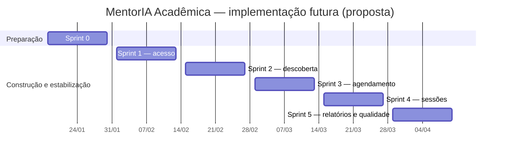

---

## 5. Custos profissionais

### 5.1 Referências salariais pesquisadas (06/11/2026)

| Cargo | Fonte | P25 | **P50** | P75 |
|---|---|---:|---:|---:|
| Arquiteto de Software — Recife | [Robert Half — Guia Salarial 2027](https://www.roberthalf.com/br/pt/vagas-detalhes/arquiteto-de-software/recife) (atualizado em 30/10/2026) | 12.550 | **16.400** | 21.150 |
| Desenvolvedor(a) Full-Stack Pleno — Recife | [Robert Half — Guia Salarial 2027](https://www.roberthalf.com/br/pt/vagas-detalhes/desenvolvedora-full-stack-pleno/recife) (atualizado em 30/10/2026) | 9.800 | **12.750** | 16.400 |
| Analista de Testes Pleno — Recife | [Robert Half — Guia Salarial 2026](https://www.roberthalf.com/br/pt/vagas-detalhes/analista-de-testes-pleno/recife) | 6.700 | **8.750** | 11.250 |
| Desenvolvedor(a) Full-Stack Sênior — Brasil | [Robert Half](https://www.roberthalf.com/br/pt/vagas-detalhes/desenvolvedora-full-stack-senior/recife) (referência) | 13.050 | 15.900 | 20.500 |

**Glassdoor (consultado conforme pedido):** a maioria das páginas do [glassdoor.com.br](https://www.glassdoor.com.br/) bloqueou a leitura automatizada. As que abriram mostram médias autodeclaradas, sem separar senioridade: [QA Analyst](https://www.glassdoor.com.br/Sal%C3%A1rios/qa-analyst-sal%C3%A1rio-SRCH_KO0,10.htm) com **R$ 4 mil/mês** (faixa de R$ 3 a 7 mil) e [Desenvolvedor Full Stack Júnior](https://www.glassdoor.com.br/Sal%C3%A1rios/desenvolvedor-full-stack-j%C3%BAnior-sal%C3%A1rio-SRCH_KO0,31.htm) com **R$ 3 mil/mês** (R$ 2 a 4 mil). Como a equipe planejada é plena, adota-se a Robert Half, que publica faixas por cargo, nível e cidade. O Glassdoor indica o piso do mercado. Os valores das duas fontes estão em R$ por mês.

### 5.2 Encargos CLT (empresa no Lucro Presumido)
Base: [Valor Final — custo do funcionário CLT](https://valorfinal.com.br/guia/custo-funcionario), atualizado em 31/10/2026.

| Componente | % sobre o salário |
|---|---:|
| INSS patronal | 20,00% |
| RAT (adotado 2%) | 2,00% |
| Terceiros (Sistema S) | 5,80% |
| FGTS | 8,00% |
| Provisão de 13º | 8,33% |
| Provisão de férias + 1/3 | 11,11% |
| Incidência de INSS/RAT/terceiros/FGTS sobre 13º e férias (35,8% × 19,44%) | 6,96% |
| **Total de encargos** | **≈ 62,2%** |

Benefícios (vale-refeição e plano de saúde): **R$ 1.000/mês por pessoa** (premissa). A multa de 40% do FGTS só incide em desligamento e não entra no cálculo.

### 5.3 Custo mensal da equipe (cenário base = P50)

| Profissional | Salário | Encargos (62,2%) | Benefícios | **Custo mensal** |
|---|---:|---:|---:|---:|
| Tech Lead / Arquiteto de Software | 16.400,00 | 10.200,72 | 1.000,00 | **27.600,72** |
| Desenvolvedor Full Stack Pleno 1 | 12.750,00 | 7.930,44 | 1.000,00 | **21.680,44** |
| Desenvolvedor Full Stack Pleno 2 | 12.750,00 | 7.930,44 | 1.000,00 | **21.680,44** |
| Analista de Testes Pleno | 8.750,00 | 5.442,46 | 1.000,00 | **15.192,46** |
| **Total** | **50.650,00** | **31.504,06** | **4.000,00** | **R$ 86.154,06** |

### 5.4 Custo total da equipe (12 semanas ≈ 2,77 meses)

Conversão de semanas para meses: **12 semanas × 12 meses ÷ 52 semanas/ano = 2,76923 meses**.
Os valores mensais são os da tabela da seção 5.3, que são **estimativas** com
encargos de 62,2% (aproximação), sujeitos à contratação efetiva.

| Cenário | Salários usados | Custo mensal | **Custo de 12 semanas** |
|---|---|---:|---:|
| Econômico | P25 | R$ 67.014,70 | **R$ 185.579** |
| **Base** | **P50** | **R$ 86.154,06** | **R$ 238.580** |
| Conservador | P75 | R$ 109.754,40 | **R$ 303.935** |

---

## 6. Custos de infraestrutura AWS

### 6.1 Preços oficiais verificados em 06/11/2026
Fonte: [Amazon Lightsail Pricing](https://aws.amazon.com/lightsail/pricing) e [Lightsail instance bundles](https://docs.aws.amazon.com/lightsail/latest/userguide/amazon-lightsail-bundles.html).

| Item | Plano | Especificação | Preço oficial |
|---|---|---|---:|
| Staging | Linux **Micro-1GB** (IPv4) | 2 vCPU · 1 GB RAM · 40 GB SSD · 2 TB de tráfego | **US$ 7,00/mês** |
| Produção | Linux **Small-2GB** (IPv4) | 2 vCPU · 2 GB RAM · 60 GB SSD · 3 TB de tráfego | **US$ 12,00/mês** |
| Snapshots (manuais e automáticos) | — | por GB armazenado | US$ 0,05/GB-mês |
| IP estático | — | incluído no plano | US$ 0,00 |
| Object Storage (cópia externa dos dumps) | Bucket de 5 GB | 5 GB + 25 GB de tráfego | US$ 1,00/mês |
| Load Balancer | — | **não usado** (sem redundância) | (US$ 18,00/mês) |

**Região:** proposta **São Paulo (sa-east-1)**, pela menor latência para usuários brasileiros e por manter os dados no país. A página oficial não mostra preço de plano diferente por região, mas informa que em São Paulo a **franquia de tráfego é a metade** (1 TB no staging e 1,5 TB na produção), o que sobra para o volume previsto. A tarifa de excedente em São Paulo é a mais alta da tabela (US$ 0,15/GB no Object Storage). **Confirmar o preço no console da AWS ao criar as instâncias.**

### 6.2 Custo mensal estimado

| Cenário | Composição | US$/mês | R$/mês (×5,7429) | R$/mês com tributos* |
|---|---|---:|---:|---:|
| Mínimo (só instâncias) | 7 + 12 | 19,00 | 109,12 | 122,37 |
| **Realista** | + snapshots de produção (~15 GB → 0,75) + snapshot de staging (~10 GB → 0,50) + bucket (1,00) | **21,25** | 122,04 | **136,86** |
| Pessimista | snapshots no tamanho total dos discos (60 GB → 3,00; 40 GB → 2,00) + bucket | 25,00 | 143,57 | 161,02 |

\* Se a fatura vier da **AWS Serviços Brasil** (com CPF/CNPJ), ela é emitida **em reais** e inclui **PIS/COFINS de 9,25% e ISS de 2,9%** ([AWS Tax Help — Brasil](https://aws.amazon.com/pt/tax-help/Brazil/)). A coluna aplica +12,15% como aproximação. Se a cobrança for feita em dólar no cartão, entra o IOF da operação em vez desses tributos.

**Custos adicionais fora da AWS:** domínio `.com.br` por **≈ R$ 40/ano** (referência: [HostGator, R$ 39,99](https://hostgator.com.br/blog/quanto-custa-um-dominio/); confirmar no Registro.br) e certificado TLS do **Let's Encrypt, gratuito**.

**Comparação com o documento do grupo:** o `00-decisoes-compartilhadas.md` previa US$ 19 de base e US$ 21,60–23,60 como total ilustrativo. A estimativa verificada fica entre **US$ 21,25 (realista) e US$ 25,00 (pessimista)**, compatível com a faixa do grupo.

### 6.3 Custo anual de operação (cenário realista)
**US$ 255,00/ano ≈ R$ 1.642/ano** com tributos, mais o domínio.

---

## 7. Custo total do projeto (cenário base)

A conta abaixo considera **12 semanas de equipe** (Sprint 0 + S1–S5),
**três meses completos de infraestrutura** no cenário realista, incluindo
staging e produção durante todo o período por prudência, e um domínio anual.
Essa estimativa é mais conservadora do que cobrar produção apenas após o go-live.

| Item | Valor estimado |
|---|---:|
| Equipe por 12 semanas, cenário P50 | **R$ 238.580,47** |
| Infraestrutura por 3 meses × R$ 136,86 (aprox. com tributos) | **R$ 410,58** |
| Domínio `.com.br` por 1 ano (estimado) | **R$ 40,00** |
| **Subtotal** | **R$ 239.031,05** |
| Contingência de 10% do subtotal | **R$ 23.903,11** |
| **Total estimado** | **R$ 262.934,16** |

**Sensibilidade:** câmbio, regime de contratação, remuneração real, impostos,
consumo de backup, região e duração efetiva podem alterar a estimativa. A
premissa US$1 = R$5,7429 é apenas referência de 05/11/2026, não cotação atual.

---

## 8. Matriz de riscos — integrada aos cinco riscos de Hadson

Escala adotada pelo Bloco 1: **P = probabilidade (1–5)**,
**I = impacto (1–5)**, **severidade = P × I (1–25)**.
R01 a R05 conservam as avaliações de Hadson, sem alterá-las silenciosamente.

| ID | Risco | P | I | Severidade | Mitigação | Responsável |
|---|---|---:|---:|---:|---|---|
| R01 | Baixa adesão dos mentores | 3 | 5 | **15** | Convite institucional, piloto com dez mentores, reconhecimento das horas | Coordenação / PO |
| R02 | Indisponibilidade da VM de produção | 2 | 4 | **8** | Snapshots e `pg_dump` externo; monitoramento e ensaio de restauração; RTO-meta de 4 h | Tech Lead |
| R03 | Vazamento de dados pessoais | 2 | 5 | **10** | RBAC, HTTPS, bcrypt, SQL parametrizado, restrição de firewall e revisão de logs | Tech Lead |
| R04 | Estouro do escopo e do prazo | 4 | 4 | **16** | MoSCoW, Sprint Review e exclusões explícitas | PO |
| R05 | Reserva duplicada por concorrência | 3 | 4 | **12** | Transação, bloqueio `FOR UPDATE`, índice parcial e teste real | Desenvolvedor backend |
| R06 | Backup não restaurável | 3 | 5 | **15** | Cópia externa e teste de restauração em staging | QA / Infraestrutura |
| R07 | Rotina de expiração falhar | 3 | 3 | **9** | Job periódico, alerta e verificação transacional antes de nova reserva | Backend |
| R08 | API não coincidir com os RF e a modelagem | 3 | 4 | **12** | Revisão conjunta dos contratos OpenAPI, SQL e UML a cada mudança | Trio / Tech Lead |
| R09 | Desempenho não alcançar p95 ≤ 300 ms no cenário de 150 simultâneos | 3 | 4 | **12** | Índices, paginação, teste de carga na Sprint 5 e redimensionamento da VM | Backend |
| R10 | Fuga de segredos para GitHub | 2 | 5 | **10** | `.env` fora do versionamento, secret scanning e rotação de credenciais | Tech Lead |
| R11 | Variação cambial e impostos | 3 | 2 | **6** | Reserva de contingência e revisão da planilha antes de contratar | PO / Financeiro |
| R12 | Ausência de integrante do time hipotético | 3 | 3 | **9** | Revisão cruzada, documentação, pareamento e backup de responsáveis | Tech Lead |

Os riscos R01–R05 derivam do `01-concepcao.md` de Hadson. Os demais são
riscos de execução futura propostos na análise técnica de Guilherme. Não há
risco “backlog oficial indisponível”: as 16 histórias já foram incorporadas.

---

## 9. Pontos pendentes para aprovação do trio

- Validar formalmente as premissas do orçamento e a pesquisa salarial na data da contratação.
- Confirmar a região AWS, política de retenção e execução dos procedimentos de backup.
- Executar as consultas e o `schema.sql` em PostgreSQL de teste sob responsabilidade do Guilherme após as alterações de RF008.
- Política de cadastro administrativo especificada na RN12: aceite comprovado do próprio titular, registrado por data e referência institucional; sem evidência, conta não é criada.
- Conferir se o diagrama de classes de Kennedy apresenta o modelo unificado (incluindo `PerfilMentor`, `LogAuditoria` e os atributos temporais derivados de `Agendamento`).


---

# Bloco 8 — Documentação do Desenvolvedor

**Projeto:** MentorIA Acadêmica · **Responsável:** Guilherme · **Equipe:** Hadson, Kennedy e Guilherme
**Versão:** 1.0 · **Data:** 08/11/2026

> A aplicação **ainda não foi implementada**. Este guia define como ela será construída, para que qualquer desenvolvedor da equipe futura comece a Sprint 1 com padrões claros e coerentes com a arquitetura (Kennedy), os requisitos (Hadson) e o banco (Bloco 5).

**Artefatos deste bloco:** [`README.md`](README.md) · [`.env.example`](.env.example) · [`api/openapi.yaml`](api/openapi.yaml)

---

## 1. Visão geral do código

- **Monólito modular:** um processo Node.js 24 + Express 5 serve `public/` (frontend) e `/api` (REST).
- **Seis módulos** em `src/modulos/`: `autenticacao`, `usuarios`, `mentorias`, `agendamentos`, `avaliacoes` e `administracao`. Eles estão mapeados para os 5 módulos do C4 de Kennedy no [diagrama de componentes](diagramas/imagens/uml-componentes.png).
- **Um módulo não acessa as tabelas de outro.** Ele chama a interface interna do outro (por exemplo, `usuariosService.buscarAtivo(id)`). As tabelas de cada módulo estão listadas no diagrama de componentes.
- **Núcleo compartilhado** (`src/core/`): pool do `pg` e `transacao()`, configuração (`dotenv`), erros e middlewares.

```text
src/
├── app.js  · server.js
├── core/
│   ├── config/env.js          # lê e valida o .env (dotenv)
│   ├── db/pool.js             # Pool do pg + transacao(fn)
│   ├── erros/AppError.js      # NaoEncontrado, Conflito, SemPermissao, DadosInvalidos…
│   ├── erros/traduzirErroPg.js
│   └── middlewares/           # autenticar.js, autorizar.js, validar.js, tratarErros.js
└── modulos/agendamentos/
    ├── agendamentos.routes.js
    ├── agendamento.controller.js
    ├── agendamento.service.js
    ├── agendamento.repository.js
    └── expiracao.job.js       # rotina de 48 h
```

---

## 2. Padrões de projeto

### 2.1 Repository: só SQL, sempre parametrizado
O Repository é a **única** camada que fala com o PostgreSQL. Ele não contém regra de negócio.
```js
// src/modulos/agendamentos/agendamento.repository.js
export async function inserir(client, a) {
  const { rows } = await client.query(
    `INSERT INTO agendamentos (disponibilidade_id, estudante_id, mentor_id, disciplina_id,
                               inicio_em, duracao_minutos, observacao)
     VALUES ($1, $2, $3, $4, $5, $6, $7)
     RETURNING *`,
    [a.disponibilidadeId, a.estudanteId, a.mentorId, a.disciplinaId, a.inicioEm, a.duracaoMinutos, a.observacao ?? null]
  );
  return paraCamelCase(rows[0]);
}
```
- **Proibido** montar SQL com *template string* contendo dados do usuário (`WHERE email = '${email}'`), porque isso abre caminho para SQL injection. Valores entram sempre como `$1, $2…`.
- Nomes de colunas dinâmicos (como a ordenação) só podem vir de uma *lista branca* (`{ data: 'inicio_em', status: 'status' }`).
- O Repository recebe o `client` da transação quando a operação faz parte de uma.

### 2.2 Service Layer: regras de negócio e transações
```js
// src/modulos/agendamentos/agendamento.service.js
export async function solicitar(usuario, dados) {
  return transacao(async (client) => {
    const disp = await disponibilidadeRepo.bloquearPorId(client, dados.disponibilidadeId); // SELECT … FOR UPDATE
    if (!disp) throw new NaoEncontrado('Disponibilidade inexistente');
    await agendamentoRepo.expirarPendentesVencidos(client, disp.id);                    // expiração preguiçosa
    return agendamentoRepo.inserir(client, { ...dados, estudanteId: usuario.id,
      mentorId: disp.mentorId, inicioEm: disp.inicioEm, duracaoMinutos: disp.duracaoMinutos });
  });
}
```
- Valida **titularidade** (só o mentor do agendamento confirma; só o estudante do agendamento avalia).
- Abre a transação quando há mais de uma escrita (ex.: concluir = atualizar o status + criar a sessão).
- Nunca conhece `req` nem `res`.

### 2.3 Controller: fino
```js
// src/modulos/agendamentos/agendamento.controller.js
export async function criar(req, res) {
  const agendamento = await agendamentoService.solicitar(req.usuario, req.body);
  res.status(201).location(`/api/agendamentos/${agendamento.id}`).json(agendamento);
}
```
O Controller traduz HTTP ↔ Service e define o status de sucesso. No Express 5, erros de funções `async` chegam automaticamente ao middleware de erro, sem precisar de `try/catch` em cada rota.

### 2.4 Pipeline de cada rota protegida
```js
router.patch('/:id/status',
  autenticar,                                  // valida o JWT (15 min) e recarrega ativo/perfil no banco
  autorizar('ESTUDANTE', 'MENTOR'),            // RBAC (x-perfis-permitidos do OpenAPI)
  validar(esquemaAlteracaoStatus),             // corpo e parâmetros → 422
  agendamentoController.alterarStatus);        // titularidade é verificada no Service → 403
```

---

## 3. Convenções de código

| Tema | Convenção |
|---|---|
| Módulos JS | ES Modules (`"type": "module"` no `package.json`) |
| Nomes | `camelCase` para variáveis e funções, `PascalCase` para classes, `UPPER_SNAKE` para constantes; arquivos `nome.camada.js` |
| Idioma | Domínio em **português, sem acento** (`agendamento`, `disponibilidade`), igual ao banco e ao UML |
| Banco ↔ JSON | `snake_case` no SQL e `camelCase` no JSON, convertidos no Repository |
| Async | `async/await`; nada de *callbacks* |
| Datas | ISO 8601 com fuso na API; `timestamptz` no banco |
| Rotas | Substantivos no plural (`/api/agendamentos`); ação de estado via `PATCH …/status` |
| Status HTTP | 200 leitura/alteração · 201 criação (+ `Location`) · 204 sem corpo · 401 · 403 · 404 · **409 conflito** · 422 validação |
| Tamanho | Funções curtas, uma responsabilidade; Controller sem SQL; Repository sem regra |
| Comentários | Explicam o **porquê**, não o óbvio |

---

## 4. Segurança

| Ameaça | Controle |
|---|---|
| SQL injection | Consultas parametrizadas (`pg`), sem ORM e sem concatenação |
| Senhas vazadas | `bcryptjs` com custo 12; o hash nunca é devolvido pela API; o banco rejeita valor que não seja hash bcrypt |
| Token roubado | JWT de **15 min** sem *refresh*; segredo forte no `.env`; o usuário desativado perde o acesso na próxima requisição |
| Acesso indevido | RBAC por rota + titularidade no Service + visões anônimas para a coordenação |
| Força bruta no login | Nginx `limit_req` em `/api/auth/login` (429); mensagem genérica de erro |
| Tráfego interceptado | HTTPS obrigatório (Let's Encrypt); HTTP redireciona com 301 |
| Banco exposto | PostgreSQL só em `localhost`; porta 5432 fechada no firewall do Lightsail |
| XSS no frontend | Inserir dados com `textContent`, nunca `innerHTML` com dado do usuário; cabeçalho `Content-Security-Policy` no Nginx |
| Segredos no Git | `.env` no `.gitignore`; apenas `.env.example`; *secret scanning* do GitHub |
| Excesso de dados (LGPD) | Respostas trazem só os campos necessários; logs sem senha, token ou corpo de requisição |

---

## 5. Tratamento de erros

Formato único (schema `Erro` do OpenAPI):
```json
{ "codigo": "HORARIO_INDISPONIVEL", "mensagem": "Este horário acabou de ser reservado.", "regra": "ux_agendamentos_disponibilidade_ativa" }
```

**Tradução de erros do PostgreSQL** (`core/erros/traduzirErroPg.js`):

| `err.code` | Significado | HTTP | Código da API |
|---|---|---|---|
| `23505` | unique_violation | **409** | `EMAIL_JA_CADASTRADO`, `HORARIO_INDISPONIVEL`, `AVALIACAO_DUPLICADA` (pelo `err.constraint`) |
| `23P01` | exclusion_violation | **409** | `HORARIO_SOBREPOSTO`, `RESERVA_SOBREPOSTA` |
| `23514` | check_violation / regra `rn_*` | **409** (estado: transição, último administrador) ou **422** (dado: nota, horário passado) | conforme `err.constraint` |
| `23503` | foreign_key_violation | 404 ou 409 | `NAO_ENCONTRADO`, `REFERENCIA_INVALIDA` |
| outros | erro inesperado | 500 | `ERRO_INTERNO` (detalhe só no log do servidor) |

```js
// core/middlewares/tratarErros.js
export function tratarErros(err, req, res, _next) {
  const e = err instanceof AppError ? err : traduzirErroPg(err);
  if (e.status >= 500) logger.error({ err, rota: req.originalUrl }); // nunca logar req.body
  res.status(e.status).json({ codigo: e.codigo, mensagem: e.mensagem, regra: e.regra, detalhes: e.detalhes });
}
```

---

## 6. Testes

| Tipo | Ferramenta | Onde | O que cobre |
|---|---|---|---|
| Unitário | `node:test` + `node:assert` | `tests/unit` | Services com repositórios simulados (transições, titularidade) |
| Integração | `node:test` + Supertest + PostgreSQL de teste | `tests/integration` | Cada rota do OpenAPI: sucesso, 401, 403, 404, **409** e 422 |
| Concorrência | `Promise.all` com duas requisições | `tests/integration` | Duas reservas simultâneas → um 201 e um 409 |
| E2E | Playwright | `tests/e2e` | Cadastro → busca → solicitação → confirmação → conclusão → avaliação |
| Banco | `sql/testes-validacao.sql` | pgAdmin/psql | 38 regras de integridade |

```js
// tests/integration/agendamentos.test.js
test('dois estudantes no mesmo horário: um 201 e um 409', async () => {
  const [a, b] = await Promise.all([
    request(app).post('/api/agendamentos').set('Authorization', `Bearer ${tokenAna}`).send(pedido),
    request(app).post('/api/agendamentos').set('Authorization', `Bearer ${tokenBruno}`).send(pedido),
  ]);
  assert.deepEqual([a.status, b.status].sort(), [201, 409]);
});
```
Meta de cobertura: a definida por Hadson no Bloco 9. Até lá, a referência é **≥ 80% nas camadas Service**.

---

## 7. Git e GitHub

### 7.1 Branches
| Branch | Uso | Deploy |
|---|---|---|
| `main` | Código em produção; protegida | Produção (Lightsail 2 GB) |
| `develop` | Integração da sprint; protegida | Staging (Lightsail 1 GB) |
| `feature/<item>-<descricao>` | Uma história ou item do backlog (`feature/US008-solicitar-agendamento`) | — |
| `fix/<descricao>` | Correção em `develop` | — |
| `hotfix/<descricao>` | Correção urgente a partir de `main` | Produção, com *merge* de volta em `develop` |

### 7.2 Commits (Conventional Commits, em português)
```text
feat(agendamentos): retorna 409 quando o horário já está reservado
fix(auth): recusa token de usuário desativado
test(avaliacoes): cobre avaliação duplicada
docs(api): documenta PATCH /agendamentos/{id}/status
db(migrations): V002 adiciona índice de pendentes
chore: atualiza dependências
```
Commits pequenos, no imperativo, com uma mudança lógica cada.

### 7.3 Pull Requests
- Todo código entra por PR para `develop` (ou `main`, só em *hotfix*).
- **Pelo menos 1 aprovação** de outro membro; o autor não aprova o próprio PR.
- O CI do GitHub roda `npm test`, que precisa passar.
- **Checklist do PR:** história vinculada · testes novos · OpenAPI atualizado se a rota mudou · migração versionada se o banco mudou · nada de segredo no diff · `README` e docs atualizados.
- *Squash merge* com mensagem no padrão de commits.

---

## 8. Deploy (staging e produção)

```bash
# Na instância Lightsail (SSH com chave)
cd /opt/mentoria-academica
git pull origin develop            # main em produção
npm ci --omit=dev
npm run db:migrate                 # migrações compatíveis (expandir → migrar → contrair)
sudo systemctl restart mentoria    # unit systemd; o Nginx continua atendendo
```

```nginx
# /etc/nginx/sites-available/mentoria (trecho)
server { listen 80; server_name mentoria-academica.com.br; return 301 https://$host$request_uri; }
server {
  listen 443 ssl;
  server_name mentoria-academica.com.br;
  ssl_certificate     /etc/letsencrypt/live/mentoria-academica.com.br/fullchain.pem;
  ssl_certificate_key /etc/letsencrypt/live/mentoria-academica.com.br/privkey.pem;
  location /api/auth/login { limit_req zone=login burst=5; proxy_pass http://127.0.0.1:3000; }
  location / { proxy_pass http://127.0.0.1:3000; proxy_set_header X-Forwarded-For $remote_addr; }
}
```

---

## 9. Sprint 1 — planejamento detalhado (backlog oficial)

**Responsável pela priorização:** Hadson (PO). Fonte: `docs/02-requisitos.md` e
cronograma `docs/09-qualidade.md`. **Sprint 0** já previu criação do repositório,
configuração de banco, pipeline, migrações e estudos técnicos. Portanto essas
tarefas não recebem story points novamente.

**Período ilustrativo:** 01/02/2027 a 12/02/2027 · **Compromisso: 17 pontos**.

**Meta:** permitir autocadastro de estudantes, autenticação JWT de 15 minutos,
autorização RBAC e gestão administrativa de contas, perfis e catálogo.

| História oficial | Pontos | Tarefas principais | Responsável proposto |
|---|---:|---|---|
| **US001** Cadastro de estudante (RF001) | 3 | `POST /api/usuarios`, obrigatoriamente perfil ESTUDANTE; validação, senha bcryptjs (12 rounds), aceite de privacidade e teste de e-mail duplicado | Dev Full Stack 1 |
| **US002** Login/logout (RF002) | 3 | `POST /api/auth/login`, JWT 15 min, tela de login/logout, revogação lógica por expiração e checagem de usuário ativo por requisição, limitação de tentativas | Dev Full Stack 2 |
| **US003** Gestão de usuários e perfis (RF004–RF005) | 8 | `POST /api/administracao/usuarios`, `PATCH /api/administracao/usuarios/{id}`, proteção do último administrador, desativação com cancelamento dos agendamentos ativos futuros, auditoria, testes 401/403 | Devs + Tech Lead |
| **US016** Catálogo de disciplinas (RF021) | 3 | Administração cria, edita, inativa e reativa disciplinas; `GET /api/disciplinas`; impedir exclusão física com histórico | Dev Full Stack 1 |
| **Total** | **17** | Revisão de código, documentação OpenAPI e testes de integração incluídos no trabalho das histórias | Equipe |

### 9.1 Exemplos de critérios de aceite Given/When/Then

- **US001:** Dado um e-mail institucional válido ainda não cadastrado, quando o estudante aceita a política e envia o cadastro, então o backend cria uma conta `ESTUDANTE`, sem permitir seleção de `MENTOR`.
- **US002:** Dado um usuário ativo, quando faz login válido, então recebe JWT de 15 min; dado um usuário inativo, mesmo com token válido, quando acessa rota protegida, então recebe 401.
- **US003:** Dado um administrador com data e referência de aceite já prestado pelo titular, quando cria um mentor, então a conta tem perfil `MENTOR`, registra origem `INSTITUCIONAL` e referência no banco e audita a ação; sem evidência a API retorna 422; dado o último administrador ativo, quando tenta se desativar, então recebe erro de conflito.
- **US016:** Dado uma disciplina com histórico, quando o administrador a inativa, então novas associações são proibidas mas o histórico persiste.

### 9.2 Definition of Done (DoD)

Para o aceite vale integralmente a DoD mais completa definida por Hadson no
`docs/09-qualidade.md`, incluindo revisão de PR, 100% das rotas com testes de
integração, RBAC 401/403, OpenAPI atualizado, consultas parametrizadas,
segredos fora do Git, responsividade, mensagens em português e validação em
ambiente de teste. As metas gerais são ≥75% de linhas no backend, ≥80% nos
serviços e ≥90% nas regras críticas, sem queda de cobertura por PR.

A Sprint 1 é **plano hipotético**, não software implementado nem testes executados
na API. A validação original relatada por Guilherme diz respeito ao SQL do banco;
a revisão posterior deve executar novamente o DDL atualizado.

### Regras administrativas para implementação — RN11–RN13

- **RN11:** antes de mudar perfil de mentor/estudante, resolver reservas futuras ativas e inativar disponibilidades futuras. Banco recusa alteração incompatível; HTTP 409.
- **RN12:** criação administrativa exige aceite do titular previamente documentado; requer `aceiteTitularEm` e `referenciaAceite`, sem consentimento prestado pelo administrador. Sem evidência: HTTP 422.
- **RN13:** editar horários só sem histórico; com histórico, inativar e criar novo, desde que não exista reserva ativa.

O funcionamento é uma especificação de implementação, não endpoint em produção.


---

# MentorIA Acadêmica — Bloco 9: Qualidade e Processo

**Responsável:** Hadson — Pessoa 1, Analista de Requisitos / Product Owner · **Versão:** 1.2 · **Data:** 06/11/2026

Documentos relacionados: [Bloco 1 — Concepção e Escopo](docs/01-concepcao.md) (inclui as premissas P1 a P6) · [Bloco 2 — Requisitos](docs/02-requisitos.md) · Diagramas: [`diagrama-casos-de-uso.drawio`](diagramas/editaveis/diagrama-casos-de-uso.drawio), [`diagrama-atividades-agendamento.drawio`](diagramas/editaveis/diagrama-atividades-agendamento.drawio), [`diagrama-atividades-administrativo.drawio`](diagramas/editaveis/diagrama-atividades-administrativo.drawio)

### 

## 9.1 Glossário

Um vocabulário único evita que o código, o banco e a documentação usem nomes diferentes para a mesma coisa. Os termos abaixo valem para a equipe inteira.

|Termo|Definição|
|-|-|
|**Mentoria**|Atividade de apoio acadêmico em que um mentor ajuda um estudante em uma disciplina.|
|**Sessão**|Um encontro individual de mentoria, com data, hora e duração. No sistema, corresponde a um agendamento que chegou ao status CONCLUIDO.|
|**Estudante**|Usuário que busca mentores, solicita agendamentos e avalia sessões.|
|**Mentor**|Usuário que oferece mentoria em uma ou mais disciplinas, publica horários e decide os pedidos.|
|**Coordenador**|Usuário que acompanha mentorias e consulta relatórios; não altera agendamentos.|
|**Administrador**|Usuário que gerencia contas e perfis.|
|**Perfil (papel)**|Conjunto de permissões de um usuário (RBAC). Cada usuário tem exatamente um perfil nesta versão.|
|**Disciplina**|Componente curricular do catálogo (ex.: Cálculo II).|
|**Catálogo de disciplinas**|Lista oficial de disciplinas, mantida pelo administrador (RF021); os mentores escolhem apenas dela.|
|**Log de auditoria**|Registro de inserção apenas das ações administrativas (autor, ação, alvo, data/hora), sem senha ou token (RNF024).|
|**Disponibilidade (horário)**|Intervalo de tempo publicado por um mentor em que ele pode atender.|
|**Agendamento**|Solicitação de um estudante para ocupar uma disponibilidade, com status próprio.|
|**Agendamento ativo**|Agendamento em status PENDENTE ou CONFIRMADO. Só pode existir um por disponibilidade.|
|**Status**|Estado do agendamento: PENDENTE, CONFIRMADO, RECUSADO, CANCELADO, EXPIRADO ou CONCLUIDO.|
|**Avaliação**|Nota de 1 a 5 e comentário opcional dados pelo estudante a uma sessão concluída.|
|**RBAC**|Controle de acesso baseado em perfis: o que o usuário pode fazer depende do seu perfil.|
|**JWT**|Token assinado que prova a identidade do usuário nas chamadas à API.|
|**Exclusão lógica**|Marcar o registro como inativo em vez de apagá-lo, preservando o histórico.|
|**MoSCoW**|Técnica de priorização: Must, Should, Could, Won’t.|
|**MVP**|Menor versão do produto que entrega o fluxo principal completo (os requisitos Must).|
|**LGPD**|Lei Geral de Proteção de Dados Pessoais (Lei 13.709/2018).|
|**ADR**|Registro de Decisão de Arquitetura: documento curto que explica uma decisão técnica e as alternativas descartadas.|

**Decisão de vocabulário:** usar “agendamento” para o pedido e “sessão” apenas para o encontro realizado, e “disponibilidade” no código e na API (`availability`), “horário” na interface. **Justificativa:** o enunciado mistura “horário”, “agendamento” e “sessão”; fixar o sentido de cada um evita bugs de interpretação entre frontend, backend e testes.

## 9.2 Modelo de domínio

O modelo abaixo é **conceitual**, ou seja, descreve o negócio e não as tabelas. O desenho físico do banco e os diagramas formais (classes e estados em diagrams.net) partem destas definições.

### Entidades e atributos principais

**Nomenclatura compartilhada para o DBA:** `SessaoMentoria` é o nome canônico para o antigo `RegistroSessao`. As entidades de apoio `PerfilMentor` e `LogAuditoria` devem constar na modelagem lógica se as funcionalidades correspondentes permanecerem no escopo. Consulte [modelo do banco](docs/05-banco.md) e [dicionário de dados](docs/dicionario-dados.md).

|Entidade|Atributos principais|Regra central|
|-|-|-|
|**Usuário**|id, nome, e-mail, senha (hash), perfil, ativo, aceite da privacidade (data/hora)|E-mail único; exclusão lógica.|
|**PerfilMentor**|usuário, biografia, formação, contato da sessão|Existe apenas para usuários com perfil Mentor.|
|**Disciplina**|id, nome, código, ativa|Catálogo único, mantido pelo administrador (RF021); disciplina inativa não recebe novas associações e não pode ser excluída se houver mentor ou agendamento ligado (RN09).|
|**MentorDisciplina**|mentor, disciplina|Associação muitos-para-muitos sem repetição.|
|**Disponibilidade**|id, mentor, início, duração (30/45/60), ativa|Sem sobreposição para o mesmo mentor; só datas futuras.|
|**Agendamento**|id, disponibilidade, estudante, disciplina, observação, status, justificativa, criado em, respondido em|No máximo um ativo por disponibilidade.|
|**SessaoMentoria**|agendamento, compareceu, duração real, observações|Um por agendamento concluído.|
|**Avaliação**|agendamento, nota (1 a 5), comentário, data|Uma por sessão; só se compareceu.|
|**Notificação**|usuário, mensagem, lida, data|Opcional (RF018, Could).|
|**LogAuditoria**|id, administrador, ação, alvo (tipo e id), data/hora|Somente inserção; sem senha ou token; retenção de 12 meses (RNF024).|

### Relacionamentos

|Relacionamento|Cardinalidade|Observação|
|-|-|-|
|Usuário (Mentor) — Disponibilidade|1 para N|Um mentor publica várias disponibilidades.|
|Mentor — Disciplina|N para N|Via MentorDisciplina.|
|Disponibilidade — Agendamento|1 para N (histórico), **no máximo 1 ativo**|Pode ter vários agendamentos ao longo do tempo (recusados, cancelados), mas apenas um ativo.|
|Usuário (Estudante) — Agendamento|1 para N|Um estudante solicita vários agendamentos.|
|Agendamento — SessaoMentoria|1 para 0..1|Existe após a conclusão.|
|Agendamento — Avaliação|1 para 0..1|Existe se o estudante avaliar.|
|Usuário (Administrador) — LogAuditoria|1 para N|Cada ação administrativa gera um registro.|

### Ciclo de vida do agendamento (máquina de estados)

|De|Para|Quem dispara|Condição|
|-|-|-|-|
|(novo)|PENDENTE|Estudante|Disponibilidade livre; sem conflito do estudante|
|PENDENTE|CONFIRMADO|Mentor|Dono da disponibilidade|
|PENDENTE|RECUSADO|Mentor|Justificativa obrigatória|
|PENDENTE|EXPIRADO|Sistema|48 h sem resposta|
|PENDENTE ou CONFIRMADO|CANCELADO|Estudante (até 2 h antes), Mentor (com justificativa) ou Sistema (quando o administrador desativa o mentor ou o estudante, RN07)|Antes do início|
|CONFIRMADO|CONCLUIDO|Mentor|Horário da sessão já passou|

**Decisão:** os estados finais não têm saída (um agendamento recusado não “volta”; o estudante cria outro). **Justificativa:** preserva a trilha de auditoria e simplifica os relatórios. **Alternativa descartada:** permitir reabrir agendamentos, que complicaria a regra de unicidade do horário ativo.

**Decisões finais de integração:** acrescentam-se RN11 (troca de perfil exige resolução de compromissos futuros), RN12 (cadastro administrativo com aceite prévio do próprio titular e referência de evidência) e RN13 (histórico de disponibilidade imutável). Vide [Bloco 2](docs/02-requisitos.md) e [contrato OpenAPI](api/openapi.yaml). São regras de projeto e devem receber testes de integração na implementação futura.

## 9.3 Estratégia de testes

### Princípios

1. **Pirâmide de testes:** muitos testes rápidos na base, poucos e caros no topo. Proporção-alvo: \~70% unitários, \~25% integração, \~5% E2E.
2. **Teste a regra de negócio, não o framework.** O valor está em RN01 a RN10 e nos RF, não em verificar o Express.
3. **Rastreabilidade:** cada história de usuário tem ao menos um teste por cenário Given/When/Then; o nome do teste cita o ID (ex.: `US008: bloqueia segunda solicitação ativa`).
4. **Ferramentas oficiais apenas** (escolhas fixadas no projeto): `node:test`, Supertest e Playwright.

### Níveis de teste

|Nível|Ferramenta|O que testa|Dados|Quando roda|
|-|-|-|-|-|
|**Unitário**|`node:test` (com `node:assert`)|Funções e serviços de regra: máquina de estados, sobreposição de horários, validações, hash, emissão e leitura de JWT. Banco simulado por funções falsas.|Dados em memória|A cada commit (local) e em cada pull request|
|**Integração**|`node:test` + Supertest|Rotas HTTP reais com PostgreSQL de teste: autenticação, RBAC (401/403), revalidação de usuário ativo e perfil a cada requisição (RN10), desativação com cancelamento em cascata (RN07), validações (400), conflito (409), índice único, paginação, concorrência.|Banco de teste separado, recriado por migração; limpeza entre testes|Em cada pull request|
|**E2E (planejado)**|Playwright|Jornadas completas no navegador, contra um ambiente de teste.|Massa de dados controlada (seed)|Antes de cada release e ao final de cada sprint|

**Decisão:** o PostgreSQL de teste é **real**, não um banco simulado, nos testes de integração. **Justificativa:** a regra mais crítica (um único agendamento ativo) é garantida por um índice do banco; um mock não a exerceria. **Alternativa descartada:** SQLite ou mocks de `pg`, mais rápidos, mas capazes de esconder erros reais de SQL e de concorrência.

### Jornadas E2E planejadas (Playwright)

|ID|Jornada|Cobre|
|-|-|-|
|E2E-1|Fluxo principal completo: estudante solicita → mentor confirma → mentor registra conclusão → estudante avalia|US008, US010, US012, US013|
|E2E-2|Conflito: dois estudantes disputam o mesmo horário|US008, US009|
|E2E-3|Recusa com justificativa e liberação do horário|US010|
|E2E-4|Controle de acesso: cada perfil só acessa suas telas|US003, US014|
|E2E-5|Coordenador gera relatório e exporta CSV|US014, US015|
|E2E-6|Responsividade em 360 px, 768 px e 1280 px|RNF021|
|E2E-7|Administrador desativa um mentor com agendamento ativo: o agendamento vira CANCELADO, o horário é liberado e o acesso do mentor é bloqueado na hora|US003, RNF007|

### Testes não funcionais

* **Carga:** script com k6 ou autocannon simulando 150 usuários simultâneos, uma vez por release (RNF001, RNF002).
* **Segurança:** `npm audit` em cada pull request; testes de 401/403 em todas as rotas (RNF009, RNF011).
* **Acessibilidade e desempenho:** Lighthouse nas telas principais a cada sprint (RNF003, RNF022).
* **Usabilidade:** teste com 5 usuários reais e questionário SUS no piloto (RNF020, RNF023).

### Automação

GitHub Actions executa unitários, integração (com PostgreSQL como serviço do pipeline) e `npm audit` em cada pull request. **Pull request só é aceito com pipeline verde e ao menos 1 revisão.** Os E2E rodam sob demanda e antes de cada release, por serem mais lentos e planejados como etapa posterior.

## 9.4 Metas de cobertura

|Escopo|Métrica|Meta mínima|Meta desejada|Justificativa|
|-|-|-|-|-|
|Regras de negócio (agendamento, disponibilidade, avaliação)|Linhas e ramificações|90%|95%|É o coração do produto e onde um erro causa prejuízo direto.|
|Serviços e utilitários (autenticação, validação)|Linhas|80%|90%|Segurança e validação precisam de alta confiança.|
|Todo o backend|Linhas|75%|85%|Meta global realista para equipe pequena.|
|Todo o backend|Ramificações|65%|75%|Ramificações são mais difíceis de cobrir; meta menor.|
|Rotas da API|Endpoints com teste de integração|100%|100%|Cada endpoint tem caminho feliz, 401/403 e um erro de validação.|
|Histórias de usuário Must|Cenários de aceite automatizados|100%|100%|Garante o MVP em conformidade com o aceite.|
|Jornadas críticas|Testes E2E|6 jornadas (E2E-1 a E2E-5 e E2E-7)|7 jornadas|Cobre o fluxo principal, o acesso e a desativação de usuários.|
|Frontend (JavaScript puro)|Cobertura|Não medida por número|Cobertura indireta via E2E|Medir o frontend simples por linhas gera pouco valor; o E2E valida o comportamento.|

**Como medir:** `node --test --experimental-test-coverage` (confirmar o nome exato da opção na documentação do Node 24 ao configurar). **Política:** a cobertura **não pode diminuir** em um pull request; se ficar abaixo da meta mínima, o pull request é bloqueado. **Ressalva:** cobertura alta não prova qualidade; por isso as metas por história e por jornada complementam os percentuais.

## 9.5 Definition of Ready (DoR)

Uma história só entra na sprint se atender a **todos** os itens:

* \[ ] Escrita no formato “Como \[persona], quero \[ação], para \[objetivo]”.
* \[ ] Tem critérios de aceite Given/When/Then, incluindo ao menos um cenário de erro.
* \[ ] Está ligada a um ou mais RF e a requisitos não funcionais aplicáveis.
* \[ ] Foi estimada em story points pelo time (Planning Poker) e não passa de 8 pontos; acima disso, é dividida.
* \[ ] Dependências identificadas (ex.: US008 depende de US005) e resolvidas ou planejadas.
* \[ ] Regras de negócio e textos de erro esclarecidos com o PO.
* \[ ] Protótipo ou esboço da tela disponível, se houver interface.
* \[ ] Cabe em uma sprint e é testável de forma independente.

**Por que importa:** história mal definida é a maior causa de retrabalho; a DoR protege a sprint e a equipe.

## 9.6 Definition of Done (DoD)

### Nível de história — uma história só está pronta se:

* \[ ] Todos os critérios de aceite foram implementados e demonstrados ao PO.
* \[ ] Código revisado por pelo menos 1 colega via pull request, sem pendências.
* \[ ] Testes unitários e de integração escritos e passando; pipeline do GitHub Actions verde.
* \[ ] Cobertura da história dentro das metas da seção 9.4, sem queda da cobertura geral.
* \[ ] Consultas SQL parametrizadas; nenhum segredo no código (tudo no `.env`, fora do GitHub).
* \[ ] Rotas protegidas por RBAC, com teste de 401 e 403.
* \[ ] Endpoint documentado no OpenAPI 3.0 e documentação em Markdown atualizada.
* \[ ] Interface responsiva (360 px a 1920 px) e sem erros no console do navegador.
* \[ ] Mensagens de erro em português claro e sem dados sensíveis em logs.
* \[ ] Implantada no ambiente de teste e sem defeitos conhecidos de severidade alta.

### Nível de sprint e de release

* \[ ] **Sprint:** todas as histórias da meta cumprem a DoD; Sprint Review feita com o PO; Retrospectiva registrada em Markdown.
* \[ ] **Release:** E2E-1 a E2E-5 e E2E-7 passando; teste de carga atendendo RNF001 e RNF002; `npm audit` sem altas ou críticas; backup restaurado com sucesso; HTTPS ativo e verificado; política de privacidade publicada.

## 9.7 Metodologia: Scrum

### Comparação Scrum × Kanban

|Critério|Scrum|Kanban|Melhor aqui|
|-|-|-|-|
|Estrutura de tempo|Sprints fixas de 2 semanas com meta|Fluxo contínuo, sem iterações|Scrum: o trabalho acadêmico tem prazos e entregas marcadas|
|Planejamento|Planning por sprint, estimativas em pontos|Pull contínuo, foco em lead time|Scrum: permite prever quanto cabe até a entrega|
|Papéis|Product Owner, Scrum Master, Time|Sem papéis obrigatórios|Scrum: o enunciado já define Hadson como PO|
|Mudança de prioridade|Entre sprints (protege o time)|A qualquer momento|Neutro: escopo fechado favorece Scrum|
|Cerimônias|Planning, Daily, Review, Retrospectiva|Opcionais|Scrum: a Review gera evidências para o trabalho acadêmico|
|Métricas|Velocidade, burndown|Lead time, WIP|Scrum: velocidade ajuda a negociar o escopo|
|Overhead|Médio|Baixo|Kanban, mas o overhead é aceitável para 4 pessoas|
|Adequação a suporte contínuo|Menor|Maior|Kanban seria melhor após a entrega, em manutenção|

**Decisão: Scrum, com um quadro Kanban dentro da sprint** (colunas A fazer, Em andamento, Em revisão, Pronto), no GitHub Projects.

**Justificativa:** (1) o prazo é fixo e acadêmico, o que combina com sprints com meta; (2) a equipe é pequena e inexperiente em processos, e os eventos do Scrum dão ritmo e pontos de verificação; (3) a velocidade medida permite renegociar escopo de forma objetiva usando a priorização MoSCoW; (4) a Sprint Review produz evidência documentada. **Alternativa descartada:** Kanban puro, por não dar previsibilidade de entrega. **Quando reconsiderar:** após a entrega, em fase de manutenção, o Kanban seria mais adequado.

### Adaptações honestas

* **Equipe de estudantes com outras matérias:** a capacidade real é menor que em um time profissional; por isso a velocidade assumida (20 a 25 pontos) é conservadora e será recalibrada após a Sprint 1.
* **Scrum Master:** função rotativa entre os membros a cada sprint, para todos praticarem a facilitação. Hadson mantém o papel fixo de PO.
* **Daily:** 15 minutos, assíncrona por mensagem em dias sem encontro presencial.

### Cerimônias

|Evento|Duração|Frequência|Resultado|
|-|-|-|-|
|Sprint Planning|1 h 30 min|Início da sprint|Meta e backlog da sprint|
|Daily|15 min|Diária (ou assíncrona)|Bloqueios identificados|
|Refinamento|1 h|Meio da sprint|Histórias prontas pela DoR|
|Sprint Review|1 h|Fim da sprint|Demonstração ao PO e feedback|
|Retrospectiva|45 min|Fim da sprint|1 a 3 melhorias acionáveis|

### Proposta de plano de sprints

|Sprint|Meta|Histórias|Pontos|
|-|-|-|-|
|0|Fundação: repositório, ambiente, pipeline, esquema do banco, spikes (PostgreSQL, Nginx)|Não pontuada|—|
|1|Acesso, administração e catálogo|US001, US002, US003, US016|17|
|2|Cadastros do mentor e descoberta|US004, US005, US006, US007|16|
|3|Solicitação e resposta (núcleo de risco)|US008, US009, US010|18|
|4|Fechamento do fluxo principal e acompanhamento|US011, US012, US013, US014|16|
|5|Relatórios e estabilização (E2E, carga, ajustes)|US015|8|
|**Total**||**16 histórias**|**75**|

**Por que essa ordem:**

* **US016 antes de US004:** o mentor só cadastra disciplinas se o catálogo existir.
* **US003 na Sprint 1 (8 pontos):** usuários, perfis e a revalidação por requisição (RN10) sustentam todas as demais histórias; é melhor acertar cedo.
* **US008 e US009 juntas na Sprint 3:** o índice único parcial e a resposta 409 nascem com a solicitação, e a Sprint 3 concentra o maior risco do MVP cedo o bastante para haver tempo de corrigir.
* **Sprint 1 abaixo do teto:** a equipe ainda está calibrando velocidade e dominando PostgreSQL e Nginx.
* **Sprint 5 leve em pontos de propósito:** absorve E2E, teste de carga e ajustes; é folga de qualidade, não ociosidade.

**Mudança em relação à versão 1.0:** o plano passou de 4 para 5 sprints. Com 75 pontos e velocidade de 20 a 25, 4 sprints seriam possíveis no papel, mas sem sprint de estabilização; manter a última leve é a decisão mais segura para um MVP com concorrência e controle de acesso.

### Métricas do processo

|Métrica|Meta|
|-|-|
|Velocidade da sprint|Recalibrada após a Sprint 1; variação de até 20% entre sprints|
|Histórias concluídas ÷ planejadas|≥ 85%|
|Defeitos de severidade alta abertos ao fim da sprint|0|
|Tempo de revisão de pull request|≤ 24 h|
|Pipeline verde na branch principal|100% do tempo|

\---

# Pendências e próximos passos

## Pontos para a equipe confirmar

|#|Ponto|Padrão assumido|
|-|-|-|
|1|Tamanho da equipe e velocidade|4 profissionais na equipe hipotética de implementação (trio acadêmico = 3 pessoas); 20 a 25 pontos por sprint (P5)|
|2|Escala de uso do piloto|1.500 estudantes, 120 mentores, 150 simultâneos (P1, P2)|
|3|Plano e custo da AWS|Lightsail staging 1 GB + produção 2 GB; subtotal US$ 19/mês (instâncias), total ilustrativo US$ 21,60–23,60/mês com snapshots e domínio; **conferir impostos, região e consumo**|
|4|Regra de cancelamento|Estudante até 2 h antes; expiração de pendência em 48 h|
|5|Anonimato das avaliações para o coordenador|Sem nome do estudante (RNF018)|
|6|Notificações e recuperação de senha por e-mail|Opcionais, fora do MVP (RF003 Should, RF018 Could)|
|7|**RF021 e US016 (catálogo de disciplinas)**|Mantidos: o projeto pede **mínimo** de 20 RF e 15 histórias; 21 RF e 16 US são válidos|
|8|Desativar usuário cancela os agendamentos ativos futuros (RN07)|Cancelamento automático com liberação dos horários; regra nova, a aprovar pelo PO|
|9|Revalidação de usuário ativo e perfil no banco a cada requisição (RN10, RNF007)|Adotada; custo de uma consulta extra por requisição, aceitável na escala de P2. Registrar no ADR de autenticação|
|10|Retenção de 12 meses da trilha de auditoria (RNF024)|Validar com o encarregado de dados (LGPD)|


---

