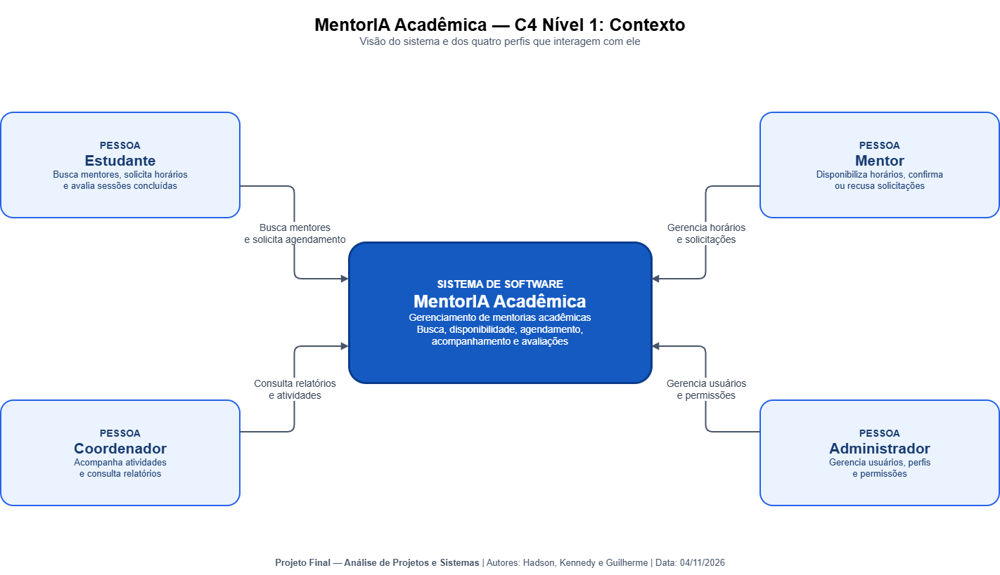
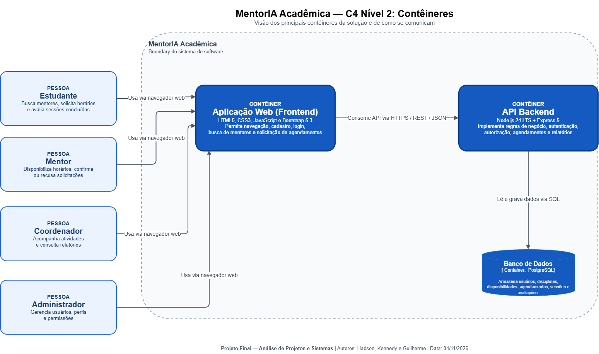
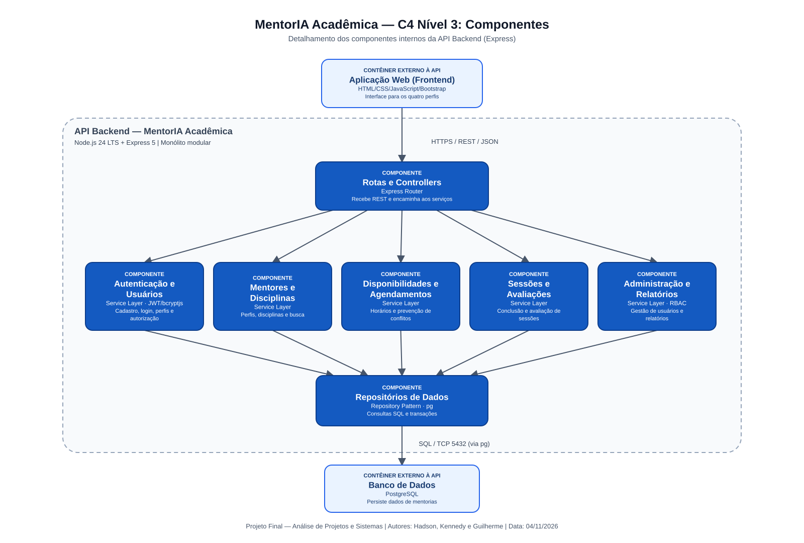
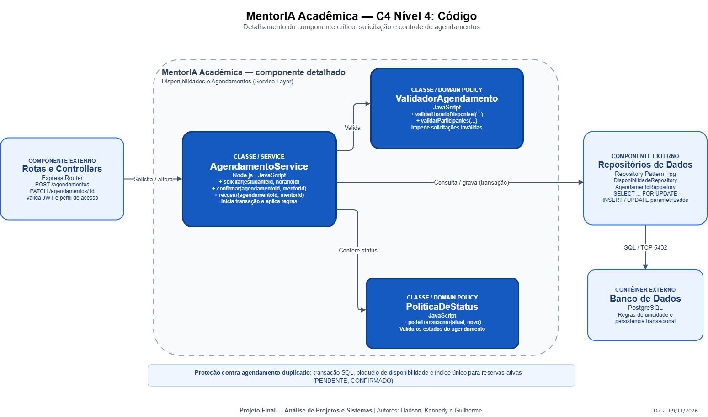

# MentorIA Acadêmica — Documento de Arquitetura de Software (DAS)

**Identificador:** DAS-APS-003  
**Versão:** 1.2  
**Status:** Proposta revisada por Kennedy — aceite do trio pendente  
**Projeto:** MentorIA Acadêmica | **Domínio:** EdTech  
**Autor técnico:** Kennedy (Arquiteto de Software)  
**Revisores previstos:** Hadson (PO) e Guilherme (Engenharia/DBA)  
**Equipe:** Hadson, Kennedy e Guilherme  
**Data de referência:** 06/11/2026

## Histórico de revisões

| Versão | Data | Alteração | Autor |
|---|---|---|---|
| 1.0 | 05/11/2026 | Primeira consolidação técnica para integração dos blocos 1–5, 7–9 | Kennedy |
| 1.1 | 05/11/2026 | Revisão de consistência UML, reservas concorrentes e referências dos diagramas | Kennedy |
| 1.2 | 06/11/2026 | Integração RF021/US016, JWT, metas de desempenho/capacidade e ambientes AWS | Kennedy + Hadson (proposta) |

> **Classificação do documento:** projeto acadêmico que simula um handoff profissional. Descreve uma **solução futura**: não representa software implantado, infraestrutura contratada, desempenho medido ou conformidade LGPD certificada.

## 1. Resumo executivo e objetivo

O MentorIA Acadêmica é uma plataforma web destinada a intermediar mentorias entre estudantes e mentores. Permite localizar mentores por disciplina, consultar disponibilidades, solicitar agendamentos, confirmar ou recusar pedidos, concluir sessões e registrar avaliações. Coordenadores consultam informações gerenciais; administradores gerenciam usuários e permissões.

Esta arquitetura foi especificada para permitir que uma futura equipe comece a implementação conhecendo as **responsabilidades de cada componente, dependências, decisões técnicas, restrições, fluxos críticos e contratos de integração**. A solução proposta utiliza **monólito modular com backend em Node.js/Express, interface web simples e banco PostgreSQL**. Esta opção reduz o número de unidades de implantação e de integrações operacionais frente a uma arquitetura distribuída.

### 1.1 Escopo arquitetural

**Incluído:** quatro papéis de acesso; autenticação; cadastro e perfis; catálogo de mentores e disciplinas; disponibilidades; solicitações e confirmação de mentorias; registro de sessões; avaliações; notificações internas; consultas e administração.

**Fora do escopo deste recorte:** inteligência artificial aplicada, pagamentos/Pix, chat em tempo real, emissão de certificados, videochamadas nativas, aplicativo móvel próprio, integrações externas de e-mail/SMS e execução efetiva de produção. Se Hadson definir algum item como `Must`, a arquitetura, os diagramas e os custos devem ser revisados antes da entrega.

### 1.2 Atores

| Perfil | Responsabilidades de negócio | Limitação relevante |
|---|---|---|
| Estudante | Procurar mentores, solicitar e cancelar agendamentos, avaliar sessões concluídas | Não gerencia horários ou sessões de terceiros |
| Mentor | Disponibilizar horários, aceitar/recusar solicitações, registrar conclusão | Atua somente sobre suas disponibilidades e sessões |
| Coordenador | Consultar indicadores e acompanhar mentorias | Não altera senhas nem concede perfis administrativos |
| Administrador | Gerenciar usuários, perfis e permissões | Operações sensíveis devem ser auditadas |

## 2. Direcionadores, premissas e restrições

### 2.1 Capacidade funcional base

A tabela abaixo rastreia capacidades arquiteturais aos **21 requisitos RF001–RF021** e **16 histórias US001–US016** entregues por Hadson. As associações estão sujeitas à validação final do trio.

| Capacidade | Fluxo essencial | Módulo responsável | Requisito RF/US final |
|---|---|---|---|
| CAP-01 | Autenticação e controle de sessão | Autenticação e Usuários | RF002, RF003; US002 |
| CAP-02 | Cadastro e manutenção de usuário | Autenticação e Usuários | RF001, RF004, RF005; US001, US003 |
| CAP-03 | Cadastro/busca de mentor por disciplina | Mentores e Disciplinas | RF006, RF007, RF010, RF021; US004, US006, US016 |
| CAP-04 | Gestão de disponibilidade | Disponibilidades e Agendamentos | RF008, RF009, RF011; US005, US007 |
| CAP-05 | Solicitação e decisão sobre agendamento | Disponibilidades e Agendamentos | RF012–RF015; US008–US011 |
| CAP-06 | Encerramento da sessão e avaliação | Sessões e Avaliações | RF016, RF017; US012, US013 |
| CAP-07 | Comunicação interna do andamento | Notificações / domínio de sessões | RF018 (Could); sem história Must |
| CAP-08 | Administração e relatórios | Administração e Relatórios | RF019, RF020; US014, US015 |

### 2.2 Atributos de qualidade propostos

Os números abaixo são **critérios arquiteturais de referência a validar com Hadson**, e não resultados de testes nem promessa comercial.

| Atributo | Meta de projeto proposta | Como verificar | Consequência arquitetural |
|---|---|---|---|
| Desempenho | p95 ≤ 300 ms para operações principais e busca da API no cenário de 150 acessos simultâneos | Testes com 150 usuários simultâneos, 10.000 cadastros e 10.000 horários, instrumentando latência | Índices apropriados e consultas parametrizadas; otimizar após medição |
| Capacidade | Meta de 10.000 usuários cadastrados; pico inicial planejado de 150 simultâneos, com cenário futuro de 750 a dimensionar | Carga de dados sintética e cenários de pico | PostgreSQL e serviços sem estado de sessão no processo |
| Segurança | 100% dos endpoints privados com validação de JWT e autorização | Testes automáticos de acesso sem token/perfil errado | Middleware de autenticação + RBAC + checagem de titularidade |
| Privacidade | 100% dos campos pessoais identificados no dicionário de dados | Revisão conjunta com DBA/PO | Minimização de dados e retenção definida no Bloco 5 |
| Resiliência | Backup diário, RPO alvo ≤ 24 h e RTO alvo ≤ 4 h (a comprovar por teste) | Ensaio documentado de restauração | Backup e procedimento operacional com dono definido |
| Disponibilidade | **Meta observável de 99,5% sem SLA garantido; não prometer 99,9%** na topologia de instância única | Medição após implantação e revisão da infra | Para SLA formal, prever redundância e failover, com novo custo |

### 2.3 Restrições

- Atividade acadêmica: a implementação e a operação real não fazem parte da entrega.
- O sistema é de domínio único e equipe pequena; a opção arquitetural deve minimizar complexidade inicial.
- O frontend usa HTML, CSS, JavaScript e Bootstrap; não há SPA com build obrigatório.
- Um único backend Express mantém módulos lógicos independentes; não são microserviços.
- PostgreSQL é o único banco de aplicação; acessos passam pelo backend.
- Banco e API não devem expor credenciais ou informações pessoais ao navegador.

## 3. Visão arquitetural da solução

### 3.1 Estilo escolhido

Adota-se um **monólito modular em camadas**. O frontend web apresenta as telas e consome uma API REST. O backend executa validações, autenticação, autorização, regras de negócio e persistência. As regras do domínio são concentradas nos serviços, enquanto os repositórios isolam operações SQL.

**Justificativa:** os recursos principais compartilham transações e dados relacionais; o time de desenvolvimento hipotético é reduzido; o custo operacional é restrito. A alternativa microserviços aumentaria custos de comunicação, observabilidade, implantação e consistência sem uma necessidade comprovada de escalabilidade independente.

### 3.2 Contêineres lógicos e execução

| Contêiner | Tecnologia | Função | Comunicação |
|---|---|---|---|
| Aplicação Web (Frontend) | HTML5, CSS3, JS, Bootstrap 5.3 | Exibição das páginas, entrada de dados e consumo da API | HTTPS para API REST/JSON |
| API Backend | Node.js 24 LTS, Express 5, `pg` | Negócio, autenticação, autorização, DTOs e consultas | REST/JSON com frontend; SQL com PostgreSQL |
| Banco de Dados | PostgreSQL | Integridade, persistência, transações e índices | Conexões privadas do backend, porta 5432 |

**Esclarecimento C4:** “contêiner” significa *unidade lógica de execução ou armazenamento*, não necessariamente um servidor diferente. A aplicação web estática pode ser servida via Nginx no **mesmo servidor** do backend. Esse servidor também pode hospedar o banco na configuração de referência de baixo custo, com risco de ponto único de falha explicitado.

### 3.3 Ambiente de referência para o futuro desenvolvimento

- Navegador → **HTTPS/443** → Nginx, que entrega HTML/CSS/JS e encaminha `/api/*` ao Express.
- Nginx → Express em **127.0.0.1:3000**; porta não exposta publicamente.
- Express → PostgreSQL em **rede privada/localhost, TCP 5432**; sem acesso direto pelo navegador.
- Ambiente **local** para desenvolvimento; instâncias **staging Linux 1 GB** e **produção Linux 2 GB** isoladas em Lightsail, de acordo com o Bloco 1. Preço-base conjunto de US$ 19/mês; backups e custos acessórios separados.
- O Bloco 6 (DevOps) é opcional. Essa descrição de topologia é uma **referência arquitetural**, não implica Docker, pipeline CI/CD ou contratação de cloud.

### 3.4 Estrutura conceitual de código (não implementada)

```text
src/
├── app.js                    # configuração do Express
├── routes/                   # mapeamento de endpoints
├── controllers/              # HTTP, validação inicial, status e DTOs
├── services/                 # regras de negócio
│   ├── autenticacao/
│   ├── mentores/
│   ├── agendamentos/
│   ├── sessoes/
│   └── administracao/
├── domain/                   # enums, validações, políticas de status
├── repositories/             # SQL parametrizado, transações e consultas
├── middleware/               # autenticação, autorização, erros
├── config/                   # conexão, variáveis, ambiente
└── tests/                    # testes unitários e de integração futuros
public/                       # HTML, CSS, JS e Bootstrap
```

**Regra de dependência:** `routes → controllers → services → repositories → PostgreSQL`. Um serviço pode usar políticas de domínio, mas não deve depender diretamente de objetos HTTP. Controllers não devem conter SQL.

## 4. Modelo C4 — quatro níveis obrigatórios

O modelo C4 oferece diferentes níveis de detalhamento: contexto, contêineres, componentes e código. No projeto APS, os quatro níveis foram elaborados conforme a exigência da disciplina.

### 4.1 Nível 1 — Contexto

**Propósito:** delimitar o sistema e os quatro tipos de usuário. O sistema aparece como uma caixa central, com relações rotuladas para Estudante, Mentor, Coordenador e Administrador. Não se detalham frameworks neste nível.

**Decisão demonstrada:** plataforma única de mentorias, sem pagamentos ou integrações de terceiros previstas no escopo inicial.



### 4.2 Nível 2 — Contêineres

**Propósito:** evidenciar frontend, API Express e PostgreSQL, tecnologias e protocolos: browser/HTTPS; frontend/API REST+JSON; backend/banco SQL. Os quatro perfis acessam apenas a interface web.

**Decisão demonstrada:** apresentação separada da lógica de negócio; acesso ao banco restrito ao backend. A borda de sistema envolve os três contêineres lógicos.



### 4.3 Nível 3 — Componentes

**Escopo:** interior da API Backend. Um `Express Router/Controllers` direciona solicitações para serviços de Autenticação e Usuários, Mentores e Disciplinas, Disponibilidades e Agendamentos, Sessões e Avaliações, Administração e Relatórios. Repositórios isolam SQL e PostgreSQL.

**Decisão demonstrada:** módulos separados por responsabilidade de negócio, sem comunicação remota entre eles. A biblioteca `pg` centraliza o acesso relacional.



### 4.4 Nível 4 — Código (componente crítico)

**Escopo:** detalhamento do componente de agendamentos. O `AgendamentoService` coordena `ValidadorAgendamento`, `PoliticaDeStatus` e repositórios; operações de reserva são transacionais.

**Critério representado na versão revisada:** a exclusividade de **solicitações ativas** considera somente `PENDENTE` e `CONFIRMADO`; `CONCLUIDO` não bloqueia uma nova reserva. O diagrama foi conferido no pacote de revisão, e a publicação final deve usar as imagens derivadas do arquivo editável.



## 5. Catálogo de componentes e contratos

| Componente | Responsabilidade | Entrada principal | Saída / regra |
|---|---|---|---|
| AutenticacaoController | Receber credenciais e devolver resposta HTTP | `POST /api/auth/login` | `200` com token ou `401` genérico |
| AutenticacaoService | Verificar identidade e emitir JWT | `email`, `senha` | Token de acesso curto (15 min) |
| UsuarioRepository | Carregar usuário por e-mail/ID | Identificador/email | Hash de senha, perfil e estado ativo |
| MentorService | Consultar mentores e vínculos a disciplinas | Filtro de disciplina | Lista paginada de mentores |
| AgendamentoController | Validar payload e encaminhar requisições | `POST /api/agendamentos` | `201`, `400`, `401`, `403` ou `409` conforme caso |
| AgendamentoService | Aplicar regras do fluxo de reserva | estudante autenticado e disponibilidade | Criação `PENDENTE` ou conflito |
| DisponibilidadeRepository | Consultar e bloquear horários | ID da disponibilidade | Registro com trava `FOR UPDATE` |
| AgendamentoRepository | Consultar ativos e persistir pedidos | IDs e status | Inserção e atualização transacional |
| SessaoService | Registrar sessão concluída | Agendamento confirmado | Sessão + estado `CONCLUIDO` |
| AvaliacaoService | Validar autoria e conclusão | Nota/comentário | Uma avaliação do estudante por sessão |
| AdministracaoService | Consultas gerenciais e usuários | Identidade e permissão | Relatórios administrativos controlados |

**Regras de interface:** o OpenAPI 3.0 de Guilherme é o contrato definitivo; estes endpoints são a **referência prevista**. Endpoint, DTO e código de erro deverão ser idênticos ao modelo final da API.

## 6. Dados e integridade

### 6.1 Entidades principais

As entidades conceituais canônicas são `Usuario`, `PerfilMentor`, `Disciplina`, `MentorDisciplina`, `Disponibilidade`, `Agendamento`, `SessaoMentoria`, `Avaliacao`, `Notificacao` (opcional) e `LogAuditoria`. O status do agendamento inclui `EXPIRADO` além dos cinco estados originais. Serviços de aplicação (`AutenticacaoService`, `AgendamentoService`) são classes de comportamento e **não** tabelas independentes.

### 6.2 Estados do agendamento

`PENDENTE → CONFIRMADO → CONCLUIDO` (caminho de sucesso). Pedidos `PENDENTE` podem ir para `RECUSADO` ou `CANCELADO`; pedidos `CONFIRMADO` podem ser cancelados antes da conclusão, conforme regra acordada com Hadson.

- Um horário só pode receber solicitação para data futura.
- Uma disponibilidade não pode ter duas solicitações em estados `PENDENTE`/`CONFIRMADO` simultaneamente.
- Agendamentos `RECUSADO`/`CANCELADO` podem coexistir no histórico sem bloquear uma nova solicitação.
- `CONCLUIDO` registra resultado histórico; não é estado ativo de uma reserva futura.
- A conclusão e a avaliação são operações distintas, com validação de autoria.

### 6.3 Concorrência de reservas (regra crítica)

A verificação de horário e a criação do agendamento devem ocorrer **na mesma transação e na mesma conexão PostgreSQL** (o `pg` client transacional deve ser compartilhado entre os repositórios envolvidos). Fluxo lógico recomendado:

1. `BEGIN`.
2. Bloquear a linha da disponibilidade com `SELECT ... FOR UPDATE`, no mesmo cliente transacional reutilizado na operação de inserção.
3. Checar propriedade do mentor, validade temporal e existência de reserva ativa.
4. Criar `Agendamento` `PENDENTE`.
5. `COMMIT`; caso exista conflito, `ROLLBACK` e HTTP `409 Conflict`.

Como defesa adicional, Guilherme deve incluir no modelo físico um **índice único parcial** para cada `disponibilidade_id` com status `PENDENTE`/`CONFIRMADO`, ou restrição equivalente. A política de erro deve traduzir violação da unicidade para `409`, sem revelar dados de outros estudantes. Isso evita confiar apenas em uma verificação feita na aplicação.

Exemplo **de referência** para discussão com o DBA (nomes de colunas devem seguir o SQL final):

```sql
CREATE UNIQUE INDEX ux_agendamento_disponibilidade_ativa
ON agendamentos (disponibilidade_id)
WHERE status IN ('PENDENTE', 'CONFIRMADO');
```

**Observação:** as sequências revisadas retratam a primeira solicitação como `201/PENDENTE` e a segunda como `409`, demonstrando a proteção de concorrência. A consistência do SQL executável pertence ao Bloco 5.

## 7. Segurança, privacidade e limites

| Controle | Proposta | Razão / risco mitigado |
|---|---|---|
| Autenticação | JWT assinado; validade inicial de 15 minutos | Limita exposição de token comprometido; revogação precisa de política adicional |
| Credenciais | Hash de senhas com `bcryptjs`, jamais senha em texto puro | Protege senhas em caso de acesso indevido ao banco |
| Autorização | RBAC por perfil **e** verificação do titular do recurso | Evita acesso a agendamentos de terceiros (BOLA/IDOR) |
| Transporte | HTTPS/TLS; sem API e banco em portas públicas não necessárias | Reduz exposição de credenciais e tráfego |
| Persistência | SQL parametrizado via `pg`; validação do payload | Mitiga SQL injection e dados inválidos |
| Segredos | Variáveis de ambiente, sem credenciais no GitHub | Evita vazamento de chaves e conexão |
| Privacidade | Minimização, retenção, controle de acesso e dicionário PII | Apoia atendimento aos requisitos LGPD definidos pelo PO/DBA |
| Erros/logs | Respostas genéricas para falha de login e logs sem senha/token | Evita vazamento de informação sensível |

O JWT deve ser tratado como segredo; o frontend não deverá gravar tokens em logs. Para o projeto simples, sugere-se guardar token apenas em memória da aba; renovação de sessão exigirá autenticação novamente ou uma proposta futura formal. O plano não constitui auditoria de segurança ou avaliação legal de conformidade.

## 8. Stack tecnológica — comparação obrigatória

| Camada | Escolha | Alternativa avaliada e descartada | Justificativa ligada ao projeto | ADR |
|---|---|---|---|---|
| Arquitetura | Monólito modular | Microserviços | Reduz unidades de deploy, complexidade de transações e operação para equipe pequena | ADR-001 |
| Interface | HTML5, CSS3, JS, Bootstrap 5.3 | React | Telas majoritariamente formulários e consultas; sem build/estado complexo obrigatório | ADR-002 |
| Runtime/API | Node.js 24 LTS + Express 5 | NestJS | Menor abstração inicial para API REST de escopo limitado; versão LTS | ADR-003 |
| Persistência | PostgreSQL + `pg` | MongoDB | Relacionamentos fortes, FKs, transações e restrições de unicidade | ADR-004 |
| Integração | REST/JSON por HTTPS | GraphQL | Operações CRUD e fluxos previsíveis; OpenAPI documentável e HTTP padrão | ADR-005 |
| Hospedagem planejada | AWS Lightsail + Nginx | EC2 + RDS | Reduz componentes e facilita estimativa inicial; custo/HA precisam ser validados | ADR-006 |
| Identidade | JWT de acesso curto + RBAC | Sessão de servidor tradicional | API sem estado de sessão; cuidado com revogação e titularidade | ADR-007 |
| Separação interna | Controller + Service Layer + Repository | Controller acessando SQL diretamente | Mantém regras testáveis e dependências sob controle | ADR-008 |
| Reserva concorrente | Transação PostgreSQL + lock + unicidade | `SELECT` simples sem transação | Protege a integridade quando duas solicitações chegam juntas | ADR-009 |

## 9. Padrões de projeto adotados

### 9.1 Service Layer

A regra “horário livre → pedido pendente → decisão do mentor” pertence ao `AgendamentoService`. Controllers recebem e respondem HTTP, sem conter transações ou regras complexas. Essa separação permite testar fluxos de negócio independentemente do navegador. **Alternativa descartada:** regras espalhadas entre rotas Express, dificultando testes e consistência.

### 9.2 Repository

`UsuarioRepository`, `DisponibilidadeRepository` e `AgendamentoRepository` concentram acesso SQL, mapeamento de registros e execução de consultas parametrizadas. **Alternativa descartada:** consultas repetidas dentro de serviços e controllers, gerando acoplamento e risco de divergência.

### 9.3 Políticas de domínio

`ValidadorAgendamento` e `PoliticaDeStatus` encapsulam verificações do agendamento e transições permitidas. São objetos simples, não novos microserviços. **Alternativa descartada:** condições duplicadas em cada endpoint, com chances de aceitar estados inválidos.

Não se propõem **Saga, CQRS ou event bus**: não há serviço distribuído, consistência eventual obrigatória ou leitura com carga diferenciada que justifique esses padrões no escopo definido.

## 10. Riscos arquiteturais e compromissos

| ID | Risco | Prob. | Impacto | Tratamento proposto | Dono |
|---|---|---|---|---|---|
| AR-01 | Duplo agendamento por concorrência | Média | Alto | `FOR UPDATE`, transação, índice parcial e teste de disputa | Kennedy + Guilherme |
| AR-02 | Acesso indevido a reservas alheias | Média | Alto | RBAC + checagem de titularidade + testes 403/404 | Kennedy + Hadson |
| AR-03 | Instância única indisponível | Média | Alto | Backups testados; não prometer SLA 99,9%; plano de recuperação | Guilherme |
| AR-04 | Exposição de dados pessoais | Média | Alto | Classificação PII, minimização e logs seguros | Hadson + Guilherme |
| AR-05 | Divergência RF ↔ C4 ↔ UML ↔ SQL | Alta | Alto | Matriz de rastreio e revisão cruzada antes do PDF | Trio |
| AR-06 | Escala acima da capacidade prevista | Média | Médio | Carga e métricas; crescimento vertical ou separação do banco após validação | Kennedy + Guilherme |

Os riscos de negócio, equipe e regulação devem completar a matriz **mínima de oito riscos** do Bloco 7, mantida por Guilherme.

## 11. Plano de validação e critérios para handoff

**Validação do Bloco 3**

- [ ] ADRs 001–009 revisados, alternativos e consequências coerentes.
- [ ] C4 N1–N4 com título, autores e data, e a mesma nomenclatura dos requisitos.
- [ ] Stack documentada por camada; nenhuma tecnologia adicional sem ADR quando relevante.
- [ ] Padrões Repository e Service Layer correspondem aos desenhos e ao código previsto.
- [ ] Restrições de agendamento aparecem no C4 N4, UML, dicionário e SQL.
- [ ] RNFs com métricas revisadas por Hadson; ambiente e custos reais revisados por Guilherme.
- [ ] Links do GitHub e nomes de arquivos conferidos.

**Critério de saída:** a equipe de desenvolvimento futura consegue identificar o caminho de uma requisição, seus pontos de validação, onde persistir dados e como testar os principais erros, sem inventar decisões que não estejam registradas. O README executável do futuro projeto, a API OpenAPI e o SQL físico dependem do Bloco 8 e do Bloco 5.

## 12. Registro de decisões (ADRs)

| ADR | Tema | Arquivo |
|---|---|---|
| 001 | Estilo arquitetural | [ADR-001](adrs/ADR-001.md) |
| 002 | Interface | [ADR-002](adrs/ADR-002.md) |
| 003 | Backend | [ADR-003](adrs/ADR-003.md) |
| 004 | Banco | [ADR-004](adrs/ADR-004.md) |
| 005 | API | [ADR-005](adrs/ADR-005.md) |
| 006 | Infraestrutura planejada | [ADR-006](adrs/ADR-006.md) |
| 007 | Segurança de acesso | [ADR-007](adrs/ADR-007.md) |
| 008 | Organização do código | [ADR-008](adrs/ADR-008.md) |
| 009 | Concorrência de agendamentos | [ADR-009](adrs/ADR-009.md) |

## 13. Referências técnicas

- Enunciado do professor: *Análise de Projeto e Sistemas — Projeto Final*, especialmente Bloco 3 (p. 8), Bloco 4 (p. 9), regra de justificativas (p. 14) e critérios bloqueadores (p. 15).
- C4 Model, Simon Brown: https://c4model.com/diagrams
- Express (documentação): https://expressjs.com/
- Node.js — política de versões LTS: https://nodejs.org/en/about/previous-releases
- PostgreSQL — cláusula `FOR UPDATE`: https://www.postgresql.org/docs/current/sql-select.html
- PostgreSQL — índices parciais: https://www.postgresql.org/docs/current/indexes-partial.html
- OWASP API Security Top 10: https://owasp.org/projects/api-security-project
- AWS Lightsail — preços oficiais (a serem calculados por região/cenário): https://aws.amazon.com/pt/lightsail/pricing/


## Anexo — Compatibilização com os Blocos 1, 2 e 9 (06/11/2026)

As premissas e os requisitos de Hadson foram incorporados como **propostas comuns sujeitas ao aceite do trio**. Regras adicionais: expiração do agendamento PENDENTE em 48 h (`EXPIRADO`), impedimento de desativar o último administrador ativo, cancelamento de reservas futuras ao desativar usuário, revalidação de status e perfil a cada requisição e trilha `LogAuditoria` para ações administrativas. **`SessaoMentoria`** substitui `RegistroSessao` no vocabulário oficial. Ver [modelo do banco](05-banco.md), [dicionário de dados](dicionario-dados.md) e [requisitos](02-requisitos.md).
