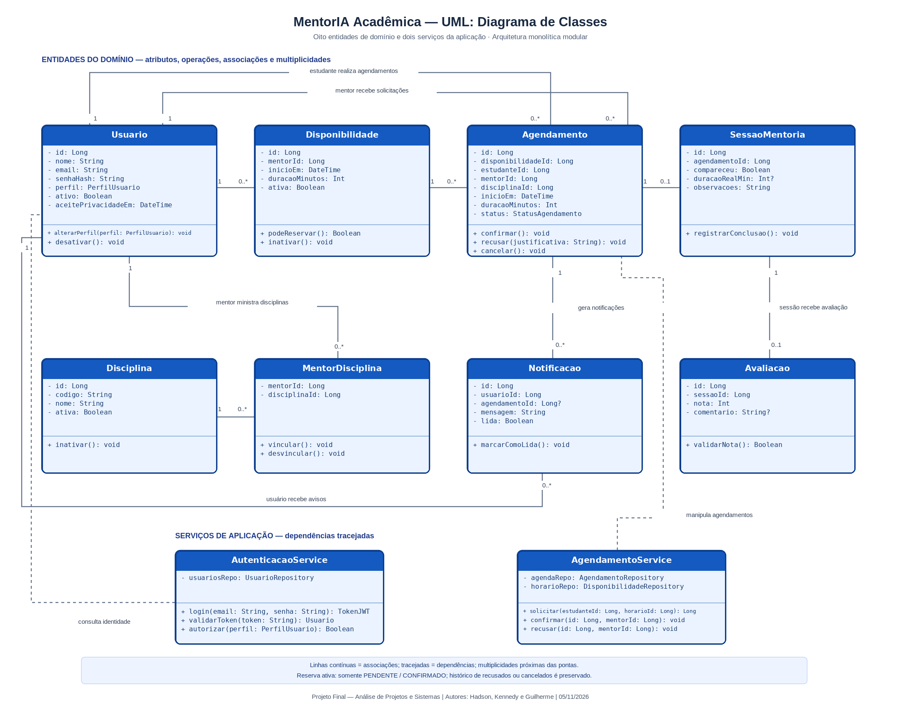
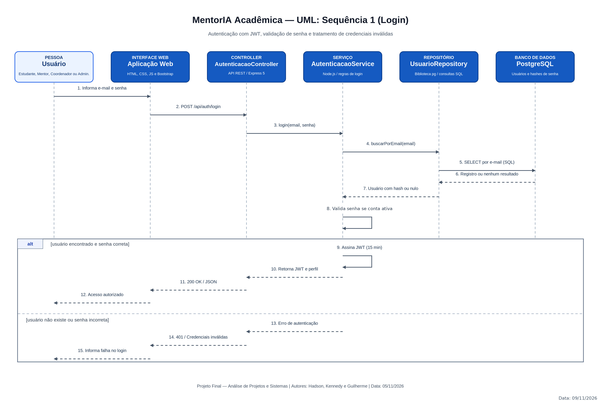
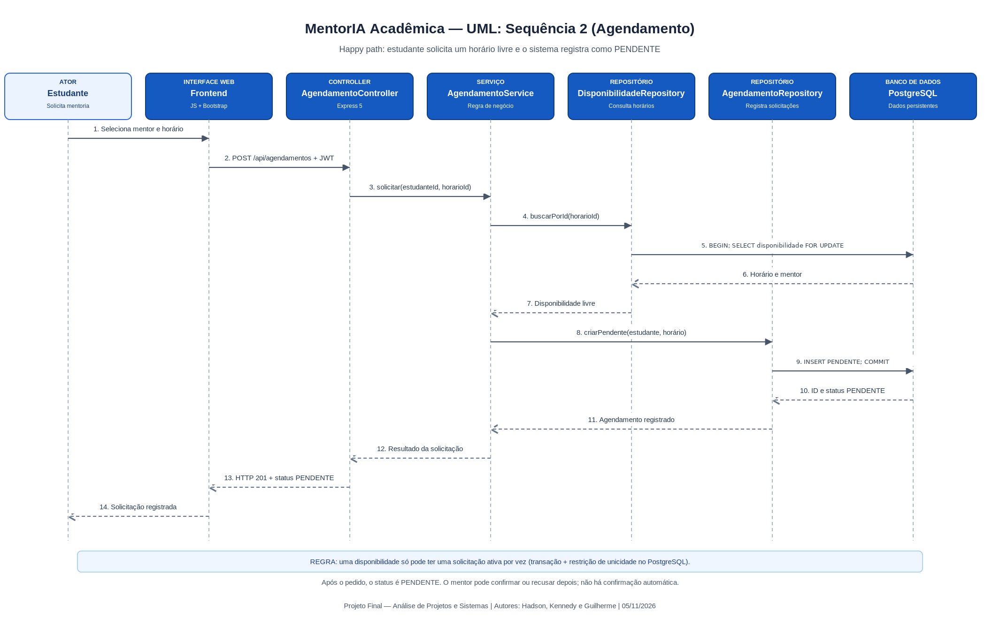
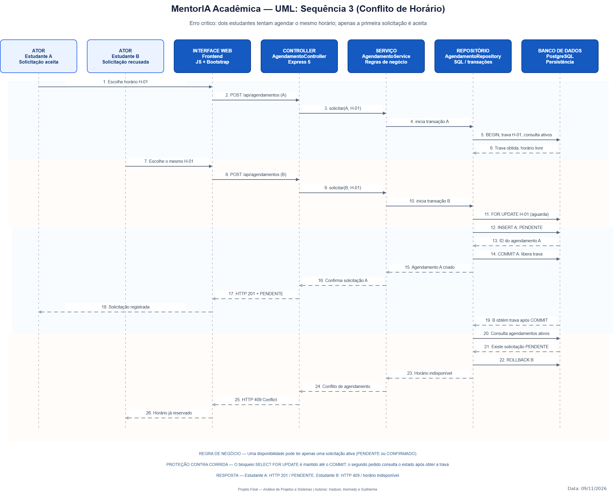
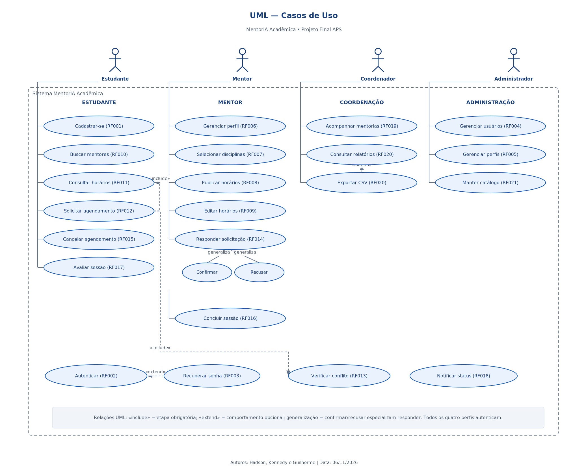
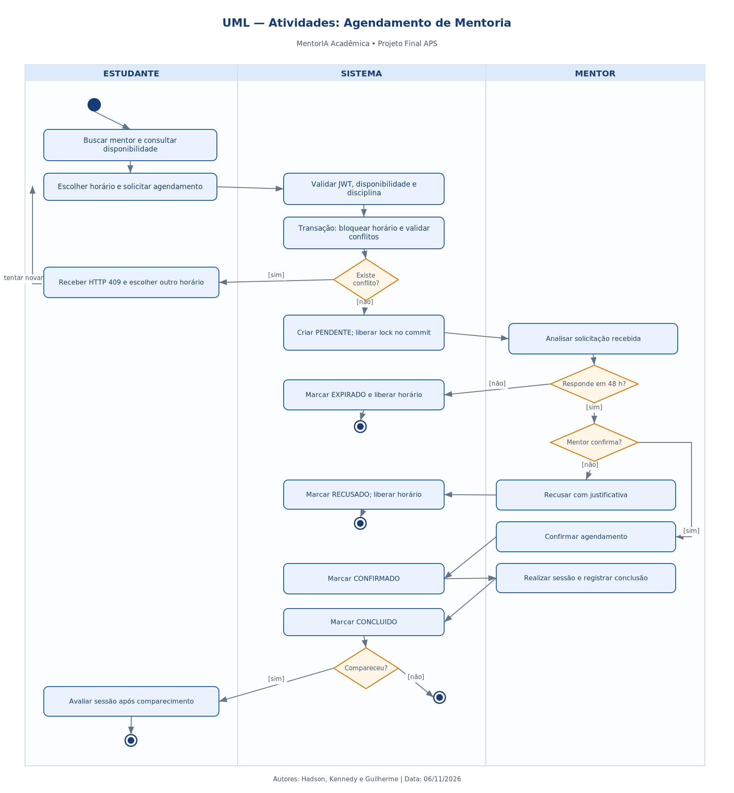
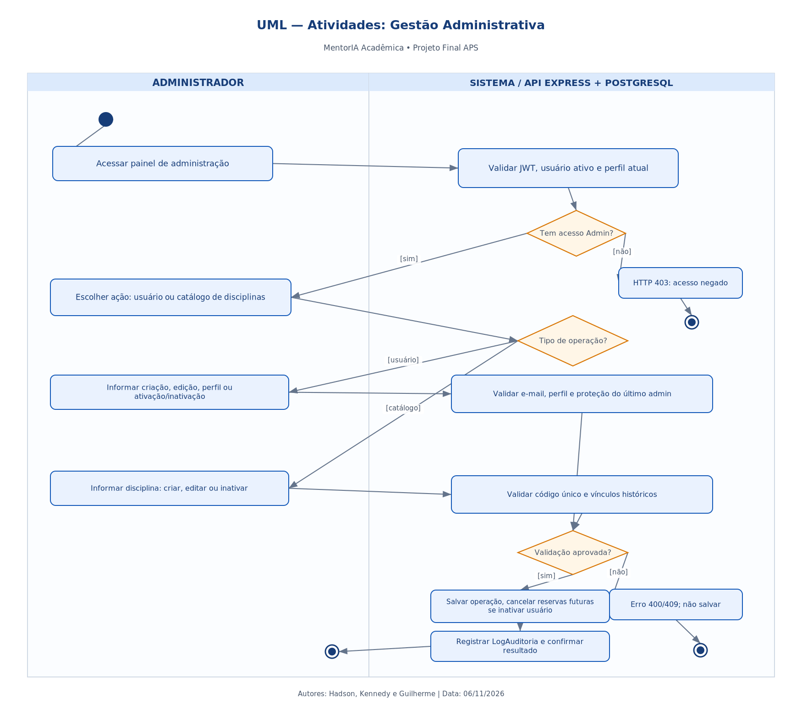
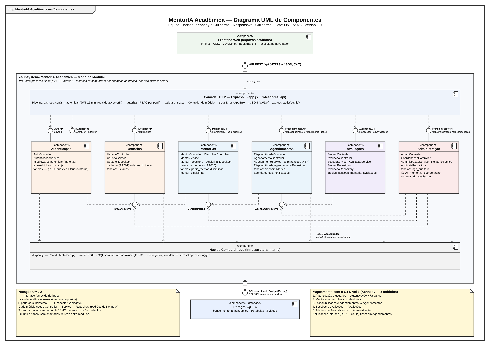
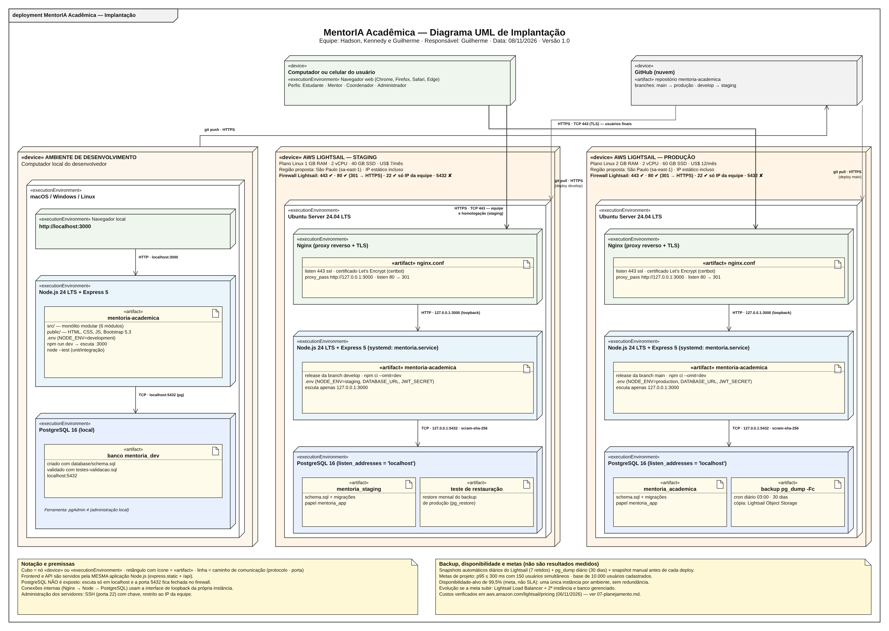

# Bloco 4 — Diagramas UML | MentorIA Acadêmica

**ID:** UML-APS-004-K  
**Versão:** 1.2  
**Responsável pela integração:** Kennedy — Arquitetura de Software  
**Revisão cruzada:** Hadson (requisitos); Guilherme (dados)  
**Status:** correções locais aplicadas; validação cruzada com requisitos e banco pendente  
**Data:** 06/11/2026

## 1. Objetivo e escopo

Este caderno descreve **quatro diagramas UML** elaborados pelo arquiteto: um de classes e três de sequência. Os outros **cinco diagramas** do Bloco 4 são divididos entre os demais integrantes: Casos de Uso e duas Atividades (Hadson), Componentes UML e Deployment (Guilherme). O total solicitado pela página 9 do enunciado corresponde a **seis tipos UML e nove diagramas concretos**.

A documentação a seguir complementa, mas não substitui, a **exibição e explicação ao vivo dos diagramas** exigida pelo professor. Cada imagem final deve ter título, autores e data.

## 2. Diagrama UML de classes

### 2.1 Classes incluídas

| Classe | Tipo | Papel | Coerência esperada com banco |
|---|---|---|---|
| `Usuario` | Entidade | Identidade, perfil, situação ativa | `usuarios` |
| `Disciplina` | Entidade | Área do conhecimento | `disciplinas` |
| `MentorDisciplina` | Entidade associativa | Vínculo N:N mentor–disciplina | `mentor_disciplinas` |
| `Disponibilidade` | Entidade | Janela de atendimento de mentor | `disponibilidades` |
| `Agendamento` | Entidade | Solicitação e estado da reserva | `agendamentos` |
| `SessaoMentoria` | Entidade | Execução/conclusão de atendimento | `sessoes_mentoria` |
| `Avaliacao` | Entidade | Avaliação do estudante | `avaliacoes` |
| `Notificacao` | Entidade | Aviso interno ao usuário | `notificacoes` |
| `AutenticacaoService` | Serviço | Regras de login/token/autorização | Não é tabela |
| `AgendamentoService` | Serviço | Solicitação, confirmação e recusa | Não é tabela |

### 2.2 Convenções exigidas

- Atributos têm nome e tipo: `- email: String`, `- id: Long`, `- ativo: Boolean`.
- Métodos têm assinatura tipada: `+ solicitar(estudanteId: Long, horarioId: Long): Long`.
- Visibilidade: `+` público; `-` privado; `#` protegido quando aplicável.
- Relações de domínio usam associação contínua e multiplicidades junto de **cada ponta**; dependências de serviço usam linhas tracejadas.
- Duas associações distintas **já representam os papéis do usuário** em agendamentos: como estudante e como mentor. A multiplicidade adotada é `Usuario 1` para `Agendamento 0..*` em cada papel; Guilherme deve confirmar as duas FKs.
- Associação `Disponibilidade → Agendamento`: `1` disponibilidade para `0..*` pedidos históricos. Apenas um pedido pode estar ativo (`PENDENTE`/`CONFIRMADO`) em um instante, regra de banco por índice único parcial. Multiplicidades não representam sozinhas a restrição por status.
- A classe de serviço depende de repositórios; não deve representar dependência direta entre frontend e banco.

### 2.3 Conferência de integridade

O desenho contém dez classes: oito entidades representativas e dois serviços; `PerfilMentor` e `LogAuditoria` existem no banco, mas ficam fora deste recorte de classes da UML. A nomenclatura oficial da sessão é `SessaoMentoria`, em todos os documentos.

Os campos `Agendamento.estudanteId`, `mentorId`, `disponibilidadeId` devem possuir FKs correspondentes no modelo físico. `Avaliacao` deve se associar a uma `SessaoMentoria` concluída. `Notificacao` guarda seu destinatário e a referência ao agendamento quando pertinente. `PerfilUsuario` e `StatusAgendamento` são tipos/enums do domínio, não precisam ser tabelas independentes.

## 3. Sequência 1 — Autenticação (login)

**Pré-condição:** usuário cadastrado e ativo, com senha armazenada apenas como hash. **Disparo:** envio de e-mail e senha pela interface.

1. Interface envia `POST /api/auth/login` ao `AutenticacaoController`.
2. O controller encaminha ao `AutenticacaoService`.
3. O serviço consulta `UsuarioRepository` e recebe hash/perfil/estado.
4. Faz comparação de senha com `bcryptjs`.
5. Em caso válido, retorna JWT de 15 minutos e perfil com HTTP `200`.
6. Em credencial inválida ou usuário inexistente, retorna `401` com mensagem genérica.

**Pós-condição:** cliente autenticado ou tentativa rejeitada sem divulgar se o e-mail existe. O diagrama usa fragmento `alt` para os caminhos de sucesso e de erro.

## 4. Sequência 2 — Solicitação de agendamento (happy path)

**Pré-condição:** estudante com JWT válido, disponibilidade futura e sem solicitação ativa.

1. O estudante seleciona mentor e horário na aplicação web.
2. Frontend envia `POST /api/agendamentos` com autenticação.
3. `AgendamentoController` chama `AgendamentoService`.
4. Service verifica disponibilidade via `DisponibilidadeRepository`.
5. Na **mesma conexão e transação**, `DisponibilidadeRepository` bloqueia o horário com `FOR UPDATE`, verifica o estado e `AgendamentoRepository` insere o pedido `PENDENTE` antes do `COMMIT`.
6. Backend devolve HTTP `201` com ID e `status: PENDENTE`.

**Pós-condição:** pedido registrado, aguardando confirmação/recusa do mentor. **Observação:** `PENDENTE` não significa que a mentoria já esteja confirmada. A transação é explicitada em regras e no diagrama de erro concorrente.

## 5. Sequência 3 — Erro crítico por concorrência

**Cenário:** estudantes A e B enviam pedidos para o mesmo horário; ambos veem a disponibilidade antes da reserva definitiva.

1. A inicia transação, bloqueia a linha de `Disponibilidade` (`SELECT ... FOR UPDATE`), checa ausência de reserva ativa e insere `PENDENTE`.
2. B tenta bloquear a mesma disponibilidade e aguarda a liberação da trava.
3. A confirma (`COMMIT`), liberando a trava.
4. B obtém a trava, consulta agendamentos ativos e encontra o pedido de A.
5. B não insere novo registro; desfaz a tentativa (`ROLLBACK`) e recebe HTTP `409 Conflict`.

**Resultado:** A recebe `201/PENDENTE`; B recebe `409/Horário indisponível`. A proteção também deve existir no banco por índice único parcial para agendamentos ativos.

## 6. Rastreamento e explicação na apresentação

| Diagrama | Demonstra principalmente | Pergunta provável do professor |
|---|---|---|
| Classes | Domínio, tipos, visibilidades, associações | “Por que `MentorDisciplina` é associação N:N? Onde estão FKs?” |
| Sequência login | Repositório, segurança, resposta 200/401 | “O frontend acessa a senha/hash?” Não. |
| Sequência agendamento | Solução de negócio e status `PENDENTE` | “Por que o agendamento ainda não está confirmado?” |
| Sequência erro | Consistência transacional e conflito `409` | “O que impede duas reservas simultâneas?” |

**Regra de apresentação:** é necessário exibir e **explicar** cada diagrama, não apenas mostrar uma imagem. Os slides finais não precisam ganhar uma data separada; cada **diagrama** deve conservar autores e data na própria figura.

## 7. Pendências para aceite

- [x] As duas associações `Usuario` ↔ `Agendamento` e multiplicidades foram corrigidas no `.drawio` e na imagem gerada. [ ] Pendente validação com Guilherme/DER.
- [ ] Validar cardinalidades com Guilherme e confirmar constraints/índice SQL.
- [ ] Fazer a última conferência de abertura no Draw.io instalado por Kennedy (os arquivos passaram na inspeção estrutural do ZIP; a conferência visual no aplicativo segue necessária).
- [ ] Confirmar códigos e nomes dos endpoints com o OpenAPI final de Guilherme.
- [ ] Atualizar PNGs após cada edição e conferir legibilidade no PDF.

---

## 8. Integração dos demais diagramas UML (responsabilidade do trio)

Os nove diagramas estão presentes em `.drawio` e PNG após a integração dos arquivos de Guilherme. O Bloco 4 ainda depende de conferência visual e aprovação formal do trio. Os quatro diagramas documentados anteriormente são a parte preparada por Kennedy. Os diagramas C4 são exigências **adicionais do Bloco 3** e não substituem estes diagramas UML.

| Diagrama obrigatório | Responsável | Imagem esperada | Situação |
|---|---|---|---|
| Casos de uso | Hadson | `diagrama-casos-de-uso.png` | Recebido e corrigido; verificar no Draw.io |
| Atividades: agendamento | Hadson | `diagrama-atividades-agendamento.png` | Recebido e corrigido; verificar no Draw.io |
| Atividades: administração | Hadson | `diagrama-atividades-administrativo.png` | Recebido e corrigido; verificar no Draw.io |
| Componentes UML | Guilherme | `uml-componentes.png` | Integrado; validar no Draw.io |
| Implantação / Deployment | Guilherme | `uml-implantacao.png` | Integrado; validar no Draw.io |

### 8.1 Casos de uso — Hadson

**Editável:** [`diagrama-casos-de-uso.drawio`](../diagramas/editaveis/diagrama-casos-de-uso.drawio). Os quatro atores são Estudante, Mentor, Coordenador e Administrador. Os casos de uso abrangem RF001–RF021, incluindo a manutenção do catálogo (RF021) e as relações de inclusão, extensão e generalização.

### 8.2 Atividades do agendamento — Hadson

**Editável:** [`diagrama-atividades-agendamento.drawio`](../diagramas/editaveis/diagrama-atividades-agendamento.drawio). O fluxo inclui busca, solicitação, validação transacional do horário, erro 409, reserva `PENDENTE`, resposta em 48 h (ou `EXPIRADO`), confirmação/recusa, conclusão e avaliação quando houve comparecimento.

### 8.3 Atividades administrativas — Hadson

**Editável:** [`diagrama-atividades-administrativo.drawio`](../diagramas/editaveis/diagrama-atividades-administrativo.drawio). Representa autorização RBAC, manutenção de usuários/perfis e catálogo de disciplinas (RF004, RF005, RF021), validações, proteção do último administrador, exclusão lógica e auditoria (RNF024).

### 8.4 Diagrama UML de componentes — Guilherme

**Editável:** [`uml-componentes.drawio`](../diagramas/editaveis/uml-componentes.drawio). O diagrama apresenta seis componentes internos mapeados aos cinco módulos de negócio da arquitetura C4: a separação entre Autenticação e Usuários é uma **subdivisão técnica** dentro do mesmo monólito. Usa portas/interfaces UML e conexão ao banco PostgreSQL. Conferir visualmente antes da apresentação.

### 8.5 Diagrama UML de implantação — Guilherme

**Editável:** [`uml-implantacao.drawio`](../diagramas/editaveis/uml-implantacao.drawio). Descreve desenvolvimento local, staging Lightsail 1 GB e produção Lightsail 2 GB, Nginx/HTTPS 443, Node.js na 3000 local e PostgreSQL na 5432 restrita ao loopback. Estimativas, não infraestrutura contratada.

## 9. Validação final do Bloco 4

- [ ] Os **nove diagramas UML** possuem título, autores e data dentro da figura, são legíveis e poderão ser explicados ao vivo.
- [x] O pacote contém os quatro UML de Kennedy em `.drawio` e `.png`. [ ] Conferir visualmente no Draw.io antes da apresentação.
- [x] Associações e nomes principais harmonizados com o banco. [ ] Conferir detalhes visuais no Draw.io ao montar os slides.
- [x] Diagrama de classes editável e PNG atualizados: tipo `Long` corresponde a `BIGINT` no SQL; `inicioEm`/`duracaoMinutos` representam `inicio_em`/`duracao_minutos`; entidades e atributos revisados com o banco.
- [ ] Nomes das entidades, valores de status e relacionamentos correspondem ao banco, aos RFs e ao contrato OpenAPI.
- [ ] Hadson e Guilherme revisaram e aprovaram suas respectivas seções.

