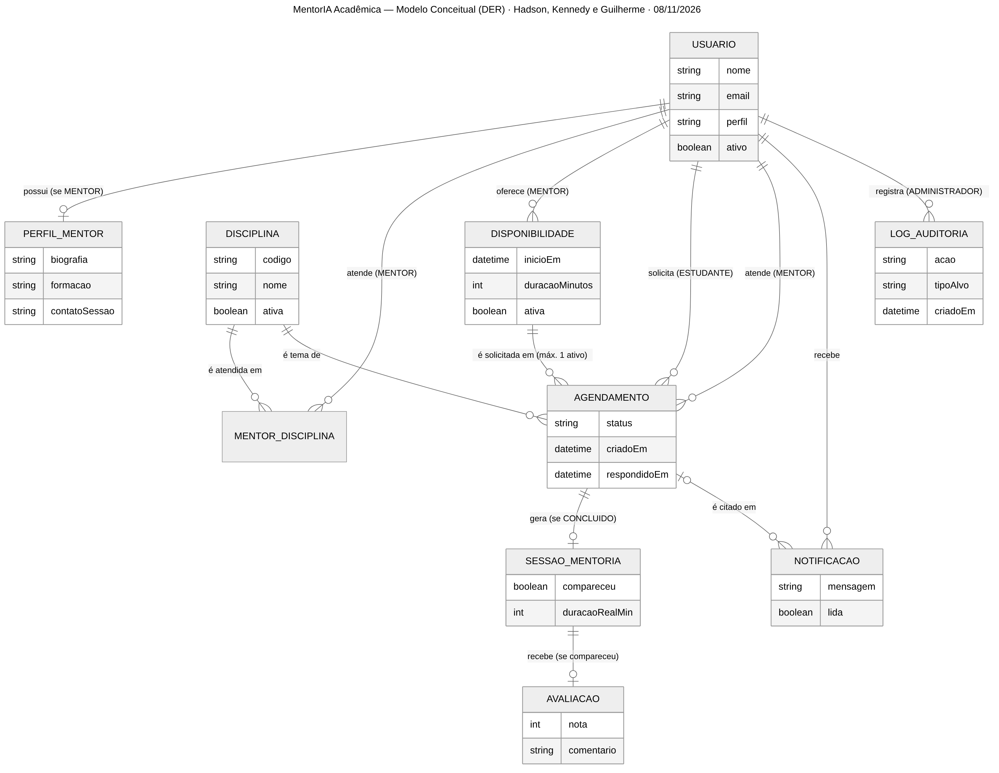
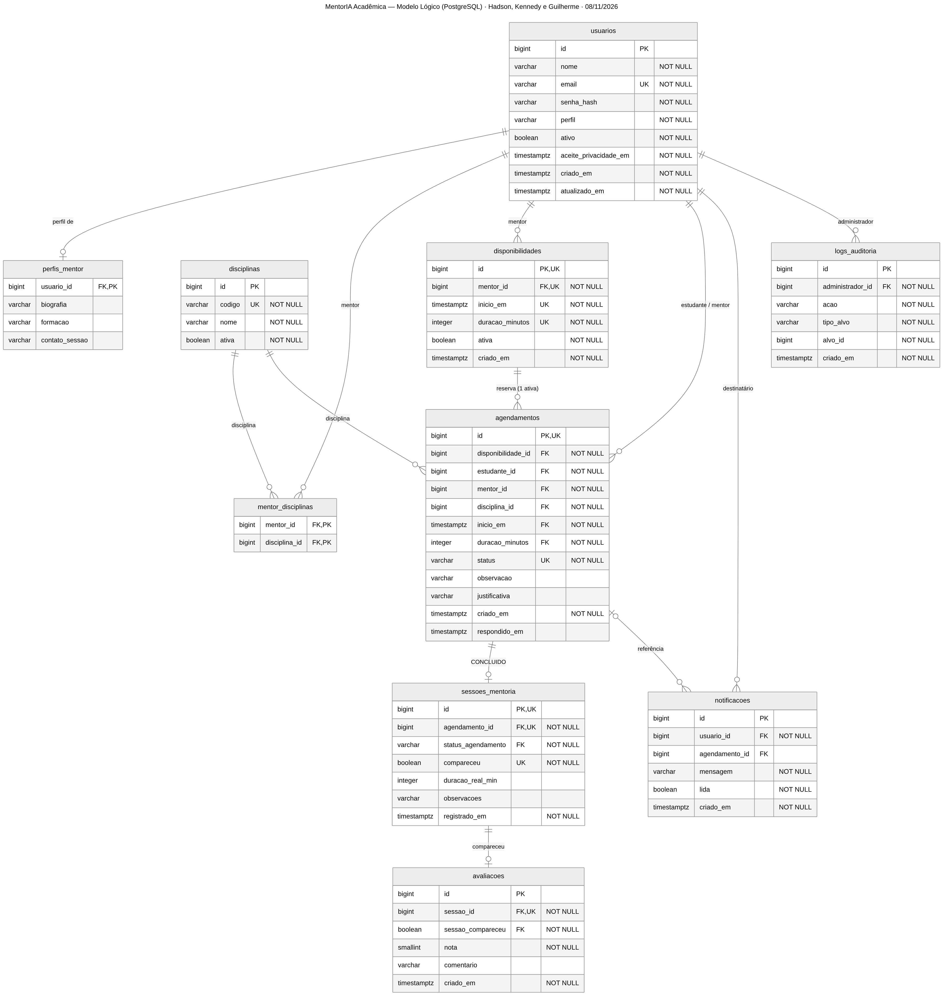

# Bloco 5 — Banco de Dados

**Projeto:** MentorIA Acadêmica · **Responsável:** Guilherme · **Equipe:** Hadson, Kennedy e Guilherme
**Versão:** 1.0 · **Data:** 08/11/2026 · **SGBD:** PostgreSQL 16 (compatível com 13+)

| Artefato | Arquivo | Conteúdo |
|---|---|---|
| Modelo físico (DDL) | [`sql/schema.sql`](../sql/schema.sql) | 10 tabelas, 13 FKs, 2 *exclusion constraints*, índice único parcial, 6 funções de trigger e 2 visões |
| Testes do modelo | [`sql/testes-validacao.sql`](../sql/testes-validacao.sql) | 38 verificações automáticas (positivas e negativas) em `BEGIN … ROLLBACK` |
| Modelo lógico (DBML) | [`sql/modelo-banco.dbml`](../sql/modelo-banco.dbml) | Importável no dbdiagram.io |
| Dicionário de dados | [`docs/dicionario-dados.md`](dicionario-dados.md) | Campos, tipos, restrições, classificação LGPD e retenção |
| DER conceitual | [`diagramas/der-conceitual.png`](../diagramas/imagens/der-conceitual.png) | Entidades e cardinalidades |
| DER lógico | [`diagramas/der-logico.png`](../diagramas/imagens/der-logico.png) | Gerado a partir do banco real |

> **Observação da revisão de 09/11/2026:** RF008 fixa disponibilidades em **30, 45 ou 60 minutos**. RTO alinhado ao RNF005: **4 h**. Os relatos de execução abaixo são de Guilherme; esta revisão não reexecutou o PostgreSQL.

> **Status de validação:** o `schema.sql` foi executado com sucesso em **PostgreSQL 16.15** (Ubuntu 24.04) em 06/11/2026. Os 38 testes originais de `testes-validacao.sql` foram relatados como aprovados; os testes T38–T39 foram adicionados após a revisão e ainda não foram executados, e as três disputas de concorrência da §6.4 foram executadas com duas sessões simultâneas. O mesmo roteiro deve ser repetido no pgAdmin 4 (§11) antes da entrega.

---

## 1. Fontes e decisões herdadas

O modelo segue o **Contrato de Integração v1.0** e o **`00-decisoes-compartilhadas.md`**, ambos de 06/11/2026. Quando esses documentos divergem do plano inicial do grupo, valem os de 06/11:

| Tema | Plano inicial | Adotado neste bloco | Motivo |
|---|---|---|---|
| Tabelas | 8 | **10** (+`perfis_mentor`, +`logs_auditoria`) | RF006 e RNF024 no contrato |
| Estados do agendamento | 5 | **6** (+`EXPIRADO`) | RF014: expiração após 48 h |
| Valores de perfil | "Estudante, Mentor…" | `ESTUDANTE`, `MENTOR`, `COORDENADOR`, `ADMINISTRADOR` | Vocabulário comum |
| Cadastro de disciplinas | "o mentor cadastra" | O catálogo é da Administração; o mentor **se vincula** (`mentor_disciplinas`) | RF021 (Must) |

---

## 2. Modelo conceitual



### 2.1 Entidades

| Entidade | O que representa | Atributos principais |
|---|---|---|
| **Usuario** | Pessoa cadastrada; os quatro atores são **perfis** (RBAC), não entidades separadas | nome, email, senhaHash, perfil, ativo, aceitePrivacidadeEm |
| **PerfilMentor** | Apresentação do mentor | biografia, formacao, contatoSessao |
| **Disciplina** | Item do catálogo institucional | codigo, nome, ativa |
| **MentorDisciplina** | Disciplinas que cada mentor atende (associativa) | — |
| **Disponibilidade** | Horário **oferecido** pelo mentor | inicioEm, duracaoMinutos, ativa |
| **Agendamento** | **Pedido** do estudante para ocupar uma disponibilidade | status, observacao, justificativa, criadoEm, respondidoEm |
| **SessaoMentoria** | Atendimento **efetivamente realizado** | compareceu, duracaoRealMin, observacoes |
| **Avaliacao** | Opinião do estudante sobre a sessão | nota (1–5), comentario |
| **Notificacao** | Aviso interno (*Could*) | mensagem, lida |
| **LogAuditoria** | Registro de ação administrativa | acao, tipoAlvo, alvoId |

> **Disponibilidade × Agendamento × Sessão:** a disponibilidade é a *oferta*, o agendamento é o *pedido de reserva* e a sessão é o *fato ocorrido*. Por isso são três tabelas: uma disponibilidade pode acumular vários pedidos ao longo do tempo (recusados, expirados), mas só um ativo; e só o pedido concluído gera sessão.

### 2.2 Relacionamentos e cardinalidades

| Relacionamento | Cardinalidade | Restrição de negócio |
|---|---|---|
| Usuario — PerfilMentor | 1 : 0..1 | Só usuário `MENTOR` |
| Usuario (Mentor) — Disciplina | N : N via MentorDisciplina | Par mentor-disciplina único |
| Usuario (Mentor) — Disponibilidade | 1 : 0..* | Sem sobreposição entre disponibilidades ativas do mesmo mentor |
| Disponibilidade — Agendamento | 1 : 0..* (histórico) | **No máximo 1 ativo** (`PENDENTE`/`CONFIRMADO`) |
| Usuario (Estudante) — Agendamento | 1 : 0..* | Sem reservas ativas sobrepostas do mesmo estudante |
| Usuario (Mentor) — Agendamento | 1 : 0..* | Igual ao mentor da disponibilidade |
| Disciplina — Agendamento | 1 : 0..* | Disciplina atendida pelo mentor |
| Agendamento — SessaoMentoria | 1 : 0..1 | Só se `CONCLUIDO` |
| SessaoMentoria — Avaliacao | 1 : 0..1 | Só se `compareceu = true` |
| Usuario — Notificacao | 1 : 0..* | — |
| Agendamento — Notificacao | 0..1 : 0..* | Referência opcional |
| Usuario (Administrador) — LogAuditoria | 1 : 0..* | Autor obrigatório |

---

## 3. Modelo lógico



| Tabela | PK | FKs | UNIQUE / regras de tabela |
|---|---|---|---|
| `usuarios` | `id` | — | `email`; CHECK de perfil, e-mail e formato bcrypt |
| `perfis_mentor` | `usuario_id` | `usuario_id → usuarios` | (PK garante 0..1) |
| `disciplinas` | `id` | — | `codigo` |
| `mentor_disciplinas` | `(mentor_id, disciplina_id)` | → `usuarios`, → `disciplinas` | PK composta |
| `disponibilidades` | `id` | `mentor_id → usuarios` | `(id, mentor_id, inicio_em, duracao_minutos)`; **EXCLUDE** sem sobreposição por mentor |
| `agendamentos` | `id` | **composta** `(disponibilidade_id, mentor_id, inicio_em, duracao_minutos) → disponibilidades`; → `usuarios` (estudante, mentor); → `disciplinas` | **índice único parcial** por disponibilidade ativa; **EXCLUDE** sem sobreposição por estudante; `(id, status)` |
| `sessoes_mentoria` | `id` | **composta** `(agendamento_id, status_agendamento) → agendamentos(id, status)` | `agendamento_id`; `(id, compareceu)` |
| `avaliacoes` | `id` | **composta** `(sessao_id, sessao_compareceu) → sessoes_mentoria(id, compareceu)` | `sessao_id`; `nota` 1–5 |
| `notificacoes` | `id` | → `usuarios` (CASCADE), → `agendamentos` (SET NULL) | — |
| `logs_auditoria` | `id` | `administrador_id → usuarios` | Somente inserção (trigger) |

**Índices de desempenho** (13 no total): busca de mentores por disciplina, disponibilidades futuras por mentor, "meus agendamentos" por estudante e mentor, varredura de pendentes para expiração, notificações não lidas e consultas de auditoria. Todos estão no dicionário de dados (§2).

O DBML (`modelo-banco.dbml`) reproduz exatamente as 10 tabelas, 13 FKs e 13 índices do SQL. Isso foi conferido por script contra o banco criado (ver §12). O que o DBML não sabe representar (CHECK, EXCLUDE, cláusula `WHERE` de índice parcial e triggers) aparece em *Notes* dentro do próprio DBML.

---

## 4. Modelo físico — decisões técnicas

| Decisão | Escolha | Alternativa descartada | Por quê |
|---|---|---|---|
| Chave primária | `bigint GENERATED ALWAYS AS IDENTITY` | `serial`; UUID | Padrão SQL moderno; impede inserir `id` manual por engano; 8 bytes contra 16 do UUID. A exposição de IDs sequenciais é tratada pela checagem de titularidade no Service |
| Datas | `timestamptz` | `timestamp` sem fuso | Evita erros de horário de verão e de fuso; o servidor grava em UTC |
| Enumerações (perfil, status) | `varchar` + `CHECK` | `CREATE TYPE … AS ENUM` | O contrato permite CHECK; incluir ou remover valor é um `ALTER` simples e não trava o tipo |
| E-mail único | `CHECK (email = lower(email))` + `UNIQUE` | Extensão `citext` | Sem extensão extra; o Service normaliza e o banco garante |
| Senha | `varchar(60)` + CHECK do formato bcrypt | Coluna livre | Defesa em profundidade: o banco rejeita senha em texto claro |
| Exclusão | **Lógica** (`ativo`, `ativa`) e FKs `RESTRICT` | `ON DELETE CASCADE` | Preserva o histórico de mentorias e de auditoria |
| Regras de perfil | Trigger `fn_exigir_perfil` no momento do registro | FK composta `(id, perfil)` | A FK "congelaria" o perfil do usuário para sempre; com o trigger, a administração pode mudar perfis sem reescrever o histórico |

### 4.1 Técnica 1 — índice único **parcial** (uma reserva ativa por horário)
```sql
CREATE UNIQUE INDEX ux_agendamentos_disponibilidade_ativa
    ON agendamentos (disponibilidade_id)
    WHERE status IN ('PENDENTE', 'CONFIRMADO');
```
Só as linhas ativas entram no índice. Recusas, cancelamentos, expirações e conclusões ficam no histórico **sem** bloquear um novo pedido. Um `UNIQUE (disponibilidade_id)` comum impediria esse histórico.

### 4.2 Técnica 2 — *exclusion constraint* (sem sobreposição de horários)
```sql
EXCLUDE USING gist (estudante_id WITH =, fn_periodo(inicio_em, duracao_minutos) WITH &&)
    WHERE (status IN ('PENDENTE', 'CONFIRMADO'))
```
Lê-se: *"não podem existir duas linhas ativas com o mesmo estudante **e** intervalos que se sobrepõem (`&&`)"*. É a generalização do UNIQUE para intervalos. Exige a extensão `btree_gist`, que é oficial e vem com o PostgreSQL. O intervalo é `[início, fim)`, então uma sessão das 10h às 11h **não** conflita com outra que começa às 11h. A mesma técnica impede que um **mentor** tenha disponibilidades ativas sobrepostas.

`fn_periodo` é marcada como `IMMUTABLE` de propósito: somar **minutos** a um `timestamptz` não depende do fuso horário (somar dias ou meses dependeria). Sem isso, o PostgreSQL não aceitaria a expressão no índice.

### 4.3 Técnica 3 — FK composta "fotografando" a disponibilidade **[proposta DBA]**
A *exclusion constraint* do estudante só enxerga colunas da própria tabela, então o horário precisa estar em `agendamentos`. Para isso não virar uma cópia descontrolada:
```sql
FOREIGN KEY (disponibilidade_id, mentor_id, inicio_em, duracao_minutos)
 REFERENCES disponibilidades (id, mentor_id, inicio_em, duracao_minutos)
```
Uma única FK garante duas regras do contrato: **(a)** o `mentor_id` do agendamento é o mesmo da disponibilidade e **(b)** o horário copiado é idêntico. Como consequência, o horário de uma disponibilidade **que já tem agendamentos** não pode ser alterado (`NO ACTION`): o mentor desativa e cria outra, e o histórico fica íntegro.

### 4.4 Técnica 4 — FK com coluna discriminadora
`sessoes_mentoria(agendamento_id, status_agendamento='CONCLUIDO') → agendamentos(id, status)` e `avaliacoes(sessao_id, sessao_compareceu=true) → sessoes_mentoria(id, compareceu)`. A combinação de uma coluna constante (com CHECK) e uma FK composta faz o próprio banco garantir que:
- só existe sessão de agendamento `CONCLUIDO`, e o agendamento não sai mais desse estado;
- só se avalia sessão com comparecimento, e uma sessão avaliada não pode virar "não compareceu".

### 4.5 Triggers (regras que CHECK e FK não expressam)
| Função | Garante |
|---|---|
| `fn_agendamento_validar_insercao` | Nasce `PENDENTE`; disponibilidade ativa; mentor ativo; horário futuro; disciplina ativa **e** atendida pelo mentor; `criado_em` = relógio do servidor |
| `fn_agendamento_validar_atualizacao` | Máquina de estados; `EXPIRADO` só após 48 h; campos de identificação imutáveis; `respondido_em` automático |
| `fn_exigir_perfil` | MENTOR em disponibilidades, vínculos e perfil de mentor; ESTUDANTE em agendamentos; ADMINISTRADOR em auditoria |
| `fn_proteger_ultimo_administrador` | Não desativa, rebaixa nem exclui o último administrador ativo (com *advisory lock*) |
| `fn_logs_auditoria_somente_insercao` | Bloqueia UPDATE/TRUNCATE; DELETE só fora da retenção |
| `fn_proteger_compromissos_ao_mudar_perfil` | Bloqueia mudança de perfil de mentor/estudante com compromissos futuros (RN11) |
| `fn_proteger_disponibilidade_atualizacao` | Bloqueia edição do intervalo com histórico e inativação com reserva ativa (RN13) |

**Máquina de estados implementada:**
```
             ┌──────────► CONFIRMADO ──────► CONCLUIDO
             │                 │
PENDENTE ────┼──► RECUSADO     └──────────► CANCELADO
             ├──► CANCELADO
             └──► EXPIRADO  (somente após 48 h)
Ativos: PENDENTE e CONFIRMADO · Finais: RECUSADO, CANCELADO, EXPIRADO, CONCLUIDO
```

---

## 5. Regras de negócio: banco × camada Service

| # | Regra | Garantia no banco | O que fica com o Service | Teste |
|---|---|---|---|---|
| 1 | Dois agendamentos ativos na mesma disponibilidade | Índice único parcial | `SELECT … FOR UPDATE` + mensagem 409 | T08, C1 |
| 2 | Reservas ativas sobrepostas do mesmo estudante | EXCLUDE em `agendamentos` | Pré-checagem para mensagem amigável; 409 | T11, C3 |
| 3 | Horários sobrepostos do mesmo mentor | EXCLUDE em `disponibilidades` | Validar entrada e devolver 409 | T05 |
| 4 | Avaliação duplicada | `UNIQUE (sessao_id)` | 409 | T25 |
| 5 | Nota fora de 1–5 | `CHECK` | Validação de entrada (422) | T23 |
| 6 | Desativar ou rebaixar o último administrador | Trigger + *advisory lock* | 409 com mensagem | T29, T30, C2 |
| 7 | Solicitação nasce `PENDENTE` | Trigger | — | T13 |
| 8 | Transições de status válidas | Trigger | **Quem** pode cada transição (RBAC): só o mentor do agendamento confirma ou recusa | T15, T22 |
| 9 | Expiração após 48 h | Trigger impede expirar antes | **Rotina periódica** e expiração "preguiçosa" (§6.2) | T16, T18 |
| 10 | Mentor do agendamento = mentor da disponibilidade | FK composta | — | T09, T10 |
| 11 | Horário futuro; disponibilidade e mentor ativos | Trigger | — | T36, T37 |
| 12 | Disciplina atendida pelo mentor | Trigger | — | T12 |
| 13 | Perfis corretos em cada papel | Trigger `fn_exigir_perfil` | Middleware RBAC em todas as rotas | T04, T06, T14, T34 |
| 14 | Sessão só de agendamento concluído | FK discriminadora | Mentor registra a conclusão | T19–T22 |
| 15 | Avaliação só com comparecimento | FK discriminadora | **Só o estudante do agendamento** avalia (titularidade) | T26, T27 |
| 16 | Desativar usuário cancela agendamentos ativos futuros e audita | Auditoria imutável | Transação da §6.3 | T31–T33 |
| 17 | Senha só como hash; JWT nunca persistido | CHECK bcrypt; não há coluna de token | `bcryptjs` (custo ≥ 12); JWT de 15 min revalidando `ativo` e `perfil` a cada requisição | T02 |
| 18 | Coordenação sem identificação do estudante | Visões `vw_*` sem colunas do estudante | Endpoints de coordenação leem apenas as visões | T35 |

---

## 6. Fluxos transacionais (referência para a implementação)

### 6.1 Solicitar agendamento — `POST /api/agendamentos` (RF012–RF013)
```js
// AgendamentoService.solicitar() — consultas sempre parametrizadas ($1, $2…)
const client = await pool.connect();
try {
  await client.query('BEGIN');                      // READ COMMITTED (padrão)

  // 1) Bloqueia a linha da disponibilidade: pedidos simultâneos para o
  //    MESMO horário passam a ser atendidos em fila.
  const { rows: [disp] } = await client.query(
    `SELECT id, mentor_id, inicio_em, duracao_minutos, ativa
       FROM disponibilidades WHERE id = $1 FOR UPDATE`, [disponibilidadeId]);
  if (!disp) throw new NaoEncontrado('Disponibilidade inexistente');           // 404

  // 2) Expiração preguiçosa: libera um PENDENTE vencido deste horário.
  await client.query(
    `UPDATE agendamentos SET status = 'EXPIRADO'
      WHERE disponibilidade_id = $1 AND status = 'PENDENTE'
        AND criado_em < now() - interval '48 hours'`, [disp.id]);

  // 3) Grava. O índice parcial e a EXCLUDE são a garantia final.
  const { rows: [novo] } = await client.query(
    `INSERT INTO agendamentos (disponibilidade_id, estudante_id, mentor_id, disciplina_id,
                               inicio_em, duracao_minutos, observacao)
     VALUES ($1, $2, $3, $4, $5, $6, $7) RETURNING *`,
    [disp.id, estudanteId, disp.mentor_id, disciplinaId, disp.inicio_em, disp.duracao_minutos, observacao]);

  await client.query('COMMIT');
  return novo;                                                                 // 201 PENDENTE
} catch (e) {
  await client.query('ROLLBACK');
  if (e.code === '23505' || e.code === '23P01') throw new Conflito(e.constraint); // 409
  if (e.code === '23514') throw new RegraViolada(e.constraint);                   // 409/422
  throw e;
} finally {
  client.release();
}
```
**Por que *lock* **e** índice?** O contrato exige os dois. O índice impede a duplicidade **mesmo que o código erre** (ou que alguém insira direto pelo pgAdmin). O `FOR UPDATE` organiza a fila: a segunda requisição espera a primeira terminar e recebe uma resposta 409 previsível. Também evita a corrida entre a expiração preguiçosa e uma nova reserva.

### 6.2 Expiração de 48 horas (RF014)
Rotina agendada no backend (por exemplo, a cada 5 minutos), **planejada e ainda não implementada**:
```sql
UPDATE agendamentos SET status = 'EXPIRADO'
 WHERE status = 'PENDENTE' AND criado_em < now() - interval '48 hours'
RETURNING id, estudante_id;          -- usado para gerar notificações (RF018, Could)
```
Usa o índice parcial `ix_agendamentos_pendentes_criado`. Se a rotina atrasar, a expiração preguiçosa da §6.1 garante que um horário vencido nunca fique bloqueado.

### 6.2.1 Cadastro administrativo com aceite prévio (RN12)

`POST /api/administracao/usuarios` deve exigir `aceiteTitularEm` (timestamp real do aceite) e `referenciaAceite` (identificador do comprovante institucional protegido). O serviço **não** permite que o administrador marque aceite em nome do titular: sem evidência, retorna 422 e não grava nada. Havendo comprovante, grava `aceite_privacidade_em`, `aceite_privacidade_fonte = 'INSTITUCIONAL'` e `aceite_privacidade_referencia`, além de gerar log de auditoria da criação. Para autocadastro, a origem padrão é `AUTOCADASTRO`, sem referência externa. O banco verifica a consistência entre fonte e referência; conferência documental real fica no processo administrativo e no Service.

### 6.3 Desativar usuário — `PATCH /api/administracao/usuarios/{id}` (RF004/RN07)
Em **uma** transação:
1. `UPDATE usuarios SET ativo = false WHERE id = $1`. O trigger protege o último administrador.
2. `UPDATE agendamentos SET status = 'CANCELADO', justificativa = 'Usuário desativado' WHERE (estudante_id = $1 OR mentor_id = $1) AND status IN ('PENDENTE','CONFIRMADO') AND inicio_em > now()`.
3. Se for mentor: `UPDATE disponibilidades SET ativa = false WHERE mentor_id = $1 AND inicio_em > now()`.
4. `INSERT INTO logs_auditoria (administrador_id, acao, tipo_alvo, alvo_id) VALUES ($adm, 'DESATIVAR_USUARIO', 'USUARIO', $1)`.

### 6.4 Concorrência — testes executados
| Teste | Cenário (duas sessões simultâneas) | Resultado observado |
|---|---|---|
| C1 | Ana e Bruno pedem a **mesma** disponibilidade | Ana grava; Bruno recebe `23505 ux_agendamentos_disponibilidade_ativa` |
| C2 | Dois administradores (os únicos) são desativados ao mesmo tempo | O primeiro é desativado; o segundo recebe `rn_ultimo_administrador` |
| C3 | Bruno pede dois horários **sobrepostos** de mentores diferentes ao mesmo tempo | O primeiro grava; o segundo recebe `23P01 ex_agendamentos_estudante_sem_sobreposicao` |

> O trigger do último administrador pressupõe o nível de isolamento padrão **READ COMMITTED** (o padrão do PostgreSQL e da biblioteca `pg`). Se algum dia a aplicação usar `SERIALIZABLE`, a proteção continua valendo, porque o próprio PostgreSQL aborta a transação conflitante.

---

## 7. Segurança

| Camada | Medida |
|---|---|
| Rede | PostgreSQL escuta só em `localhost` (`listen_addresses = 'localhost'`); a porta 5432 **fechada** no firewall do Lightsail; abertas apenas 443/80 (Nginx) e 22 (SSH com chave, restrito ao IP da equipe) |
| Autenticação no banco | `pg_hba.conf` com `scram-sha-256`; nenhum acesso com o usuário `postgres` pela aplicação |
| Privilégio mínimo | Três papéis: **`mentoria_owner`** (dono do schema, roda migrações), **`mentoria_app`** (`SELECT/INSERT/UPDATE`, sem `UPDATE` em `logs_auditoria`, sem DDL) e **`mentoria_backup`** (somente leitura, para o `pg_dump`). O script de papéis está comentado no final do `schema.sql` |
| SQL injection | **Somente consultas parametrizadas** (`$1, $2…`) com a biblioteca `pg`; nunca concatenar texto do usuário em SQL |
| Segredos | `DATABASE_URL` e `JWT_SECRET` no `.env` (fora do Git); `.env.example` sem valores reais |
| Senhas e tokens | Só hash bcrypt; JWT não é gravado no banco; nenhum segredo vai para `logs_auditoria` |
| Limites | `statement_timeout = '5s'` e `idle_in_transaction_session_timeout = '30s'` para o papel `mentoria_app` |
| Erros | A API devolve código e mensagem de negócio; nunca o texto bruto do PostgreSQL |

---

## 8. LGPD e retenção

- **Minimização:** só se coleta o necessário para a mentoria (nome, e-mail, perfil). Não há CPF, telefone, endereço, data de nascimento nem dado sensível (art. 5º, II).
- **Transparência:** `aceite_privacidade_em` registra o aceite da política.
- **Classificação:** cada coluna está marcada no dicionário (PI-D, PI-C, PI-L, PI-I, CRED, NP).
- **Visões gerenciais anônimas:** a coordenação acessa `vw_mentorias_coordenacao` e `vw_relatorio_avaliacoes`, que não identificam o estudante.
- **Direitos do titular (art. 18):** acesso, correção e eliminação ou anonimização. A eliminação é feita **por anonimização** (nome → "Usuário removido", e-mail → `anonimo-<id>@removido.invalid`, hash aleatório), preservando a integridade do histórico e os relatórios agregados.
- **Retenção:** auditoria por 12 meses (decisão do grupo, a validar). Os demais prazos são propostas, detalhados em [dicionário §4](dicionario-dados.md#4-retenção-e-ciclo-de-vida-dos-dados).
- **Backups também contêm dados pessoais:** retenção limitada (7 dias de snapshots e 30 dias de dumps), acesso restrito e criptografia antes de sair da instância.

---

## 9. Backup e restauração

| Mecanismo | Frequência | Retenção | Onde | Cobre |
|---|---|---|---|---|
| **Snapshot automático do Lightsail** (instância inteira) | Diário | 7 últimos (padrão do Lightsail) | AWS Lightsail | Perda da VM, erro de atualização do SO |
| **`pg_dump -Fc`** (lógico) via `cron` | Diário, às 03:00 | 30 dias | Disco local + cópia em bucket do Lightsail Object Storage | Erro humano em dados, restauração de uma tabela, migração de servidor |
| Snapshot manual | Antes de cada deploy ou migração | Até o deploy seguinte | AWS Lightsail | Reverter um deploy problemático |

**Metas propostas:** RPO ≤ 24 h e RTO ≤ 4 h. O RTO de até 4 h é um limite por incidente; isoladamente pode superar o orçamento mensal de cerca de 3,6 h da meta de **99,5%**, portanto ambas as metas exigem acompanhamento e não são garantias. Com uma única instância, sem réplica, **não se promete** 99,9%. A evolução natural, se a meta subir, é *WAL archiving* com PITR ou um banco gerenciado.

```bash
# Backup diário (crontab do usuário de backup)
pg_dump -Fc -d mentoria_academica -f /var/backups/mentoria/mentoria_$(date +%F).dump
find /var/backups/mentoria -name '*.dump' -mtime +30 -delete

# Restauração em um banco novo (validar antes de trocar o de produção)
createdb mentoria_restore
pg_restore -d mentoria_restore --no-owner /var/backups/mentoria/mentoria_2026-11-08.dump
```
**Teste de restauração mensal** no ambiente de *staging*: um backup que nunca foi restaurado não conta como backup.

---

## 10. Migrações sem indisponibilidade planejada

**Ferramenta:** arquivos SQL versionados (`sql/migrations/V001__schema_inicial.sql`, `V002__…`) mais uma tabela `schema_migrations`, aplicados por um script Node com `pg`. Assim nenhum ORM ou dependência nova entra na stack. Uma alternativa avaliada foi o `node-pg-migrate`, que pode ser adotado se o grupo preferir.

**Padrão expandir → migrar → contrair:**
1. **Expandir:** só mudanças compatíveis com a versão atual do código (nova coluna anulável, nova tabela, novo índice).
2. **Migrar:** deploy do código que escreve nos dois formatos; *backfill* em lotes pequenos.
3. **Contrair:** depois que nenhuma versão antiga estiver rodando, remover o que ficou obsoleto.

**Regras práticas:**
| Operação | Como fazer sem travar |
|---|---|
| Novo índice | `CREATE INDEX CONCURRENTLY` (fora de transação) |
| Nova coluna | `ADD COLUMN` anulável ou com `DEFAULT` constante (instantâneo no PostgreSQL 11+) |
| Nova FK ou CHECK | `ADD CONSTRAINT … NOT VALID` e depois `VALIDATE CONSTRAINT` em outro passo |
| Renomear coluna | Criar a nova, copiar e trocar o código; remover a antiga depois (nunca `RENAME` direto com a aplicação rodando) |
| Qualquer migração | `SET lock_timeout = '3s'` para falhar rápido em vez de enfileirar a aplicação; snapshot manual antes |

Fluxo de deploy: snapshot → migração (expandir) no *staging* → testes → migração em produção → `systemctl reload` da aplicação. Como o Node.js reinicia em segundos atrás do Nginx, o impacto percebido é mínimo, sem janela de manutenção planejada.

---

## 11. PostgreSQL × MongoDB

| Critério | PostgreSQL (escolhido) | MongoDB (descartado) |
|---|---|---|
| Natureza dos dados | Fortemente relacionais: usuário ↔ disciplina ↔ disponibilidade ↔ agendamento ↔ sessão ↔ avaliação | Documentos; relações exigem `$lookup` ou duplicação |
| Regra "1 reserva ativa por horário" | **Índice único parcial** nativo | Possível com índice único parcial, mas sem FKs para o restante |
| Horários sobrepostos | **EXCLUDE + `tstzrange`**, garantia declarativa no banco | Sem equivalente; dependeria só da aplicação |
| Integridade referencial | FKs, inclusive compostas | Inexistente; responsabilidade do código |
| Transações | ACID nativo e maduro | Multi-documento desde a 4.0, menos idiomático |
| Relatórios da coordenação | SQL, `GROUP BY`, visões | *Aggregation pipeline* |
| Esquema | Rígido e versionado (bom para o domínio estável do projeto) | Flexível (vantagem que o projeto não precisa) |
| Stack definida | `pg` sem ORM, SQL parametrizado | Exigiria outro driver e outra modelagem |
| Custo | Software livre na própria instância Lightsail | Livre na instância, ou Atlas (custo extra) |

**Conclusão:** as regras mais críticas do MentorIA (sem dupla reserva, sem sobreposição, histórico íntegro) são **restrições relacionais e temporais**, que o PostgreSQL garante no próprio banco. No MongoDB, elas ficariam só na aplicação. *(Mantém coerência com o ADR-004 de Kennedy.)*

---

## 12. Como validar no pgAdmin 4 (passo a passo)

**Pré-requisitos (macOS com Apple Silicon):** PostgreSQL 16 pelo [Postgres.app](https://postgresapp.com/) ou pelo instalador da EDB, e o [pgAdmin 4](https://www.pgadmin.org/download/).

1. **Criar o banco:** no pgAdmin, *Servers → PostgreSQL 16 → Databases →* botão direito *Create → Database…*, com o nome `mentoria_academica`.
2. **Executar o DDL:** selecione o banco, *Tools → Query Tool*, abra `schema.sql` (ícone de pasta) e pressione **F5**. O esperado é *"Query returned successfully"*, sem erros.
3. **Conferir os objetos:** *Schemas → public → Tables* deve mostrar 10 tabelas, e *Views* deve mostrar 2. Em cada tabela, *Constraints* mostra PK, FK, UNIQUE, CHECK e EXCLUDE; *Triggers* mostra os gatilhos.
4. **Rodar os testes:** abra um novo Query Tool, carregue `testes-validacao.sql` e pressione **F5**. Na aba **Messages** devem aparecer **44 casos principais `[OK] T00…T43` (mais notificações auxiliares T41b/T43b)**. Se alguma regra falhar, a execução para em `FALHOU: Txx`. O script termina em `ROLLBACK`, então o banco continua vazio.
5. **Testar a concorrência (C1) com duas abas:**
   - Insira dados de exemplo **sem** `BEGIN/ROLLBACK` (copie o bloco "Massa de dados" do arquivo de testes e execute).
   - **Aba A:** `BEGIN;` + o `INSERT` do agendamento da Ana (sem `COMMIT`).
   - **Aba B:** `BEGIN;` + o mesmo `INSERT` com o Bruno. A aba fica **esperando** (a linha está bloqueada).
   - **Aba A:** `COMMIT;`. Na hora, a **Aba B** recebe `duplicate key value violates unique constraint "ux_agendamentos_disponibilidade_ativa"`.
6. **Gerar o DER no pgAdmin (opcional):** botão direito no banco → *ERD For Database*. Isso serve de prova visual de que o modelo físico existe.
7. **Gerar o DER no dbdiagram.io:** em https://dbdiagram.io/d, cole o conteúdo de `modelo-banco.dbml`. *Export → PNG* gera a imagem do modelo lógico.

Para recomeçar do zero: botão direito no banco → *Delete/Drop* → criar novamente e voltar ao passo 2.

---

## 13. Decisões técnicas consolidadas e validação final

| Item | Proposta adotada | Validar com |
|---|---|---|
| Colunas `inicio_em` e `duracao_minutos` em `agendamentos` (FK composta) | Necessárias para a regra do estudante; o diagrama de classes pode mostrá-las como atributos derivados (`/inicioEm`) | Kennedy |
| Colunas técnicas `status_agendamento` e `sessao_compareceu` | Discriminadoras de integridade; não precisam aparecer no UML de classes | Kennedy |
| `perfis_mentor` com PK = `usuario_id` (sem `id` próprio) | Expressa diretamente o 1 : 0..1 | Kennedy |
| Duração da disponibilidade 30, 45 ou 60 min | **Conforme RF008** | Alinhado |
| Pedido feito a menos de 48 h do horário | RF014 mantém expiração após 48 h; mesmo que o horário passe antes, a rotina não altera o prazo sem decisão formal do PO. | Hadson (RF014) |
| Horário com histórico não pode ser editado | **RN13:** inativar (depois de encerrar pedidos ativos) e criar outro horário; protegido por trigger | Proposta técnica registrada; confirmar com Hadson |
| Mudança de perfil | **RN11:** primeiro encerrar reservas e inativar horários futuros; senão 409 | Proposta técnica registrada; confirmar com Hadson |
| Cadastro administrativo e LGPD | **RN12:** aceitar apenas data/origem/referência de aceite prestado pelo próprio titular; sem evidência 422 | Proposta técnica registrada; confirmar com Hadson |
| Prazos de retenção além da auditoria | Propostas no dicionário | Trio |
