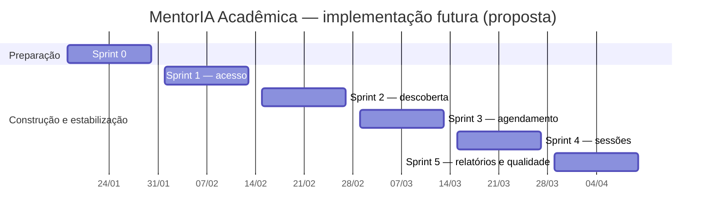

# Bloco 7 — Planejamento

**Projeto:** MentorIA Acadêmica · **Responsável:** Guilherme · **Equipe:** Hadson, Kennedy e Guilherme
**Versão:** 1.0 · **Data:** 08/11/2026 · **Pesquisa de preços e salários feita em:** 06/11/2026

> Este bloco planeja a **implementação futura** do sistema, feita por uma equipe hipotética de quatro profissionais. O projeto acadêmico atual entrega somente análise, projeto e documentação.

---

## 1. Premissas

| # | Premissa |
|---|---|
| P1 | Metodologia **Scrum** (Bloco 9), com sprints de **2 semanas** (10 dias úteis) |
| P2 | Equipe hipotética de **4 profissionais CLT**: 1 Tech Lead/Arquiteto (também facilita o Scrum), 2 Desenvolvedores Full Stack Pleno e 1 Analista de Testes Pleno. O papel de PO fica com o cliente (coordenação acadêmica) e não entra no custo |
| P3 | Stack fixa do grupo: HTML/CSS/JS + Bootstrap 5.3, Node.js 24 + Express 5, PostgreSQL com `pg`, JWT + `bcryptjs`, AWS Lightsail + Nginx |
| P4 | O Bloco 5 (`schema.sql`) e o contrato OpenAPI (Bloco 8) já existem: a implementação parte deles |
| P5 | Metas de arquitetura (p95 ≤ 300 ms, 150 simultâneos, 10.000 cadastrados, 99,5%) serão testadas na **Sprint 5**; ainda não há resultado medido |
| P6 | Câmbio de referência: **US$ 1 = R$ 5,7429** (cotação de 05/11/2026, [Asaas](https://www.asaas.com/cotacao-do-dolar)) |

---

## 2. EAP / WBS (4 níveis)

```text
1  MentorIA Acadêmica
├── 1.1  Gestão do projeto
│   ├── 1.1.1  Planejamento (EAP, estimativas, cronograma, custos)
│   ├── 1.1.2  Cerimônias Scrum (planning, daily, review, retrospectiva)
│   └── 1.1.3  Gestão de riscos e comunicação com stakeholders
├── 1.2  Requisitos (Hadson)
│   ├── 1.2.1  Documento de visão, personas e stakeholders
│   ├── 1.2.2  Requisitos funcionais (21 RF) e não funcionais
│   ├── 1.2.3  Histórias de usuário (16 US) com critérios de aceite
│   └── 1.2.4  Casos de uso e diagramas de atividades
├── 1.3  Arquitetura e projeto (Kennedy + Guilherme)
│   ├── 1.3.1  ADRs e tabela de stack
│   ├── 1.3.2  C4 (contexto, contêineres, componentes, código)
│   ├── 1.3.3  UML: classes, sequência, componentes, implantação
│   └── 1.3.4  Contrato de API (OpenAPI 3.0)
├── 1.4  Banco de dados (Guilherme)
│   ├── 1.4.1  Modelos conceitual, lógico e físico
│   ├── 1.4.2  DDL, índices e restrições de integridade
│   ├── 1.4.3  Dicionário de dados e LGPD
│   └── 1.4.4  Backup, restauração e migrações
├── 1.5  Desenvolvimento (futuro)
│   ├── 1.5.1  Fundação técnica
│   │   ├── 1.5.1.1  Repositório, estrutura de pastas e padrões
│   │   ├── 1.5.1.2  Núcleo compartilhado (pool pg, erros, config)
│   │   └── 1.5.1.3  Execução de migrações
│   ├── 1.5.2  Módulo Autenticação e Usuários
│   │   ├── 1.5.2.1  Cadastro com aceite de privacidade
│   │   ├── 1.5.2.2  Login JWT (15 min)
│   │   └── 1.5.2.3  Middleware RBAC
│   ├── 1.5.3  Módulo Mentorias (perfil do mentor, disciplinas, busca)
│   ├── 1.5.4  Módulo Agendamentos (disponibilidades, solicitação, resposta, expiração 48 h)
│   ├── 1.5.5  Módulo Avaliações (sessão e avaliação)
│   ├── 1.5.6  Módulo Administração (usuários, perfis, catálogo, relatórios, auditoria)
│   └── 1.5.7  Frontend (páginas Bootstrap por perfil)
├── 1.6  Testes
│   ├── 1.6.1  Unitários (node:test)
│   ├── 1.6.2  Integração da API (node:test + Supertest + PostgreSQL de teste)
│   ├── 1.6.3  E2E dos fluxos principais (Playwright)
│   └── 1.6.4  Desempenho (meta p95 ≤ 300 ms / 150 simultâneos)
├── 1.7  Implantação
│   ├── 1.7.1  Instância Lightsail de staging (1 GB) + Nginx + HTTPS
│   ├── 1.7.2  Instância Lightsail de produção (2 GB) + firewall
│   ├── 1.7.3  Backups (snapshots + pg_dump) e teste de restauração
│   └── 1.7.4  Go-live e monitoramento
└── 1.8  Documentação
    ├── 1.8.1  README e guia do desenvolvedor
    ├── 1.8.2  Documentação da API (Swagger)
    └── 1.8.3  Manual do usuário por perfil
```

---

## 3. Estimativas — backlog oficial de Hadson

O planejamento foi harmonizado com o `docs/02-requisitos.md` de Hadson e com o cronograma
`docs/09-qualidade.md` do projeto integrado. **Não há backlog paralelo B01–B20 nem pontos provisórios.**
As 16 histórias somam **75 story points**; os habilitadores técnicos da Sprint 0 são
**atividades sem story points**, para não duplicar esforço de histórias de produto.

### 3.1 Rastreabilidade do backlog

| História | Produto / objetivo | RF principal | MoSCoW | Pontos | Sprint |
|---|---|---|---|---:|---|
| US001 | Cadastro de estudante | RF001 | Must | 3 | S1 |
| US002 | Login e logout | RF002 | Must | 3 | S1 |
| US003 | Administração de usuários, perfis e inativação | RF004–RF005 | Must | 8 | S1 |
| US004 | Vínculo mentor–disciplinas | RF007 | Must | 3 | S2 |
| US005 | Disponibilidade do mentor | RF008 | Must | 5 | S2 |
| US006 | Busca de mentores | RF010 | Must | 5 | S2 |
| US007 | Consulta de horários | RF011 | Must | 3 | S2 |
| US008 | Solicitar agendamento com proteção contra concorrência | RF012–RF013 | Must | 8 | S3 |
| US009 | Impedir duplicidade de reserva ativa | RF013 | Must | 5 | S3 |
| US010 | Confirmar ou recusar (inclui rotina de expiração) | RF014 | Must | 5 | S3 |
| US011 | Cancelar agendamento | RF015 | Should | 3 | S4 |
| US012 | Registrar sessão concluída | RF016 | Must | 5 | S4 |
| US013 | Avaliar sessão | RF017 | Must | 3 | S4 |
| US014 | Consulta gerencial | RF019 | Must | 5 | S4 |
| US015 | Relatórios e CSV | RF020 | Should | 8 | S5 |
| US016 | Manter catálogo de disciplinas | RF021 | Must | 3 | S1 |
| **Total** | **16 histórias** | **21 RF no catálogo geral** | | **75** | |

**Itens não pontuados:** infraestrutura, pipeline, instalação do PostgreSQL, migrações,
OpenAPI, testes E2E e testes de carga. São tarefas vinculadas às histórias ou à Sprint 0,
não novas histórias com pontuação adicional. RF003 (recuperação de senha), RF006
(perfil complementar do mentor), RF009 (editar/inativar horário) e RF018
(notificações) constam como funcionalidades opcionais/refináveis e não entram
como entregas obrigatórias no MVP de 75 pontos.

### 3.2 Velocidade, esforço e duração

- Equipe hipotética: quatro profissionais CLT, conforme P2; não confundir com os três autores do trabalho acadêmico.
- Sprint: duas semanas, com capacidade **planejada** de 20 a 25 pontos por sprint; a velocidade real só poderá ser medida após a implementação.
- Backlog: 75 pontos / aproximadamente 20–25 pontos por sprint; distribuição em **cinco sprints**, com folga planejada para qualidade na Sprint 5.
- **Sprint 0**: preparação de ambiente e documentação, sem story points e com duração ilustrativa de duas semanas.
- **Duração orçada:** Sprint 0 + cinco sprints = **12 semanas (≈ 2,77 meses)** de equipe hipotética.
- Não transformar story points automaticamente em horas: pontos representam complexidade relativa e são recalibrados no Planning.

---

## 4. Cronograma (cinco sprints + Sprint 0)

Datas **ilustrativas**, sem compromisso contratual:

| Etapa | Período previsto | Histórias | Pontos | Entrega principal |
|---|---|---|---:|---|
| **S0** | 18/01 – 29/01/2027 | Sem US | — | Repositório, PostgreSQL, esquema, migrações, pipeline, estudos técnicos de Nginx e segurança |
| **S1** | 01/02 – 12/02/2027 | US001, US002, US003, US016 | **17** | Cadastro apenas de estudantes, login, RBAC, gestão administrativa, catálogo e auditoria |
| **S2** | 15/02 – 26/02/2027 | US004, US005, US006, US007 | **16** | Disciplinas do mentor, disponibilidades de 30/45/60 min, busca e horários livres |
| **S3** | 01/03 – 12/03/2027 | US008, US009, US010 | **18** | Solicitação PENDENTE, conflito 409, resposta do mentor e expiração de 48 h |
| **S4** | 15/03 – 26/03/2027 | US011, US012, US013, US014 | **16** | Cancelamento, sessão, avaliação, consulta da coordenação |
| **S5** | 29/03 – 09/04/2027 | US015 | **8** | Relatórios + CSV, E2E, carga, recuperação e preparação da implantação |
| **Total** | **12 semanas incluindo Sprint 0** | **16 US** | **75** | MVP documentalmente planejado |

**Dependências principais:** US016 precede US004; US005 e US007 precedem US008;
US008 precede US010; US010 precede US012; US012 precede US013. As práticas de
qualidade do Bloco 9 são executadas ao longo de todo o projeto, e o teste de
carga na S5 verifica a meta p95 ≤ 300 ms para 150 simultâneos, sem afirmar que
ela já foi atingida. O projeto está apenas documentado.



---

## 5. Custos profissionais

### 5.1 Referências salariais pesquisadas (06/11/2026)

| Cargo | Fonte | P25 | **P50** | P75 |
|---|---|---:|---:|---:|
| Arquiteto de Software — Recife | [Robert Half — Guia Salarial 2027](https://www.roberthalf.com/br/pt/vagas-detalhes/arquiteto-de-software/recife) (atualizado em 30/10/2026) | 12.550 | **16.400** | 21.150 |
| Desenvolvedor(a) Full-Stack Pleno — Recife | [Robert Half — Guia Salarial 2027](https://www.roberthalf.com/br/pt/vagas-detalhes/desenvolvedora-full-stack-pleno/recife) (atualizado em 30/10/2026) | 9.800 | **12.750** | 16.400 |
| Analista de Testes Pleno — Recife | [Robert Half — Guia Salarial 2026](https://www.roberthalf.com/br/pt/vagas-detalhes/analista-de-testes-pleno/recife) | 6.700 | **8.750** | 11.250 |
| Desenvolvedor(a) Full-Stack Sênior — Brasil | [Robert Half](https://www.roberthalf.com/br/pt/vagas-detalhes/desenvolvedora-full-stack-senior/recife) (referência) | 13.050 | 15.900 | 20.500 |

**Glassdoor (consultado conforme pedido):** a maioria das páginas do [glassdoor.com.br](https://www.glassdoor.com.br/) bloqueou a leitura automatizada. As que abriram mostram médias autodeclaradas, sem separar senioridade: [QA Analyst](https://www.glassdoor.com.br/Sal%C3%A1rios/qa-analyst-sal%C3%A1rio-SRCH_KO0,10.htm) com **R$ 4 mil/mês** (faixa de R$ 3 a 7 mil) e [Desenvolvedor Full Stack Júnior](https://www.glassdoor.com.br/Sal%C3%A1rios/desenvolvedor-full-stack-j%C3%BAnior-sal%C3%A1rio-SRCH_KO0,31.htm) com **R$ 3 mil/mês** (R$ 2 a 4 mil). Como a equipe planejada é plena, adota-se a Robert Half, que publica faixas por cargo, nível e cidade. O Glassdoor indica o piso do mercado. Os valores das duas fontes estão em R$ por mês.

### 5.2 Encargos CLT (empresa no Lucro Presumido)
Base: [Valor Final — custo do funcionário CLT](https://valorfinal.com.br/guia/custo-funcionario), atualizado em 31/10/2026.

| Componente | % sobre o salário |
|---|---:|
| INSS patronal | 20,00% |
| RAT (adotado 2%) | 2,00% |
| Terceiros (Sistema S) | 5,80% |
| FGTS | 8,00% |
| Provisão de 13º | 8,33% |
| Provisão de férias + 1/3 | 11,11% |
| Incidência de INSS/RAT/terceiros/FGTS sobre 13º e férias (35,8% × 19,44%) | 6,96% |
| **Total de encargos** | **≈ 62,2%** |

Benefícios (vale-refeição e plano de saúde): **R$ 1.000/mês por pessoa** (premissa). A multa de 40% do FGTS só incide em desligamento e não entra no cálculo.

### 5.3 Custo mensal da equipe (cenário base = P50)

| Profissional | Salário | Encargos (62,2%) | Benefícios | **Custo mensal** |
|---|---:|---:|---:|---:|
| Tech Lead / Arquiteto de Software | 16.400,00 | 10.200,72 | 1.000,00 | **27.600,72** |
| Desenvolvedor Full Stack Pleno 1 | 12.750,00 | 7.930,44 | 1.000,00 | **21.680,44** |
| Desenvolvedor Full Stack Pleno 2 | 12.750,00 | 7.930,44 | 1.000,00 | **21.680,44** |
| Analista de Testes Pleno | 8.750,00 | 5.442,46 | 1.000,00 | **15.192,46** |
| **Total** | **50.650,00** | **31.504,06** | **4.000,00** | **R$ 86.154,06** |

### 5.4 Custo total da equipe (12 semanas ≈ 2,77 meses)

Conversão de semanas para meses: **12 semanas × 12 meses ÷ 52 semanas/ano = 2,76923 meses**.
Os valores mensais são os da tabela da seção 5.3, que são **estimativas** com
encargos de 62,2% (aproximação), sujeitos à contratação efetiva.

| Cenário | Salários usados | Custo mensal | **Custo de 12 semanas** |
|---|---|---:|---:|
| Econômico | P25 | R$ 67.014,70 | **R$ 185.579** |
| **Base** | **P50** | **R$ 86.154,06** | **R$ 238.580** |
| Conservador | P75 | R$ 109.754,40 | **R$ 303.935** |

---

## 6. Custos de infraestrutura AWS

### 6.1 Preços oficiais verificados em 06/11/2026
Fonte: [Amazon Lightsail Pricing](https://aws.amazon.com/lightsail/pricing) e [Lightsail instance bundles](https://docs.aws.amazon.com/lightsail/latest/userguide/amazon-lightsail-bundles.html).

| Item | Plano | Especificação | Preço oficial |
|---|---|---|---:|
| Staging | Linux **Micro-1GB** (IPv4) | 2 vCPU · 1 GB RAM · 40 GB SSD · 2 TB de tráfego | **US$ 7,00/mês** |
| Produção | Linux **Small-2GB** (IPv4) | 2 vCPU · 2 GB RAM · 60 GB SSD · 3 TB de tráfego | **US$ 12,00/mês** |
| Snapshots (manuais e automáticos) | — | por GB armazenado | US$ 0,05/GB-mês |
| IP estático | — | incluído no plano | US$ 0,00 |
| Object Storage (cópia externa dos dumps) | Bucket de 5 GB | 5 GB + 25 GB de tráfego | US$ 1,00/mês |
| Load Balancer | — | **não usado** (sem redundância) | (US$ 18,00/mês) |

**Região:** proposta **São Paulo (sa-east-1)**, pela menor latência para usuários brasileiros e por manter os dados no país. A página oficial não mostra preço de plano diferente por região, mas informa que em São Paulo a **franquia de tráfego é a metade** (1 TB no staging e 1,5 TB na produção), o que sobra para o volume previsto. A tarifa de excedente em São Paulo é a mais alta da tabela (US$ 0,15/GB no Object Storage). **Confirmar o preço no console da AWS ao criar as instâncias.**

### 6.2 Custo mensal estimado

| Cenário | Composição | US$/mês | R$/mês (×5,7429) | R$/mês com tributos* |
|---|---|---:|---:|---:|
| Mínimo (só instâncias) | 7 + 12 | 19,00 | 109,12 | 122,37 |
| **Realista** | + snapshots de produção (~15 GB → 0,75) + snapshot de staging (~10 GB → 0,50) + bucket (1,00) | **21,25** | 122,04 | **136,86** |
| Pessimista | snapshots no tamanho total dos discos (60 GB → 3,00; 40 GB → 2,00) + bucket | 25,00 | 143,57 | 161,02 |

\* Se a fatura vier da **AWS Serviços Brasil** (com CPF/CNPJ), ela é emitida **em reais** e inclui **PIS/COFINS de 9,25% e ISS de 2,9%** ([AWS Tax Help — Brasil](https://aws.amazon.com/pt/tax-help/Brazil/)). A coluna aplica +12,15% como aproximação. Se a cobrança for feita em dólar no cartão, entra o IOF da operação em vez desses tributos.

**Custos adicionais fora da AWS:** domínio `.com.br` por **≈ R$ 40/ano** (referência: [HostGator, R$ 39,99](https://hostgator.com.br/blog/quanto-custa-um-dominio/); confirmar no Registro.br) e certificado TLS do **Let's Encrypt, gratuito**.

**Comparação com o documento do grupo:** o `00-decisoes-compartilhadas.md` previa US$ 19 de base e US$ 21,60–23,60 como total ilustrativo. A estimativa verificada fica entre **US$ 21,25 (realista) e US$ 25,00 (pessimista)**, compatível com a faixa do grupo.

### 6.3 Custo anual de operação (cenário realista)
**US$ 255,00/ano ≈ R$ 1.642/ano** com tributos, mais o domínio.

---

## 7. Custo total do projeto (cenário base)

A conta abaixo considera **12 semanas de equipe** (Sprint 0 + S1–S5),
**três meses completos de infraestrutura** no cenário realista, incluindo
staging e produção durante todo o período por prudência, e um domínio anual.
Essa estimativa é mais conservadora do que cobrar produção apenas após o go-live.

| Item | Valor estimado |
|---|---:|
| Equipe por 12 semanas, cenário P50 | **R$ 238.580,47** |
| Infraestrutura por 3 meses × R$ 136,86 (aprox. com tributos) | **R$ 410,58** |
| Domínio `.com.br` por 1 ano (estimado) | **R$ 40,00** |
| **Subtotal** | **R$ 239.031,05** |
| Contingência de 10% do subtotal | **R$ 23.903,11** |
| **Total estimado** | **R$ 262.934,16** |

**Sensibilidade:** câmbio, regime de contratação, remuneração real, impostos,
consumo de backup, região e duração efetiva podem alterar a estimativa. A
premissa US$1 = R$5,7429 é apenas referência de 05/11/2026, não cotação atual.

---

## 8. Matriz de riscos — integrada aos cinco riscos de Hadson

Escala adotada pelo Bloco 1: **P = probabilidade (1–5)**,
**I = impacto (1–5)**, **severidade = P × I (1–25)**.
R01 a R05 conservam as avaliações de Hadson, sem alterá-las silenciosamente.

| ID | Risco | P | I | Severidade | Mitigação | Responsável |
|---|---|---:|---:|---:|---|---|
| R01 | Baixa adesão dos mentores | 3 | 5 | **15** | Convite institucional, piloto com dez mentores, reconhecimento das horas | Coordenação / PO |
| R02 | Indisponibilidade da VM de produção | 2 | 4 | **8** | Snapshots e `pg_dump` externo; monitoramento e ensaio de restauração; RTO-meta de 4 h | Tech Lead |
| R03 | Vazamento de dados pessoais | 2 | 5 | **10** | RBAC, HTTPS, bcrypt, SQL parametrizado, restrição de firewall e revisão de logs | Tech Lead |
| R04 | Estouro do escopo e do prazo | 4 | 4 | **16** | MoSCoW, Sprint Review e exclusões explícitas | PO |
| R05 | Reserva duplicada por concorrência | 3 | 4 | **12** | Transação, bloqueio `FOR UPDATE`, índice parcial e teste real | Desenvolvedor backend |
| R06 | Backup não restaurável | 3 | 5 | **15** | Cópia externa e teste de restauração em staging | QA / Infraestrutura |
| R07 | Rotina de expiração falhar | 3 | 3 | **9** | Job periódico, alerta e verificação transacional antes de nova reserva | Backend |
| R08 | API não coincidir com os RF e a modelagem | 3 | 4 | **12** | Revisão conjunta dos contratos OpenAPI, SQL e UML a cada mudança | Trio / Tech Lead |
| R09 | Desempenho não alcançar p95 ≤ 300 ms no cenário de 150 simultâneos | 3 | 4 | **12** | Índices, paginação, teste de carga na Sprint 5 e redimensionamento da VM | Backend |
| R10 | Fuga de segredos para GitHub | 2 | 5 | **10** | `.env` fora do versionamento, secret scanning e rotação de credenciais | Tech Lead |
| R11 | Variação cambial e impostos | 3 | 2 | **6** | Reserva de contingência e revisão da planilha antes de contratar | PO / Financeiro |
| R12 | Ausência de integrante do time hipotético | 3 | 3 | **9** | Revisão cruzada, documentação, pareamento e backup de responsáveis | Tech Lead |

Os riscos R01–R05 derivam do `01-concepcao.md` de Hadson. Os demais são
riscos de execução futura propostos na análise técnica de Guilherme. Não há
risco “backlog oficial indisponível”: as 16 histórias já foram incorporadas.

---

## 9. Pontos pendentes para aprovação do trio

- Validar formalmente as premissas do orçamento e a pesquisa salarial na data da contratação.
- Confirmar a região AWS, política de retenção e execução dos procedimentos de backup.
- Executar as consultas e o `schema.sql` em PostgreSQL de teste sob responsabilidade do Guilherme após as alterações de RF008.
- Política de cadastro administrativo especificada na RN12: aceite comprovado do próprio titular, registrado por data e referência institucional; sem evidência, conta não é criada.
- Conferir se o diagrama de classes de Kennedy apresenta o modelo unificado (incluindo `PerfilMentor`, `LogAuditoria` e os atributos temporais derivados de `Agendamento`).
